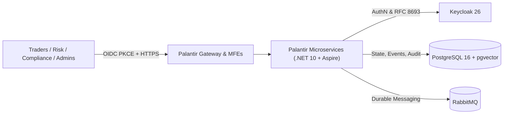

# Palantir Enterprise .NET 10 Reference Documentation

Welcome to the documentation hub for **Palantir** — a cloud-native .NET 10 + .NET Aspire enterprise microservices reference architecture.

## Quick Start

```bash
dotnet run --project src/Aspire/Palantir.AppHost
```

Open the Aspire Dashboard URL printed in the terminal to inspect all microservices, PostgreSQL, RabbitMQ, Keycloak, microfrontends, OpenTelemetry traces, logs, and metrics.

## C4 Architecture Overview (System Context)



> [!TIP]
> **IDE Diagram Rendering**: Install the workspace-recommended extensions in `.vscode/extensions.json` — **Markdown Preview Mermaid Support** (`bierner.markdown-mermaid`) for inline Markdown diagrams and **C4 DSL Extension** (`systemticks.c4-dsl-extension`) for [docs/architecture/c4-model.dsl](architecture/c4-model.dsl).

## Documentation Map

| Section | Description | Link |
| --- | --- | --- |
| **Architecture Reference** | C4 container/component diagrams, Building Blocks catalog, patterns matrix | [docs/architecture/README.md](architecture/README.md) |
| **C4 Structurizr Model** | Full Context, Container, and OMS Component views (`.dsl`) | [docs/architecture/c4-model.dsl](architecture/c4-model.dsl) |
| **Architecture Decision Records** | Key architectural choices (VSA, Wolverine, Marten, Orleans, Keycloak) | [docs/architecture/adr](architecture/adr/0001-vertical-slice-architecture.md) |
| **Getting Started** | Prerequisites, local Aspire inner loop, Keycloak login, first API call | [docs/guides/getting-started.md](guides/getting-started.md) |
| **Master Developer Walkthrough** | Step-by-step Parts 1–8 covering runtime flows, specs, auditing, permissions, and recipes | [docs/guides/developer-guide.md](guides/developer-guide.md) |
| **Building Blocks Deep Dive** | `Constants`, `SharedKernel`, `Generators`, `AppHost`, `ServiceDefaults` | [docs/guides/building-blocks/README.md](guides/building-blocks/README.md) |
| **Platform Chassis Deep Dive** | Caching, Security/Permissions, Auditing, Specifications, Scheduling, Rate Limiting | [docs/guides/building-blocks/platform-chassis.md](guides/building-blocks/platform-chassis.md) |
| **Microservices & Gateway Guides** | All 9 microservices + YARP Gateway endpoints, schemas, sagas, gRPC, AI protocols | [docs/guides/services/README.md](guides/services/README.md) |
| **Frontend Clients Guide** | Webpack 5 Module Federation MFEs, Next.js Multi-Zones, A2UI, Playwright | [docs/guides/clients/README.md](guides/clients/README.md) |
| **Testing Guide** | ArchTests, Platform/Service UnitTests, Aspire IntegrationTests, Reqnroll & UI BDD | [docs/guides/testing.md](guides/testing.md) |
| **Deployment Guide** | Cloud-native deployment, Kubernetes, OTLP observability, config | [docs/guides/deployment.md](guides/deployment.md) |
| **Accessibility** | WCAG 2.1 AA compliance statement and verification | [docs/ACCESSIBILITY.md](ACCESSIBILITY.md) |
| **AsyncAPI Contracts** | Event-driven message specifications | [docs/asyncapi](asyncapi/order-events-asyncapi.yaml) |
| **EventCatalog** | Domain, event, and service catalog configuration | [docs/eventcatalog](eventcatalog/eventcatalog.config.js) |
