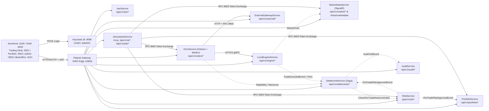

# Palantir Cloud-Native Trading Platform — Comprehensive Feature & Operations Guide

> **Single-Entry Documentation Hub & `src/` Technical Review**  
> This guide explains every capability implemented in [`src/`](../src/), how to boot the entire distributed system from **one start point**, how to execute every API call step by step from [`palantir-api.http`](./palantir-api.http), and what our codebase + live Aspire review uncovered.

---

## Table of Contents
1. [One-Command Start Point (Boot Everything)](#1-one-command-start-point-boot-everything)
2. [System Architecture & Endpoint Map](#2-system-architecture--endpoint-map)
3. [Standard HTTP Request Collection (`palantir-api.http`)](#3-standard-http-request-collection-palantir-apihttp)
4. [Step-by-Step Feature Walkthroughs](#4-step-by-step-feature-walkthroughs)
   - [Feature 0: Zero-Trust AuthN, Keycloak OIDC & PBAC Permissions](#feature-0-zero-trust-authn-keycloak-oidc--pbac-permissions)
   - [Feature 1: Edge API Gateway (`Palantir.Gateway`)](#feature-1-edge-api-gateway-palantirgateway)
   - [Feature 2: Local Matching Engine, Order Book & OHLCV Candles (`Palantir.LocalEngineService`)](#feature-2-local-matching-engine-order-book--ohlcv-candles-palantirlocalengineservice)
   - [Feature 3: Real-Time Market Data, FusionCache L2 & SignalR (`Palantir.MarketDataService`)](#feature-3-real-time-market-data-fusioncache-l2--signalr-palantirmarketdataservice)
   - [Feature 4: Order Management, Orleans Actors & Marten Event Sourcing (`Palantir.OmsService`)](#feature-4-order-management-orleans-actors--marten-event-sourcing-palantiromsservice)
   - [Feature 5: Pre-Trade Risk Engine (`Palantir.RiskService`)](#feature-5-pre-trade-risk-engine-palantirriskservice)
   - [Feature 6: Portfolio Accounts, Positions & Margin Ledger (`Palantir.PortfolioService`)](#feature-6-portfolio-accounts-positions--margin-ledger-palantirportfolioservice)
   - [Feature 7: Distributed Settlement & Compensation Saga (`Palantir.SettlementService`)](#feature-7-distributed-settlement--compensation-saga-palantirsettlementservice)
   - [Feature 8: External Venue Routing & Mock Exchange Simulator (`Palantir.ExternalGatewayService`)](#feature-8-external-venue-routing--mock-exchange-simulator-palantirexternalgatewayservice)
   - [Feature 9: Identity & Permission Token Caching (`Palantir.IamService`)](#feature-9-identity--permission-token-caching-palantiriamservice)
   - [Feature 10: Non-Blocking 4-Sink Auditing & Regulatory Full-Text Store (`Palantir.AuditService`)](#feature-10-non-blocking-4-sink-auditing--regulatory-full-text-store-palantirauditservice)
   - [Feature 11: Multi-Agent AI Copilot, MCP, A2A, AG-UI & Governance (`Palantir.AiAssistantService`)](#feature-11-multi-agent-ai-copilot-mcp-a2a-ag-ui--governance-palantiraiassistantservice)
   - [Feature 12: Microfrontends (Module Federation) & Next.js Multi-Zones (`src/Clients/`)](#feature-12-microfrontends-module-federation--nextjs-multi-zones-srcclients)
   - [Feature 13: Platform Chassis, Source Generators, Rate Limiting, Feature Flags & Observability](#feature-13-platform-chassis-source-generators-rate-limiting-feature-flags--observability)
5. [`src/` Codebase Review & Known Limitations](#5-src-codebase-review--known-limitations)
6. [Additional Guides](#6-additional-guides)

---

## 1. One-Command Start Point (Boot Everything)

`Palantir.AppHost` ([Program.cs](../src/Aspire/Palantir.AppHost/Program.cs)) is the single orchestrator for all containers, 11 backend executables (Gateway + 10 services), and 6 frontend applications.

### Prerequisites
- **.NET 10 SDK** (`global.json` / verified on `10.0.202`)
- **Docker Desktop** or **Podman** running (for PostgreSQL 16 + `pgvector`, RabbitMQ, Keycloak 26, pgAdmin)
- **Node.js 20+** (for `src/Clients/`)

### Step 1 — Install Frontend Dependencies (First Run Only)
```bash
cd src/Clients
npm install
cd ../..
```

### Step 2 — Start the Entire Solution from One Command
```bash
# HTTP profile (recommended locally; enables unsecured OTLP transport)
dotnet run --project src/Aspire/Palantir.AppHost --launch-profile http
```
*(Or use `--launch-profile https` to launch the Aspire Dashboard on `https://localhost:17054`.)*

### What Starts Automatically
1. **Infrastructure Containers (Docker)**:
   - `pgvector/pgvector:pg16` (`PalantirDb`) + `dpage/pgadmin4`
   - `rabbitmq` (AMQP + Management UI plugin)
   - `quay.io/keycloak/keycloak:26.0` on fixed port **`http://localhost:8080`**, auto-importing [`deploy/keycloak/palantir-realm.json`](../deploy/keycloak/palantir-realm.json)
2. **Backend Projects** (dynamic Aspire ports; check Aspire Dashboard → **Resources**):
   - `gateway` (`Palantir.Gateway` — also binds `http://localhost:63893` / `https://localhost:63888` per `launchSettings.json`)
   - `iam-service`, `oms-service`, `local-engine-service`, `external-gateway-service`, `market-data-service`, `risk-service`, `portfolio-service`, `settlement-service`, `audit-service`, `ai-assistant-service`
3. **Frontend Apps** (fixed ports):
   - `storefront-zone`: `http://localhost:3100` (unified entry rewrites `/desk` and `/backoffice`)
   - `backoffice-zone`: `http://localhost:3101`
   - `frontend-shell`: `http://localhost:3000` (Webpack 5 Module Federation host)
   - `trading-desk-mfe`: `http://localhost:3001`
   - `portfolio-mfe`: `http://localhost:3002`
   - `admin-mfe`: `http://localhost:3003`
4. **Aspire Dashboard**: `http://localhost:15025` (login token printed to console at startup).

### Pre-Seeded Accounts & Test Data
| Resource | Identifier / Credentials | Notes |
| --- | --- | --- |
| Keycloak Realm | `palantir` (`http://localhost:8080/realms/palantir`) | Auto-imported on container boot |
| Keycloak Clients | `palantir-shell` (public PKCE + Direct Grant), `palantir-gateway` (`palantir-gateway-secret-2026`), `palantir-mcp` | Defined in `palantir-realm.json` |
| Seeded Users | `admin` / `admin123` (`Admin`), `trader1` / `trader123` (`Trader`), `riskofficer1` / `risk123` (`RiskOfficer`), `auditor1` / `audit123` (`Auditor`) | See [Known Limitations](#5-src-codebase-review--known-limitations) on PBAC hydration |
| Seeded Portfolio Account | `11111111-1111-1111-1111-111111111111` | Seeded in Development by `PortfolioService` ($100,000 cash + 500 `PAL/USD`) |

---

## 2. System Architecture & Endpoint Map



### Route & Storage Quick Reference
| Service | Aspire Resource ID | Gateway Prefix | Data Store / Tech |
| --- | --- | --- | --- |
| `Palantir.Gateway` | `gateway` | `/` (edge) | Stateless YARP + Aspire Discovery + JWT AuthN |
| `Palantir.IamService` | `iam-service` | `/api/v1/iam/*` | EF Core (`iam` schema) + `platform_cache` + Keycloak Admin |
| `Palantir.OmsService` | `oms-service` | `/api/v1/orders/*` | Marten (`event_store`) + Orleans ADO.NET (`orders`) + Wolverine Outbox |
| `Palantir.LocalEngineService` | `local-engine-service` | `/api/v1/engine/*` | EF Core (`local_engine.market_ticks`, `Pairs`) + In-Memory L2 Book + gRPC |
| `Palantir.ExternalGatewayService` | `external-gateway-service` | `/api/v1/external/*`, `/mock-exchange/*` | Stateless `RestWebSocketVenueConnector` + Feature Flag simulator |
| `Palantir.MarketDataService` | `market-data-service` | `/api/v1/market/*`, `/hubs/marketdata/*` | FusionCache + PostgreSQL L2 (`platform_cache`) + SignalR |
| `Palantir.RiskService` | `risk-service` | `/api/v1/risk/*` | Stateless `RiskEngine` + Wolverine RMQ handlers |
| `Palantir.PortfolioService` | `portfolio-service` | `/api/v1/portfolio/*` | EF Core (`portfolio` schema: `Accounts`, `Positions`) |
| `Palantir.SettlementService` | `settlement-service` | `/api/v1/settlements/*` | EF Core (`settlement` schema) + Wolverine `OrderSettlementSaga` |
| `Palantir.AuditService` | `audit-service` | `/api/v1/audit/*` | EF Core (`audit.audit_records` + `GIN` FTS) + `platform_audit.audit_entries` |
| `Palantir.AiAssistantService` | `ai-assistant-service` | `/mcp/*`, `/api/v1/ai/*`, `/api/v1/a2a/*` | EF Core (`ai` + `pgvector`) + MCP + A2A + AG-UI/A2UI + YAML Governance |

---

## 3. Standard HTTP Request Collection (`palantir-api.http`)

All runnable HTTP requests across the entire platform are consolidated into one standard, step-by-step `.http` collection:

- **[docs/palantir-api.http](./palantir-api.http)** — Compatible with **Visual Studio `.http` Editor**, **VS Code REST Client**, and **JetBrains HTTP Client**.

### How to Run Step by Step
1. Open [`palantir-api.http`](./palantir-api.http) in your IDE.
2. Execute **Step 0.1** and **Step 0.2** to confirm `Palantir.Gateway` returns `Healthy` (`200 OK`).
3. Execute **Step 0.4** (`# @name keycloakToken`) to fetch a Keycloak JWT; `@token` automatically populates `Authorization: Bearer {{token}}` for all subsequent steps.
4. Execute **Steps 1 through 12** in order (chaining `@orderId` from **Step 6.1** and `@userId` from **Step 9.2**).

Domain enum values used across JSON request bodies come from [`TradingValueObjects.cs`](../src/BuildingBlocks/Palantir.SharedKernel/TradingValueObjects.cs):
- `TradeSide`: `1` = `Buy`, `2` = `Sell`
- `OrderType`: `1` = `Market`, `2` = `Limit`, `3` = `StopLimit`
- `TimeInForce`: `1` = `GoodTilCancelled`, `2` = `ImmediateOrCancel`, `3` = `FillOrKill`, `4` = `GoodTilTime`

---

## 4. Step-by-Step Feature Walkthroughs

### Feature 0: Zero-Trust AuthN, Keycloak OIDC & PBAC Permissions

**What it does**:
- Every microservice validates Keycloak JWT tokens (`AddPalantirJwtAuthentication`) against `http://localhost:8080/realms/palantir`.
- Outgoing service-to-service HTTP/gRPC calls attach `TokenExchangeDelegatingHandler` (RFC 8693 `urn:ietf:params:oauth:grant-type:token-exchange` via `KeycloakTokenExchangeService`, cached in PostgreSQL `platform_cache` with SHA-256 token hashing, falling back to forwarding the incoming Bearer token if Keycloak token-exchange policy is not provisioned).
- Fine-grained authorization (`Permissions.*` and `.RequireDimension(...)`) runs through [`PermissionEvaluator`](../src/BuildingBlocks/Palantir.Platform/Security/Permissions/PermissionEvaluator.cs) evaluating 5 specifications: `DimensionActionSpec`, `ResourceMatchSpec`, `OwnershipSpec`, `TradingHoursSpec` (header `X-Market-State`), and `NetworkConditionSpec` (header `X-VPN-Connected`).

#### Step-by-Step 1: Obtain a Keycloak Bearer Token (`@token`)
1. Run **Step 0.3** and **Step 0.4** (`admin` / `admin123`) in [`palantir-api.http`](./palantir-api.http) against `http://localhost:8080/realms/palantir/protocol/openid-connect/token` (`client_id=palantir-shell`, `grant_type=password`).
2. Every subsequent request in [`palantir-api.http`](./palantir-api.http) attaches `Authorization: Bearer {{token}}`.
3. Optionally run **Step 0.5** to retrieve a token for `trader1` / `trader123`.

#### Step-by-Step 2: Configure `AiProvider:ApiKey` (Required for AI Chat & Embeddings)
`Palantir.AiAssistantService` validates `AiProvider:ApiKey` in [`AiProviderHttpGuard`](../src/Services/AiAssistant/Palantir.AiAssistantService/AiProvider/OpenAiCompatibleClients.cs#L13-L20) on `POST /api/v1/a2a/messages`, `POST /api/v1/ai/stream`, and `get_market_sentiment`. Without it, `TradeAnalysisAgent` and `RiskGuardAgent` throw `InvalidOperationException`.

1. **Get an API Key** from an OpenAI-compatible provider:
   - **OpenAI**: Create a key at `https://platform.openai.com/api-keys` (default endpoint `https://api.openai.com/v1/`, chat model `gpt-4o-mini`, embedding model `text-embedding-3-small`).
   - **Local Ollama** (no external cloud key needed): Run `ollama serve`, pull models (`ollama pull llama3.2 && ollama pull nomic-embed-text`), and use any non-empty placeholder string (e.g., `"ollama"`) for `ApiKey` with endpoint `http://localhost:11434/v1/`.
2. **Store secrets on `Palantir.AppHost`** ([Program.cs](../src/Aspire/Palantir.AppHost/Program.cs#L106-L113) automatically forwards `AiProvider:*` to `Palantir.AiAssistantService` as `AiProvider__*`):
   ```bash
   # Option A: OpenAI
   dotnet user-secrets set "AiProvider:ApiKey" "sk-your-openai-key" --project src/Aspire/Palantir.AppHost

   # Option B: Local Ollama (OpenAI-compatible endpoint)
   dotnet user-secrets set "AiProvider:ApiKey" "ollama" --project src/Aspire/Palantir.AppHost
   dotnet user-secrets set "AiProvider:Endpoint" "http://localhost:11434/v1/" --project src/Aspire/Palantir.AppHost
   dotnet user-secrets set "AiProvider:ChatModel" "llama3.2" --project src/Aspire/Palantir.AppHost
   dotnet user-secrets set "AiProvider:EmbeddingModel" "nomic-embed-text" --project src/Aspire/Palantir.AppHost
   ```
3. **Restart `Palantir.AppHost`** so the updated user secrets are injected into `ai-assistant-service`, then execute **Step 11.2** and **Step 11.9** in [`palantir-api.http`](./palantir-api.http).

> [!NOTE]
> **Authorization & Live Endpoint Verification Status**:  
> - [`AddPalantirJwtAuthentication`](../src/BuildingBlocks/Palantir.Platform/Security/Security.cs#L304-L327) maps Keycloak's nested `realm_access.roles` JSON claim via `MapKeycloakRealmRoles`, so `admin` (`Admin` role) passes all `Permissions.*` authorization checks (`200`/`201` verified on `LocalEngineService`, `RiskService`, `PortfolioService`, `IamService`, `AuditService`, and `AiAssistantService`).
> - Non-`Admin` users (`Trader`, `RiskOfficer`, `Auditor`) still require a cached `PermissionToken` in PostgreSQL `platform_cache` (`iam:perm:{userId:N}`), which can be provisioned by an `Admin` via **Step 9.2** (`POST /api/v1/iam/users`) or **Step 9.5** (`POST /api/v1/iam/token/exchange`).
> - See [Section 5](#5-src-codebase-review--known-limitations) for remaining runtime findings (`OmsService` Wolverine routing `500`, `ExternalGatewayService` `localhost:5005` timeout).

---

### Feature 1: Edge API Gateway (`Palantir.Gateway`)

**What it does**:
- Single YARP reverse proxy (`src/Gateway/Palantir.Gateway`) resolving service addresses (`http://oms-service`, etc.) dynamically via `AspireServiceDiscoveryDestinationResolver`.
- Enforces JWT Bearer auth (`AddPalantirJwtAuthentication`) and CORS policy `"AllowMicroUI"` for ports `:3000–:3003` and `:3100–:3101`.

**Execution in `palantir-api.http`**:
- **Step 1.1**: Calls public route `/api/v1/a2a/card` through YARP (`200 OK`).
- **Step 1.2**: Calls `/api/v1/orders/blotter` without a Bearer token (`401 Unauthorized`).

---

### Feature 2: Local Matching Engine, Order Book & OHLCV Candles (`Palantir.LocalEngineService`)

**What it does**:
- **Symbol Registry**: Persists `TradingPair` metadata in PostgreSQL (`local_engine` schema) and pre-allocates an in-memory order book.
- **L2 Matching Engine**: Price-time priority matching (`SortedDictionary<decimal, Queue<OrderBookEntry>>`) via both REST (`POST /api/v1/engine/match`) and HTTP/2 gRPC (`MatchingEngineGrpc` defined in [`matching_engine.proto`](../src/BuildingBlocks/Palantir.Platform/Protos/matching_engine.proto)).
- **OHLCV Candlestick Aggregation**: Aggregates `local_engine.market_ticks` in PostgreSQL using `date_trunc` / epoch bucketing across `1s`, `1m`, `5m`, `1h`, and `1d`.
- **Integration Events**: Publishes `MarketTickRecordedEvent` & `OrderBookUpdatedEvent` (`market.data` fanout → `market.ticks.v1`) and `TradeExecutedEvent` (`trading.settlement.saga`).

**Execution in `palantir-api.http`**:
1. **Step 2.1**: Lists registered symbols (`200 OK`, `[]` initially).
2. **Step 2.2**: Creates `PAL-USD` (`Permissions.Market.DefineSymbol`).
3. **Step 2.3 & Step 2.4**: Places a resting Sell Limit (`side: 2`) and crossing Buy Limit (`side: 1`) (`Permissions.Orders.Place`).
4. **Step 2.5 & Step 2.6**: Inspects L2 order book depth (`404` `"Symbol 'PAL-USD' not found in active order books."` when empty) and OHLCV candles (`200 OK`, `[]` when no ticks exist).
5. **gRPC Contract (`Palantir.LocalEngineService.Grpc.MatchingEngineGrpc`)**:
   - `SubmitOrder(GrpcSubmitOrderRequest) returns (GrpcExecutionReport)`
   - `CancelOrder(GrpcCancelOrderRequest) returns (GrpcCancelReport)`
   - `GetOrderBook(GrpcGetOrderBookRequest) returns (GrpcOrderBookSnapshot)`

---

### Feature 3: Real-Time Market Data, FusionCache L2 & SignalR (`Palantir.MarketDataService`)

**What it does**:
- Consumes `MarketTickRecordedEvent` and `OrderBookUpdatedEvent` from RabbitMQ `market.ticks.v1` ([`MarketDataTickHandler.cs`](../src/Services/MarketData/Palantir.MarketDataService/Handlers/MarketDataTickHandler.cs)), writes snapshots to `IKeyValueStore` (`platform_cache`, 15 min TTL), and broadcasts `MarketTick` / `OrderBookUpdated` to SignalR symbol groups.
- Exposes FusionCache + PostgreSQL L2 REST endpoints with automatic fallback default quotes/depth when no live ticks exist yet.

**Execution in `palantir-api.http`**:
- **Step 3.1**: Fetches cached quote (`200 OK`, singular `/quote/` path):
  ```json
  {"symbol":"PAL-USD","bid":100.50,"ask":100.55,"last":100.52,"timestampUtc":"2026-11-27T09:35:25.9484973+00:00"}
  ```
- **Step 3.2**: Fetches cached L2 order book snapshot (`200 OK`):
  ```json
  {"symbol":"PAL-USD","bids":[{"price":100.50,"quantity":1000}],"asks":[{"price":100.55,"quantity":850}],"timestampUtc":"2026-11-27T09:35:26.2700386+00:00"}
  ```
- **Step 3.3**: Performs SignalR `/hubs/marketdata/negotiate` handshake.

**Subscribe via SignalR Client (`/hubs/marketdata`)**:
```javascript
import * as signalR from "@microsoft/signalr";

const conn = new signalR.HubConnectionBuilder()
  .withUrl("http://localhost:63893/hubs/marketdata", { accessTokenFactory: () => token })
  .withAutomaticReconnect()
  .build();

conn.on("MarketTick", tick => console.log("Tick:", tick));
conn.on("OrderBookUpdated", book => console.log("Book:", book));
await conn.start();
await conn.invoke("SubscribeSymbol", "PAL-USD");
```

---

### Feature 4: Order Management, Orleans Actors & Marten Event Sourcing (`Palantir.OmsService`)

**What it does**:
- **Dual Specification Validation**: [`CreateOrderFeature.cs`](../src/Services/Oms/Palantir.OmsService/Features/Orders/Create/CreateOrderFeature.cs) evaluates `OrderSymbolSpecification`, `OrderQuantitySpecification`, and `LimitOrderPriceSpecification` both at HTTP validation (`SpecificationValidator`) and inside the domain handler (`EnsureSatisfies`).
- **Idempotency Header**: Echoes `x-request-id` (`ApiConstants.RequestIdHeader`) via `.WithIdempotency()`.
- **Orleans Stateful Actors**:
  - `OrderGrain` ([`Grains.cs`](../src/Services/Oms/Palantir.OmsService/Grains/Grains.cs)): Manages lifecycle (`New` → `Submitted` → `Accepted` / `PartiallyFilled` / `Filled` / `Cancelled` / `Rejected` / `Expired`).
  - `ClientSessionGrain`: Tracks active `OrderId`s per client.
  - `OrderExpiryGrain`: Uses Orleans ADO.NET Reminders (`IRemindable`) to auto-expire `TimeInForce.GoodTilTime` (`4`) orders after `expiryDuration`.
- **Marten Event Store + Async Projection**: Appends `OrderCreatedDomainEvent`, `OrderRiskApprovedDomainEvent`, `OrderExecutionAppliedDomainEvent`, `OrderCancelledDomainEvent`, `OrderRejectedDomainEvent`, and `OrderExpiredDomainEvent` into PostgreSQL `event_store`, projected asynchronously into `OrderBlotterView`.
- **Venue Routing**: `ExecutionRouter` dispatches `"Local"` orders over resilient HTTP/2 gRPC to `LocalEngineService` and `"External"` orders over HTTP + RFC 8693 token exchange to `ExternalGatewayService`.
- **Saga Trigger**: Publishes `InitiateOrderSettlementCommand` via Wolverine PostgreSQL durable Outbox to `trading.settlement.saga`.

**Execution in `palantir-api.http`**:
1. **Step 6.1** (`# @name createOrder`): Submits Limit Buy order (`Permissions.Orders.Place`) with `x-request-id`.
2. **Step 6.2 – Step 6.4**: Queries order snapshot, Marten blotter projection, and active client orders (`GET /api/v1/orders/client/{clientId}` — no `/active` suffix).
3. **Step 6.5**: Cancels the open order (`DELETE /api/v1/orders/{orderId}`), triggering `OrderSettlementFailedEvent` compensation.

---

### Feature 5: Pre-Trade Risk Engine (`Palantir.RiskService`)

**What it does**:
- Enforces two deterministic invariants in [`RiskEngine.cs`](../src/Services/Risk/Palantir.RiskService/Engine/RiskEngine.cs):
  1. `MaxSingleOrderValue`: Notional (`quantity * price`) must be `<= $1,000,000`.
  2. `MarginRequirementRate`: `10%` initial margin (`notional * 0.10`) must be `<= availableMargin`.
- Participates asynchronously in the settlement saga by consuming `CheckPreTradeRiskCommand` from `trading.risk.checks` and publishing `PreTradeRiskApprovedEvent` (fanout `trading.sagas`) or `OrderSettlementFailedEvent` + `AuditTrailEvent`.

**Execution in `palantir-api.http`**:
- **Step 4.1**: Retrieves client limits (`MaxSingleOrderValue=1000000`, `MaxLeverage=10`, `MarginRequirementRate=0.10`).
- **Step 4.2 & Step 4.3**: Runs synchronous risk validation for both an approved order and a > $1M rejected order (`Permissions.Risk.ViewExposure`).

---

### Feature 6: Portfolio Accounts, Positions & Margin Ledger (`Palantir.PortfolioService`)

**What it does**:
- Stores `Account` and `Position` entities in PostgreSQL (`portfolio` schema).
- In `Development`, seeds account `11111111-1111-1111-1111-111111111111` (`$100,000` cash + `500 PAL/USD @ $100.00`, current `$105.50`).
- Handles saga margin reservation (`PreTradeRiskApprovedEvent`), settlement confirmation (`ConfirmSettlementEvent`), and failure compensation (`ReleaseReservedMarginCommand`).

**Execution in `palantir-api.http`**:
- **Step 5.1**: Retrieves seeded account equity, available margin, and positions (`Permissions.Portfolio.View`).
- **Step 5.2 & Step 5.3**: Reserves and releases margin via `?amount=250` (`Permissions.Portfolio.AdjustBalance`).

---

### Feature 7: Distributed Settlement & Compensation Saga (`Palantir.SettlementService`)

**What it does**:
- Persists Wolverine saga state in PostgreSQL (`settlement` schema) via [`OrderSettlementSaga.cs`](../src/Services/Settlement/Palantir.SettlementService/Sagas/OrderSettlementSaga.cs):
  1. `Start(InitiateOrderSettlementCommand)` → state `"Submitted"`, sends `CheckPreTradeRiskCommand` to `trading.risk.checks`.
  2. `Handle(PreTradeRiskApprovedEvent)` → records `ReservedMargin`, state `"RiskApproved"`.
  3. `Handle(TradeExecutedEvent)` → state `"Settled"`, `MarkCompleted()`, publishes `ConfirmSettlementEvent` + `"SettlementCompleted"` `AuditTrailEvent`.
  4. `Handle(OrderSettlementFailedEvent)` → state `"Failed"`, `MarkCompleted()`, publishes compensating `ReleaseReservedMarginCommand` + `"SettlementFailed"` `AuditTrailEvent`.

**Execution in `palantir-api.http`**:
- **Step 7.1**: Queries settlement saga state for `@orderId` (`Permissions.Orders.ViewBlotter`).

---

### Feature 8: External Venue Routing & Mock Exchange Simulator (`Palantir.ExternalGatewayService`)

**What it does**:
- Routes external venue orders (`POST /api/v1/external/orders`) via `RestWebSocketVenueConnector` (`ExternalVenues:MockExchangeUrl`, default `http://localhost:5005`, returning simulated `Filled` fallback report if unreachable).
- Includes built-in mock endpoints (`/api/v1/external/mock/orders` and `/api/v1/external/mock/quotes/{symbol}`) gated by Feature Flag `"ExternalExchangeSimulator"`.

**Execution in `palantir-api.http`**:
- **Step 8.1**: Routes an external order (`Permissions.Orders.Place`).
- **Step 8.2 & Step 8.3**: Calls the simulator endpoints (observed live output when flag is unset: `404 Not Found` `{"message": "Feature 'ExternalExchangeSimulator' is currently disabled."}`). Enable via `FeatureManagement__ExternalExchangeSimulator=true` on `Palantir.ExternalGatewayService`.

---

### Feature 9: Identity & Permission Token Caching (`Palantir.IamService`)

**What it does**:
- Manages `TradingProfile` records (`iam` schema), creates users in Keycloak via `KeycloakAdminClient`, caches `PermissionToken` (30 min TTL) in `platform_cache` (`iam:perm:{userId:N}`), and broadcasts `UserCreatedIntegrationEvent` & `PermissionsUpdatedIntegrationEvent` on `iam.events` fanout.

**Execution in `palantir-api.http`**:
- **Step 9.1**: Lists all `TradingProfile` records (`Permissions.Iam.ManageUsers`).
- **Step 9.2** (`# @name createUser`): Creates user in Keycloak + PostgreSQL + `platform_cache` (`Permissions.Iam.ManageUsers`).
- **Step 9.3 & Step 9.4**: Fetches user by ID and updates assigned permissions (`Permissions.Iam.ManageRoles`).
- **Step 9.5**: Hydrates `PermissionToken` into PostgreSQL cache from `iam.Profiles` (JWT authenticated).

---

### Feature 10: Non-Blocking 4-Sink Auditing & Regulatory Full-Text Store (`Palantir.AuditService`)

**What it does**:
1. **Platform Hot-Path Pipeline** (`Palantir.Platform/Auditing/`): `ChannelAuditEmitter` writes `AuditEntry` non-blocking to a bounded channel (capacity `10,000`, `DropOldest`). `AuditPipelineService` flushes batches of 100 concurrently to:
   - `PostgresAuditSink` (binary `COPY` into `platform_audit.audit_entries`)
   - `OtlpAuditSink` (`ActivitySource("Palantir.Auditing")`)
   - `StructuredLogAuditSink`
   - `RabbitMqAuditSink` (opt-in)
2. **Regulatory Compliance Store** (`Palantir.AuditService`): Consumes `AuditTrailEvent` from `audit.trail.v1` and persists `RegulatoryAuditRecord` in `audit.audit_records` with a PostgreSQL `GIN` full-text `tsvector` index over `EventType` and `Symbol`.

**Execution in `palantir-api.http`**:
- **Step 10.1 & Step 10.2**: Appends a `RegulatoryAuditRecord` and queries via PostgreSQL `PlainToTsQuery` (`Permissions.Audit.View`).

---

### Feature 11: Multi-Agent AI Copilot, MCP, A2A, AG-UI & Governance (`Palantir.AiAssistantService`)

**What it does**:
- **YAML Governance & PII Redaction** ([`ai-agents.yaml`](../src/Services/AiAssistant/Palantir.AiAssistantService/Policies/ai-agents.yaml), [`AgentGovernanceMiddleware.cs`](../src/Services/AiAssistant/Palantir.AiAssistantService/Governance/AgentGovernanceMiddleware.cs)): Enforces `max_daily_executions: 50000`, per-agent tool allowlists (`default_action: deny`), prompt-injection regex blocking (`bypass risk`, `ignore previous instructions`, `override margin limit`, `exfiltrate`), and `PresidioPiiRedactor` scrubbing emails/phones/SSNs/cards.
- **MCP (Model Context Protocol)**: Exposes `TradingMcpTools` over standard HTTP MCP (`/mcp`, authenticated) AND REST discovery/invocation (`/api/v1/ai/mcp/tools`, `/api/v1/ai/mcp/tools/call`).
- **A2A (Agent-to-Agent)**: Publishes agent capability card (`/api/v1/a2a/card`) and message dispatch (`/api/v1/a2a/messages`).
- **AG-UI & A2UI Streaming**: Streams SSE frames (`RUN_STARTED`, `thought_start`, `reasoning_token`, `a2ui_component` for `TradeProposalCard` & `RiskGauge`, `RUN_FINISHED`) at `POST /api/v1/ai/stream`.
- **PostgreSQL `pgvector` Sentiment**: `PostgresSentimentRepository` queries vector embeddings in schema `ai`.

**Execution in `palantir-api.http`**:
1. **Step 11.1**: Discovers A2A agent card (`200 OK`, public).
2. **Step 11.2**: Dispatches A2A message to `trade-copilot-coordinator` (requires `@token` + `AiProvider:ApiKey`).
3. **Step 11.3 – Step 11.7**: Discovers MCP tools (`200 OK`) and invokes `get_market_quote` (`200 OK`, cross-service token exchange verified), `get_order_blotter`, `check_risk_exposure`, and `get_market_sentiment`.
4. **Step 11.8**: Sends standard JSON-RPC 2.0 `tools/list` to `/mcp`.
5. **Step 11.9 & Step 11.10**: Streams AG-UI SSE events (requires `@token` + `AiProvider:ApiKey`; without `AiProvider:ApiKey`, stream emits `RUN_STARTED` + `thought_start` then aborts) and verifies blocked prompt-injection rejection (`400 Bad Request`: `{"error":"Prompt blocked by AI governance safety policy."}`).

---

### Feature 12: Microfrontends (Module Federation) & Next.js Multi-Zones (`src/Clients/`)

**What it does**:
- **Unified Entry (`storefront` `:3100`)**: Next.js Multi-Zone portal rendering `A2UIRenderer` (`TradeProposalCard`, `RiskGauge`) and proxying `/desk/*` → `shell` (`:3000`) and `/backoffice/*` → `backoffice` (`:3101`).
- **Webpack 5 Module Federation (`shell` `:3000`)**: Lazy-loads 3 independent React 19 remotes (`trading-desk` `:3001`, `portfolio-mfe` `:3002`, `admin-mfe` `:3003`) with error-boundary fallback cards if any remote is offline.
- **Accessibility**: Semantic landmarks (`banner`, `navigation`, `main`, `dialog`), `aria-live="polite"` announcements, `role="progressbar"` margin meter, and automated `playwright-bdd` + `@axe-core/playwright` E2E verification.

**Step-by-Step UI Verification**:
1. Open `http://localhost:3100` (`Storefront`) → verify Markets, `A2UIRenderer` cards, and links to `/desk`, `/backoffice`, and `/accessibility`.
2. Open `http://localhost:3000` (`Shell`) → switch tabs across **Trading Desk (:3001)**, **Portfolio & Risk (:3002)**, and **IAM & Admin (:3003)**; click **Copilot Pre-Trade Review** in Trading Desk to inspect the accessible A2UI dialog.
3. Open `http://localhost:3101` (`Backoffice`) → inspect operations governance cards.

*(All 6 ports `3000`, `3001`, `3002`, `3003`, `3100`, `3101` returned HTTP `200` during live verification.)*

---

### Feature 13: Platform Chassis, Source Generators, Rate Limiting, Feature Flags & Observability

Every service calls `builder.AddServiceDefaults()` + `builder.AddPalantirChassis(typeof(Program).Assembly)` and activates `app.MapDefaultEndpoints()` + `app.UsePalantirChassis()`:
- **API Versioning** (`ApiVersioningExtensions`): URL segment `/api/v{version:apiVersion}` + `api-version` header (`v1` default).
- **Rate Limiting** (`RateLimitingExtensions`): Global fixed-window limiter of **100 requests per 60 seconds** (queue 10) partitioned by authenticated username or remote IP, returning `429 Too Many Requests`.
- **Exception Handling** (`ProblemDetailsExtensions`): RFC 7807 `ProblemDetails` enriched with `traceId` + `timestamp`, mapping `DomainSpecificationException` to HTTP `400 ValidationProblemDetails`.
- **OpenAPI + Scalar & AsyncAPI + Saunter** (`Palantir.ServiceDefaults`): Available in `Development` on each service's HTTP URL via **Step 12.1–12.6** in [`palantir-api.http`](./palantir-api.http):
  - `/scalar/v1` (Scalar interactive UI, verified `200`)
  - `/openapi/v1.json` (OpenAPI JSON, verified `200`)
  - `/asyncapi/asyncapi.json` & `/asyncapi` UI (Saunter AsyncAPI specs, verified `200`)
- **Health Probes**: `/health` (includes `PostgresHealthCheck` `SELECT 1;`) and `/alive` (`live` tag), plus 15s graceful shutdown timeout.
- **Roslyn Source Generator (`Palantir.Generators`)**: `QueryBinderGenerator` generates `<ClassName>BinderExtensions.FromQuery(IQueryCollection)` for classes marked `[QueryBindable]` / `[QueryParamName("...")]`.
- **Persistent Job Scheduling (`Palantir.Platform/Scheduling/`)**: `AddPalantirScheduling` packages Quartz.NET with PostgreSQL persistent store + System.Text.Json serialization.

---

## 5. `src/` Codebase Review & Known Limitations

Our line-by-line review of `src/` plus live Aspire execution identified the following gaps and implementation notes (left unmodified per review scope):

| Area | Finding | Impact & Operator/Developer Guidance |
| --- | --- | --- |
| **PBAC Authorization vs. Keycloak JWT** | [`MapKeycloakRealmRoles`](../src/BuildingBlocks/Palantir.Platform/Security/Security.cs#L333-L377) maps Keycloak `realm_access.roles` so `Admin` passes `Permissions.*` checks (`200`/`201` verified). Non-`Admin` realm-imported users (`trader1`, `riskofficer1`, `auditor1`) still have no `iam.Profiles` / `platform_cache` `PermissionToken` until created or assigned by an `Admin` via `IamService`. | Use `admin` (`admin123`) directly or provision profiles via **Step 9.2 / 9.5** in [`palantir-api.http`](./palantir-api.http). |
| **`OmsService` Wolverine Routing (`500`)** | `Palantir.OmsService` passes `Permissions.Orders.*` auth but fails at `IMessageBus.InvokeAsync` with `Wolverine.Runtime.Routing.IndeterminateRoutesException` (Wolverine does not discover handlers in `Palantir.OmsService` because `AddPalantirMessaging` resides in `Palantir.Platform` without explicit service assembly inclusion). | Affects **Step 6.1–6.5** (`500`/`405`) and MCP `get_order_blotter` (**Step 11.5**). |
| **External Venue Connector Timeout** | `Palantir.ExternalGatewayService` `RestWebSocketVenueConnector` calls `http://localhost:5005/mock-exchange/orders` synchronously when `POST /api/v1/external/orders` (**Step 8.1**) runs, causing HTTP client timeouts if nothing listens on `:5005`. | Configure `ExternalVenues:MockExchangeUrl` or start a mock listener on `:5005`. |
| **AI Provider Key Required for Chat Agents** | `TradeAnalysisAgent` and `RiskGuardAgent` call `IChatClient.GetResponseAsync` (`AiProviderHttpGuard.EnsureApiKeyConfigured`), and `get_market_sentiment` calls `IEmbeddingGenerator`. | Without `AiProvider:ApiKey`, `GET /api/v1/a2a/card`, `GET /api/v1/ai/mcp/tools`, `get_market_quote`, and prompt-safety blocking work, while `/api/v1/a2a/messages` returns `500` and `/api/v1/ai/stream` aborts after `thought_start`. |
| **Frontend MFEs Use Local Demo State** | `TradingDeskApp.tsx`, `PortfolioApp.tsx`, `AdminApp.tsx`, `shell/App.tsx`, and `storefront/page.tsx` manage orders, positions, copilot proposals, and user identity in local React state / `setTimeout` rather than calling Gateway APIs or live SignalR/OIDC PKCE flows. | Useful for UI/accessibility demos and `playwright-bdd` tests, not yet wired to backend persistence. |
| **External Simulator Route & Flag** | `Palantir.Gateway` defines `/mock-exchange/{**catch-all}`, while `SimulateExchangeFeature.cs` registers `/api/v1/external/mock/*` gated by `.RequireFeature("ExternalExchangeSimulator")` (disabled by default); `RestWebSocketVenueConnector` calls `http://localhost:5005/mock-exchange/orders` with a filled fallback. | Enable `FeatureManagement__ExternalExchangeSimulator=true` on `ExternalGatewayService` and use `/api/v1/external/mock/*` when testing the built-in mock endpoints. |
| **Unused Platform Building Blocks** | `QueryBinderGenerator` (`[QueryBindable]`) and `AddPalantirScheduling` (Quartz.NET) exist in `BuildingBlocks` and build cleanly, but no microservice in `src/Services/` currently references them. | Available for adoption in future slices; covered as chassis capabilities. |
| **Existing `docs/guides/*` Path Drift** | Legacy guide files contain 4 inaccurate endpoint paths (`/market/quotes/{symbol}`, `/portfolio/margin/*`, `/orders/client/{id}/active`, `/api/v1/mcp/tools`) and `.insight/bootstrap/repository-map.json` lists Redis/TimescaleDB/Meilisearch/Qdrant/Ollama containers not present in `Palantir.AppHost`. | Treat this document ([docs/README.md](./README.md)) and [`palantir-api.http`](./palantir-api.http) as the authoritative `src/`-verified reference. |
| **Compiler/Analyzer Warnings** | `dotnet build Palantir.slnx --configuration Release` succeeds (`0` errors) with 3 notable code warnings in `src/`: `EF1002` in `PostgresSchemaExtensions.cs`, `CS8604` in `McpTools.cs`, and `CA2024` in `OpenAiCompatibleClients.cs` (plus NuGet `NU1507`/`NU1510`). | Non-blocking for runtime; recommended cleanup in future `src/` maintenance. |

---

## 6. Additional Guides
- [Standard HTTP Request Collection](./palantir-api.http)
- [Getting Started](./guides/getting-started.md)
- [Comprehensive Developer Walkthrough](./guides/developer-guide.md)
- [Microservices & Gateway Index](./guides/services/README.md)
- [Frontend Microfrontends Guide](./guides/clients/README.md)
- [Comprehensive Testing Guide](./guides/testing.md)
- [Deployment & Operations Guide](./guides/deployment.md)
