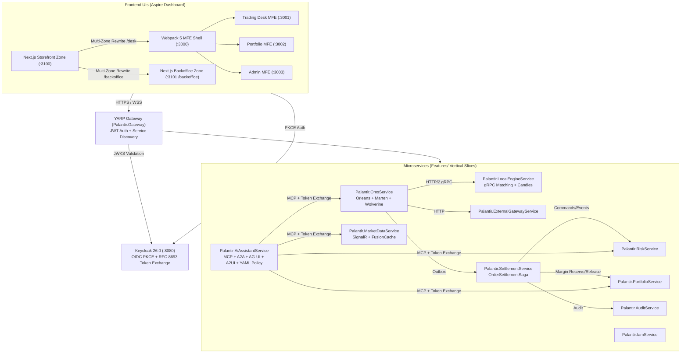

# Palantir Architectural Reference & Implementation Guide

## 1. Executive Overview & Architectural Alignment
**Palantir** is a cloud-native **.NET 10** microservices and microfrontend reference solution modeled structurally on **BookWorm** (`F:\Lab\BookWorm`), tailored to institutional financial trading. It enforces **SOLID principles**, **Vertical Slice Architecture (VSA)**, **Domain-Driven Design (DDD)**, **CQRS**, **Event Sourcing**, **Zero-Trust Security**, **Multi-Agent AI Protocols**, **Next.js Multi-Zones + Webpack 5 Module Federation**, and **Multi-Layered Automated Testing**.

### Key Architectural Invariants
1. **Folder Convention (`Features/` vs `Endpoints/`)**: Every microservice organizes endpoints, commands, queries, validators, and handlers strictly under `Features/<Aggregate>/<Action>/`. The `Endpoints/` folder is permitted **exclusively** inside the chassis project (`src/BuildingBlocks/Palantir.Platform/Endpoints/`).
2. **BookWorm Service Isolation (Zero `*.Contracts` Projects)**: Following `BookWorm`, there are **zero** `*.Contracts.csproj` projects and **zero** cross-service project references. HTTP DTOs live inside each slice (`Features/`), Orleans grain interfaces live inside `OmsService/Grains/`, and async RabbitMQ messages live inside each service's `IntegrationEvents/Events/` decorated with Wolverine `[MessageIdentity("palantir.<event-name>")]`, verified by `PactNet` and `ArchUnitNET`.
3. **Microservices Chassis (`Palantir.Platform`)**: All cross-cutting infrastructure (typed `IEndpoint`, API versioning, feature flags, FluentValidation endpoint filter, FusionCache + PostgreSQL L2 cache, Wolverine durable outbox/inbox, Marten event store, gRPC resilience, ProblemDetails, and Keycloak JWT + RFC 8693 Token Exchange) lives in `Palantir.Platform`.
4. **All UIs Orchestrated in Aspire Dashboard**: `Palantir.AppHost` registers both backend services and all 6 frontend applications via `AddExecutable` (`npm run dev`) with clickable endpoints (`:3000`–`:3003`, `:3100`–`:3101`).
5. **Strict Zero Redundant Code**: No unused packages (`TUnit` removed in favor of `xUnit`), no duplicate endpoint/caching abstractions, and no business logic inside minimal API route lambdas.

---

## 2. Solution Topology & Dependency Boundaries



---

## 3. Aspire Hosting & ServiceDefaults (`src/Aspire/`)

- **`Palantir.AppHost/Program.cs`**:
  - Infrastructure: PostgreSQL (`pgvector/pgvector:pg16` -> `PalantirDb`), RabbitMQ (with management plugin), Keycloak (`26.0` importing `deploy/keycloak/palantir-realm.json`).
  - Microservices: All 10 `.NET` backend projects receive `Keycloak__Url` for consistent JWT Bearer validation and RFC 8693 Token Exchange.
  - **Aspire Dashboard UI Resources (`AddExecutable` -> `npm run dev`)**:
    - `trading-desk-mfe` (`:3001`)
    - `portfolio-mfe` (`:3002`)
    - `admin-mfe` (`:3003`)
    - `frontend-shell` (`:3000`, referencing MFE remotes + Gateway)
    - `backoffice-zone` (`:3101`, Next.js `/backoffice`)
    - `storefront-zone` (`:3100`, Next.js Multi-Zone root proxying `/desk` and `/backoffice`)
- **`Palantir.ServiceDefaults`**:
  - `Extensions.cs`: Kestrel `AddServerHeader = false`, OpenTelemetry metrics/tracing (`Palantir.*`, `Wolverine`), health checks (`/health`, `/alive`), HTTP standard resilience + service discovery.
  - `ApiSpecification/OpenApi/`: `AddDefaultOpenApi` + `SecuritySchemeDefinitionsTransformer` (Bearer JWT) + Scalar UI (`/scalar/v1`).
  - `ApiSpecification/AsyncApi/`: `Saunter` (`AddDefaultAsyncApi` / `UseDefaultAsyncApi`) exposing AsyncAPI documents & UI in development.

---

## 4. Microservices Chassis (`src/BuildingBlocks/Palantir.Platform/`)

`Palantir.Platform` packages shared infrastructure via `builder.AddPalantirChassis(typeof(Program).Assembly)` and `app.UsePalantirChassis()`:

| Module | Location | Responsibility |
|---|---|---|
| **Endpoints & Versioning** | `Palantir.Platform/Endpoints/` | `IEndpoint`, typed `IEndpoint<TResult, ...>`, `ProducesPost/Get/Put/Delete`, `WithIdempotency()`, `AddPalantirApiVersioning()`, `NewV1ApiVersionSet()` |
| **Feature Flags** | `Palantir.Platform/FeatureFlags/` | `AddPalantirFeatureFlags()` + `.RequireFeature("...")` endpoint filter |
| **Validation** | `Palantir.Platform/Validation/` | `AddPalantirValidators()` + `.WithValidation<TRequest>()` FluentValidation endpoint filter |
| **Caching** | `Palantir.Platform/Caching/` | `FusionCache` (`IFusionCache`) backed by `PostgresKeyValueStore` (`IDistributedCache` + `IKeyValueStore`) with fail-safe |
| **Messaging & Outbox/Inbox** | `Palantir.Platform/Messaging/` | `WolverineFx` + PostgreSQL (`wolverine` schema) durable outbox/inbox, RabbitMQ, retry + error queue policies |
| **Event Store** | `Palantir.Platform/EventStore/` | `Marten` (`event_store` schema) with correlation/causation metadata, async daemon, and Wolverine integration |
| **gRPC Resilience** | `Palantir.Platform/Grpc/` | `AddResilientGrpcClient<TClient>` with HTTP/2 retry policies + optional token exchange handler |
| **Security & Token Exchange** | `Palantir.Platform/Security/` | `AddPalantirJwtAuthentication()`, `KeycloakTokenExchangeService`, `TokenExchangeDelegatingHandler`, `PostgresPermissionTokenManager` |
| **ProblemDetails** | `Palantir.Platform/Exceptions/` | `AddPalantirProblemDetails()` with `traceId` and `timestamp` enrichment |

---

## 5. Vertical Slice Architecture, DDD, CQRS, Sagas & Event Sourcing

Every microservice follows the uniform slice layout:
```text
src/Services/<Domain>/Palantir.<Name>Service/
  Features/
    <Aggregate>/
      <Action>/
        <Action><Aggregate>Feature.cs   # Command/Query + Validator + Handler + sealed IEndpoint
  Domain/                               # Aggregates, Entities, Value Objects
  Infrastructure/                       # DbContexts, Repositories, External Clients
  Sagas/                                # Wolverine Saga state machines (SettlementService)
  Program.cs                            # AddServiceDefaults + AddDefaultAsyncApi + AddPalantirChassis
```

### Microservices & Patterns Mapping
- **`Palantir.OmsService`**: `Features/Orders/{Create,Get,Cancel,GetClientActive,GetBlotter}` dispatching via Wolverine `IMessageBus` to Orleans `OrderGrain`, persisting `Order` domain events to **Marten** (`MartenOrderRepository`), projecting read models via `OrderBlotterProjection`, and publishing `InitiateOrderSettlementCommand` / `AuditTrailEvent` through the Wolverine PostgreSQL outbox.
- **`Palantir.LocalEngineService`**: `Features/{Symbols,Matching,OrderBook,Candles}` + HTTP/2 `MatchingEngineGrpcService` (`Protos/matching_engine.proto`) + `MapGrpcHealthChecksService()`.
- **`Palantir.ExternalGatewayService`**: `Features/{ExternalOrders,Simulator}` (simulator gated by `.RequireFeature("ExternalExchangeSimulator")`).
- **`Palantir.SettlementService`**: `Features/Settlements/Get` + `OrderSettlementSaga` (Wolverine `Saga`) orchestrating `CheckPreTradeRiskCommand`, handling choreography events (`PreTradeRiskApprovedEvent`, `TradeExecutedEvent`), and issuing compensating `ReleaseReservedMarginCommand` on `OrderSettlementFailedEvent`.
- **`Palantir.RiskService`**, **`Palantir.PortfolioService`**, **`Palantir.MarketDataService`**, **`Palantir.IamService`**, **`Palantir.AuditService`**: Each refactored into `Features/` slices with full JWT authorization, API versioning (`v1`), FluentValidation, and FusionCache/EF Core/Wolverine integration.

---

## 6. Security: Keycloak PKCE & RFC 8693 Token Exchange
1. **User Authentication**: `deploy/keycloak/palantir-realm.json` configures `palantir-shell` with `pkce.code.challenge.method: S256` and redirect URIs for `:3000`, `:3100`, `:3101`, and `:5000`.
2. **Gateway & Service Enforcement**: `Palantir.Gateway` and all 9 services register `AddPalantirJwtAuthentication` + `UseAuthentication()` + `UseAuthorization()`.
3. **Service-to-Service Token Exchange**: `AddTokenExchangeHandler(targetAudience)` attaches `TokenExchangeDelegatingHandler` to outgoing `HttpClient` and gRPC clients (e.g., `OmsService -> LocalEngineService`, `AiAssistantService -> Oms/MarketData/Risk/Portfolio`), exchanging subject tokens via Keycloak RFC 8693 and caching exchanged tokens in `IKeyValueStore`.

---

## 7. AI Ecosystem (`Palantir.AiAssistantService`)
- **Multi-Agent Orchestration**: `TradeCopilotCoordinator` coordinates `TradeAnalysisAgent` and `RiskGuardAgent` using `Microsoft.Extensions.AI` (`IChatClient` + `IEmbeddingGenerator`).
- **Model Context Protocol (MCP)**: `ModelContextProtocol.AspNetCore` (`app.MapMcp("/mcp").RequireAuthorization()`) backed by `[McpServerToolType] TradingMcpTools` + `Features/Mcp/` discovery endpoints.
- **A2A Protocol**: `Features/A2A/A2AFeature.cs` exposes `/api/v1/a2a/card` (`AgentCardDescriptor`) and `/api/v1/a2a/messages`, consumed via `IA2AClient`.
- **AG-UI Protocol**: `Features/AgUi/AgUiStreamFeature.cs` streams real SSE lifecycle events (`RUN_STARTED`, `thought_start`, `reasoning_token`, `a2ui_component`, `RUN_FINISHED`) over `/api/v1/ai/stream`.
- **Policy-Based Governance**: `Policies/ai-agents.yaml` parsed via `YamlDotNet` in `AgentGovernanceManager` enforces per-agent tool allowlists, prompt-injection regex blocking, execution budgets, and `PresidioPiiRedactor` masking.
- **A2UI Rendering**: `A2UI/ComponentSchemas.cs` (`TradeProposalCard`, `RiskGauge`, `DepthImpactChart`) rendered in `storefront/components/a2ui-renderer.tsx`.

---

## 8. Client Architecture & WCAG 2.1 AA (`src/Clients/`)
- **Next.js Multi-Zones**:
  - `storefront` (`:3100`): Customer-facing Next.js 15 App Router portal with `next.config.mjs` rewrites (`/desk/:path*` -> MFE Shell `:3000`, `/backoffice/:path*` -> Backoffice `:3101`), PKCE helper, A2UI renderer, and `/accessibility`.
  - `backoffice` (`:3101`): Admin backoffice Next.js 15 App Router dashboard (`basePath: '/backoffice'`).
- **Webpack 5 Module Federation**: `shell` (`:3000`) lazily loads `trading-desk` (`:3001`), `portfolio-mfe` (`:3002`), and `admin-mfe` (`:3003`).
- **Accessibility**: Semantic landmarks, skip-navigation links, `aria-live="polite"` status regions, `aria-pressed` toggles, `progressbar` roles, and automated `@axe-core/playwright` + Vitest/RTL checks. See [ACCESSIBILITY.md](file:///f:/Lab/Trade/04/Palantir/docs/ACCESSIBILITY.md).

---

## 9. Documentation, Testing & CI/CD Blueprint
- **OpenAPI + AsyncAPI + EventCatalog**: OpenAPI + Scalar + Saunter AsyncAPI configured in `Palantir.ServiceDefaults`; `docs/asyncapi/*.yaml` and `docs/eventcatalog/` configured with `@eventcatalog/generator-asyncapi` & `@eventcatalog/generator-openapi`.
- **Testing Pyramid**:
  - **Architecture Tests (`tests/Palantir.ArchTests`)**: `ArchUnitNET` rules enforcing `Features/` placement, zero legacy `Endpoints/` namespaces in services, sealed endpoints/validators, `SharedKernel`/`Constants` isolation, and `Sagas` namespace convention.
  - **Contract Tests (`tests/Palantir.ContractTests`)**: `PactNet` v5 HTTP (`OmsService -> RiskService`) and Message (`SettlementService -> RiskService`) interactions outputting pacts to `tests/pacts/`.
  - **Service Unit Tests (`tests/Services/*`)**: `xUnit + Shouldly + Bogus` coverage across all 9 services.
  - **Frontend Unit/Component Tests**: `Vitest + @testing-library/react` across `shell`, `portfolio-mfe`, `admin-mfe`, `storefront`, and `backoffice`.
  - **E2E BDD**: `playwright-bdd` + `@axe-core/playwright` executing `tests/bdd/order_execution.feature` and `tests/bdd/accessibility.feature` via `src/Clients/e2e/steps/trading.steps.ts`.
- **GitHub Actions**: `.github/workflows/backend-ci.yml` and `.github/workflows/frontend-ci.yml`.
