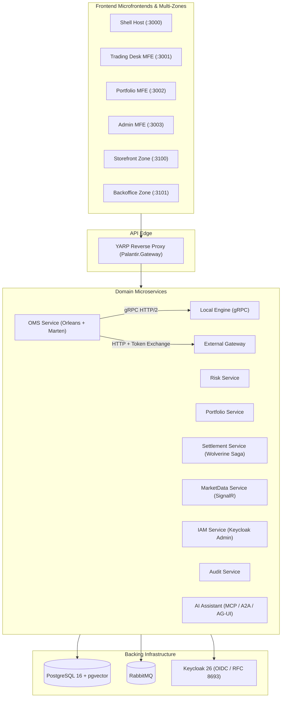
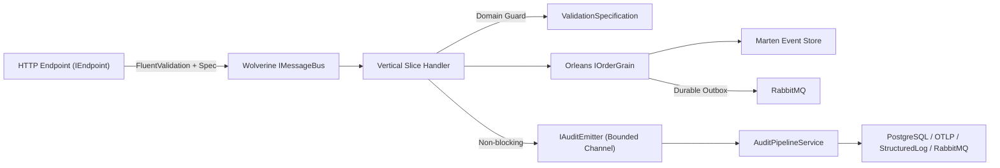

# Architecture Reference

Palantir demonstrates a production-grade cloud-native enterprise architecture built on **.NET 10**, **.NET Aspire**, **Vertical Slice Architecture**, **Domain-Driven Design**, **CQRS / Event Sourcing**, and **Zero-Trust Security**.

---

## 1. System Context & Container Topology (C4)

> Full Structurizr C4 model (System Context, Containers, and OMS Components) is also maintained in [c4-model.dsl](c4-model.dsl).

---

## 2. Internal Service Component View (OMS Example)

---

## 3. Building Blocks Catalog

| Project | Namespace / Folder | Responsibility |
| --- | --- | --- |
| **Palantir.SharedKernel** | `Palantir.SharedKernel` | Dependency-free DDD primitives: `Entity<TId>`, `AggregateRoot<TId>`, `DomainEvent`, Vogen strong IDs, `ISpecification<T>`, `IValidationSpecification<T>`, `And/Or/NotSpecification<T>`, `DomainSpecificationException`. |
| **Palantir.Constants** | `Palantir.Constants` | Zero-dependency shared identifiers: `AspireResourceNames`, `ApiConstants`, `MessagingConstants`, `Permissions`, `PermissionDimensions`. |
| **Palantir.Platform** | `Auditing` | Non-blocking `Channel<AuditEntry>` emitter (`IAuditEmitter`) and `AuditPipelineService` draining batches to `PostgresAuditSink`, `OtlpAuditSink`, `StructuredLogAuditSink`, and `RabbitMqAuditSink`. |
| **Palantir.Platform** | `Security` & `Security.Permissions` | Keycloak JWT AuthN, RFC 8693 Token Exchange (`ITokenExchangeService`), cached `PermissionToken`, and Dimension-Resource-Context `IPermissionEvaluator` driven by `IPermissionSpecification` rules (`DimensionActionSpec`, `ResourceMatchSpec`, `OwnershipSpec`, `TradingHoursSpec`, `NetworkConditionSpec`). |
| **Palantir.Platform** | `Validation` | `SpecificationValidator<T>` (FluentValidation adapter) and `WithSpecificationValidation<T>()` endpoint filter reusing domain specifications at HTTP boundaries. |
| **Palantir.Platform** | `Endpoints` | Auto-discovered `IEndpoint` Vertical Slice mapping, API versioning (`Asp.Versioning.Http`), idempotency header filter. |
| **Palantir.Platform** | `Messaging` | WolverineFx + RabbitMQ + PostgreSQL durable Outbox/Inbox (`AddPalantirMessaging`) and retry/dead-letter policies (`AddPalantirDeadLetterHandling`). |
| **Palantir.Platform** | `Caching` | `FusionCache` L1 + PostgreSQL distributed L2 (`IKeyValueStore`) with fail-safe and OpenTelemetry. |
| **Palantir.Platform** | `Persistence` & `EventStore` | EF Core interceptors (`PublishDomainEventsInterceptor`, `AuditableEntityInterceptor`), schema bootstrapper, Marten Event Store setup. |
| **Palantir.Platform** | `HealthChecks` | PostgreSQL readiness check (`PostgresHealthCheck`) and graceful shutdown timeout configuration (`HostOptions.ShutdownTimeout`). |
| **Palantir.Platform** | `RateLimiting` | Partitioned fixed-window rate limiting (`AddPalantirRateLimiting` / `UsePalantirRateLimiting`) returning HTTP 429. |
| **Palantir.Platform** | `Scheduling` | Quartz.NET persistent PostgreSQL job scheduling (`AddPalantirScheduling`) with `System.Text.Json`. |
| **Palantir.Platform** | `Grpc` & `FeatureFlags` & `Exceptions` | Resilient HTTP/2 gRPC clients, `Microsoft.FeatureManagement`, RFC 7807 ProblemDetails + `DomainSpecificationExceptionHandler`. |
| **Palantir.ServiceDefaults** | `Palantir.ServiceDefaults` | OpenTelemetry (metrics, traces, logs), service discovery, HTTP resilience, `/health` & `/alive` probes, OpenAPI + Scalar, AsyncAPI + Saunter. |

---

## 4. Enterprise Patterns Matrix

| Pattern | Implementation | Where |
| --- | --- | --- |
| **Vertical Slice Architecture** | `Features/<Area>/<Action>/*Feature.cs` enforced by ArchUnitNET | All 9 microservices |
| **CQRS & Event Sourcing** | Marten event streams + async projections (`OrderBlotterProjection`) | `Palantir.OmsService` |
| **Stateful Actor Concurrency** | Microsoft Orleans grains (`OrderGrain`, `ClientSessionGrain`) | `Palantir.OmsService` |
| **Distributed Sagas** | Wolverine Saga (`OrderSettlementSaga`) + choreography events | `Palantir.SettlementService` |
| **Transactional Outbox / Inbox** | Wolverine PostgreSQL durable queues & outbox | All messaging services |
| **Unified Specification Pattern** | `IValidationSpecification<T>` shared across domain guards & FluentValidation | `SharedKernel` + `Platform` |
| **Non-Blocking Multi-Sink Audit** | `Channel<AuditEntry>` -> `BackgroundService` -> pluggable `IAuditSink`s | `Palantir.Platform.Auditing` |
| **Dimension-Resource-Context AuthZ** | `PermissionEvaluator` + `IPermissionSpecification` + `DimensionRequirement` | `Palantir.Platform.Security.Permissions` |
| **Zero-Trust Token Exchange** | OAuth 2.0 RFC 8693 `TokenExchangeDelegatingHandler` | `Palantir.Platform.Security` |
