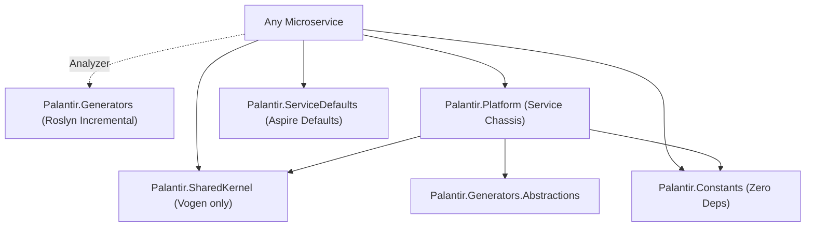

# Building Blocks & Infrastructure Foundations

Palantir separates pure domain contracts, shared constants, compile-time Roslyn generators, Aspire hosting defaults, and the runtime service chassis into focused Building Block projects under `src/BuildingBlocks/` and `src/Aspire/`.

---

## 1. `Palantir.Constants` — Shared Identifiers

Zero external or project dependencies (verified by `Constants_Should_Have_Zero_Dependencies_On_SharedKernel_Or_Platform` in [ArchitectureTests.cs](../../../tests/Palantir.ArchTests/ArchitectureTests.cs)).

| Class | File | Purpose |
| --- | --- | --- |
| `AspireResourceNames` | [SystemConstants.cs](../../../src/BuildingBlocks/Palantir.Constants/SystemConstants.cs) | Canonical Aspire resource IDs (`postgres`, `rabbitmq`, `keycloak`, `PalantirDb`, `gateway`, `oms-service`, `risk-service`, `audit-service`, MFEs). |
| `ApiConstants` | [SystemConstants.cs](../../../src/BuildingBlocks/Palantir.Constants/SystemConstants.cs) | HTTP correlation/idempotency headers (`x-request-id`, `x-correlation-id`). |
| `MessagingConstants` | [SystemConstants.cs](../../../src/BuildingBlocks/Palantir.Constants/SystemConstants.cs) | RabbitMQ exchanges (`trading.commands`, `trading.sagas`, `iam.events`, `market.data`, `audit.events`), queues (`market.ticks.v1`, `trading.settlement.saga`, `trading.risk.checks`, `trading.portfolio.margin`, `audit.trail.v1`, `iam.events.v1`), and cache key builders. |
| `Permissions` & `DimensionNames` | [Permissions.cs](../../../src/BuildingBlocks/Palantir.Constants/Permissions.cs) | Dot-notation permission strings (`Permissions.Orders.Place`, `Permissions.Risk.OverrideLimits`, etc.), `Permissions.All`, and `Permissions.DimensionNames` (`Orders`, `MarketData`, `Risk`, `Portfolio`, `Settlement`, `Audit`, `Iam`, `System`). |

---

## 2. `Palantir.SharedKernel` — Domain-Driven Design Primitives

Contains pure domain building blocks with zero infrastructure dependencies (only `Vogen` for compile-time strongly typed IDs):

1. **Entities & Aggregates** ([DomainBase.cs](../../../src/BuildingBlocks/Palantir.SharedKernel/DomainBase.cs), [Abstractions.cs](../../../src/BuildingBlocks/Palantir.SharedKernel/Abstractions.cs)):
   - `Entity<TId>` with ID-based equality, `IAuditableEntity`, `ISoftDeletable`.
   - `AggregateRoot<TId>` maintaining uncommitted `IDomainEvent` records (`AddDomainEvent`, `ClearDomainEvents`, `DequeueUncommittedEvents`) and optimistic concurrency `Version`.
   - `DomainEvent` base record capturing `EventId`, `TimestampUtc`, and `CorrelationId`.
2. **Strongly Typed IDs & Value Objects** ([Identifiers.cs](../../../src/BuildingBlocks/Palantir.SharedKernel/Identifiers.cs), [TradingValueObjects.cs](../../../src/BuildingBlocks/Palantir.SharedKernel/TradingValueObjects.cs)):
   - Vogen value objects: `OrderId`, `TradeId`, `AccountId`, `SymbolId`, `UserId`, `ClientId` (rejecting empty `Guid` / blank strings).
   - Trading enums & structs: `TradeSide`, `OrderType`, `OrderStatus`, `TimeInForce`, `Money` (currency-safe `+` / `-`), `Price`, `Quantity`.
3. **Order Aggregate & Events** ([Order.cs](../../../src/BuildingBlocks/Palantir.SharedKernel/Aggregates/Order.cs), [Trade.cs](../../../src/BuildingBlocks/Palantir.SharedKernel/Aggregates/Trade.cs), [OrderDomainEvents.cs](../../../src/BuildingBlocks/Palantir.SharedKernel/Events/OrderDomainEvents.cs)):
   - State machine enforcing valid transitions: `Order.Create` -> `ApproveRisk` -> `ApplyExecution` (weighted average fill price + `PartiallyFilled`/`Filled`) -> `Cancel` / `Reject` / `Expire`.
   - Event-sourcing `Apply(IDomainEvent)` replay for `OrderCreatedDomainEvent`, `OrderRiskApprovedDomainEvent`, `OrderExecutionAppliedDomainEvent`, `OrderCancelledDomainEvent`, `OrderRejectedDomainEvent`, and `OrderExpiredDomainEvent`.
4. **Dual-Purpose Specification Pattern** ([Specifications.cs](../../../src/BuildingBlocks/Palantir.SharedKernel/Specifications.cs)):
   - **Query specifications**: `ISpecification<T>`, `Specification<T>`, `SpecificationEvaluator.GetQuery(...)` for criteria, includes, sorting, and paging.
   - **Validation specifications**: `IValidationSpecification<T>`, `ValidationSpecification<T>`, `AndSpecification<T>`, `OrSpecification<T>`, `NotSpecification<T>`, `entity.Validate(...)`, `entity.EnsureSatisfies(...)`, and `DomainSpecificationException`.

---

## 3. `Palantir.Generators` — Roslyn Source Generation

- [Attributes.cs](../../../src/BuildingBlocks/Palantir.Generators.Abstractions/Attributes.cs) exposes `[QueryBindable]` and `[QueryParamName("...")]`.
- [QueryBinderGenerator.cs](../../../src/BuildingBlocks/Palantir.Generators/QueryBinderGenerator.cs) implements `IIncrementalGenerator` to emit `<ClassName>BinderExtensions.FromQuery(IQueryCollection)` at compile time for `string`, `int`, `decimal`, `long`, `bool`, and `Guid` properties—eliminating reflection on query-string binding.

---

## 4. `Palantir.Aspire` — Orchestration & Service Defaults

### `Palantir.AppHost` ([Program.cs](../../../src/Aspire/Palantir.AppHost/Program.cs))
1. Provisions **PostgreSQL 16 (`pgvector/pgvector:pg16`)** with pgAdmin and database `PalantirDb`.
2. Provisions **RabbitMQ** with management UI and **Keycloak 26** importing [palantir-realm.json](../../../deploy/keycloak/palantir-realm.json).
3. Registers all 9 microservices, `Palantir.Gateway`, and 6 Node/Next.js frontend apps (`shell` `:3000`, `trading-desk` `:3001`, `portfolio-mfe` `:3002`, `admin-mfe` `:3003`, `storefront` `:3100`, `backoffice` `:3101`) with `WaitFor` ordering and `Keycloak__Url` injection.

### `Palantir.ServiceDefaults` ([Extensions.cs](../../../src/Aspire/Palantir.ServiceDefaults/Extensions.cs))
- `AddServiceDefaults()`: Disables Kestrel `Server` header, configures OpenTelemetry (`AddAspNetCoreInstrumentation`, `AddHttpClientInstrumentation`, `AddRuntimeInstrumentation`, `AddMeter("Palantir.*")`, `AddSource("Palantir.*")`, `AddSource("Wolverine")`, OTLP exporter), adds `"live"` self health check, service discovery, HTTP resilience (`AddStandardResilienceHandler`), and OpenAPI + Scalar ([OpenApiExtensions.cs](../../../src/Aspire/Palantir.ServiceDefaults/ApiSpecification/OpenApi/OpenApiExtensions.cs)).
- `MapDefaultEndpoints()`: Maps `/health` (full readiness), `/alive` (liveness), and OpenAPI/Scalar UI.
- `AddDefaultAsyncApi(...)` / `UseDefaultAsyncApi()` ([AsyncApiExtensions.cs](../../../src/Aspire/Palantir.ServiceDefaults/ApiSpecification/AsyncApi/AsyncApiExtensions.cs)): Exposes Saunter AsyncAPI 3.0 docs for Wolverine/RabbitMQ message contracts.

---

Next: [Platform Service Chassis Deep Dive](platform-chassis.md)
