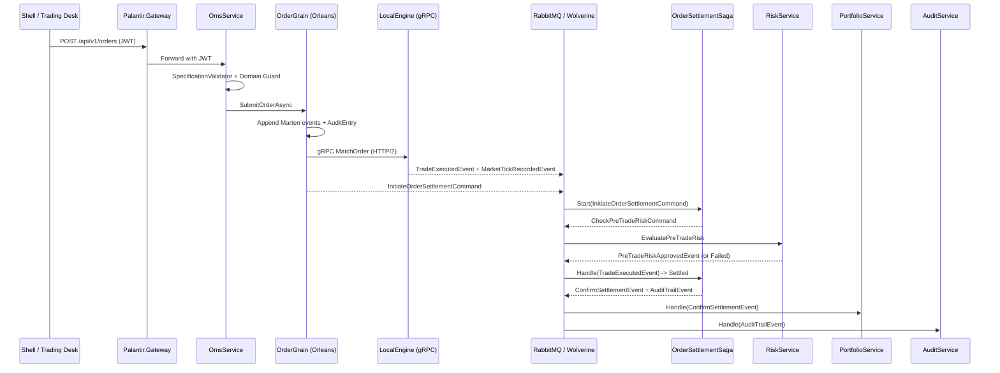

# Palantir Comprehensive Developer Walkthrough

This guide walks step by step through every architectural layer, runtime flow, Building Block, microservice, microfrontend, and test suite across `src/` and `tests/`.

---

## Part 1: Solution Topology & Dependency Governance

`Palantir.slnx` ([Palantir.slnx](../../Palantir.slnx)) targets `.NET 10` with Central Package Management ([Directory.Packages.props](../../Directory.Packages.props)) and enforces strict architectural boundaries via `Palantir.ArchTests`:

1. **`src/BuildingBlocks/Palantir.Constants`**: Zero dependencies on `SharedKernel` or `Platform`. Holds `AspireResourceNames`, `ApiConstants`, `MessagingConstants`, and `Permissions`.
2. **`src/BuildingBlocks/Palantir.SharedKernel`**: Depends only on `Vogen`. Holds DDD `Entity`, `AggregateRoot`, `Order` / `Trade` aggregates, `OrderDomainEvents`, and `IValidationSpecification`.
3. **`src/BuildingBlocks/Palantir.Platform`**: Depends on `SharedKernel`, `Constants`, and `Generators.Abstractions`. Exposes `AddPalantirChassis()` and `UsePalantirChassis()`.
4. **`src/Aspire/`**: `Palantir.AppHost` orchestrates PostgreSQL 16 + pgvector, RabbitMQ, Keycloak 26, all backend services, `Palantir.Gateway`, and 6 frontend apps; `Palantir.ServiceDefaults` adds OpenTelemetry, health checks, service discovery, OpenAPI/Scalar, and AsyncAPI/Saunter.
5. **`src/Services/`**: 10 autonomous Vertical Slice services with zero cross-service project references.

Deep dive: [Building Blocks Guide](building-blocks/README.md) | [Platform Chassis Guide](building-blocks/platform-chassis.md)

---

## Part 2: How Every Service Boots (`Program.cs` Lifecycle)

Every microservice follows a uniform startup sequence:

1. `builder.AddServiceDefaults()` registers OpenTelemetry, `/health` + `/alive` liveness checks, service discovery, HTTP resilience, and OpenAPI/Scalar.
2. `builder.AddDefaultAsyncApi(...)` registers Saunter AsyncAPI 3.0 event specifications.
3. `builder.AddPalantirChassis(typeof(Program).Assembly)` registers FusionCache + PostgreSQL L2, Keycloak JWT + RFC 8693 token exchange, Dimension-Resource-Context permissions, RFC 7807 `ProblemDetails` + `DomainSpecificationExceptionHandler`, API versioning (`/api/v1`), feature flags, FluentValidation + `SpecificationValidator`, Scrutor `IEndpoint` discovery, `ChannelAuditEmitter` + `AuditPipelineService`, `PostgresHealthCheck` + 15s graceful shutdown, and fixed-window rate limiting.
4. Service-specific stores (`EF Core` / `Marten` / `Orleans`) and `builder.Host.AddPalantirMessaging(...)` (Wolverine + RabbitMQ + PostgreSQL durable outbox/inbox + dead-letter policies) are wired.
5. `app.MapDefaultEndpoints()`, `app.UseDefaultAsyncApi()`, and `app.UsePalantirChassis()` activate exception handling, authN/authZ, rate limiting, and versioned endpoints.

---

## Part 3: Runtime Walkthrough 1 — Order Lifecycle, Risk & Settlement Saga

Follow an institutional Limit Buy order end to end:

1. **HTTP Validation & Domain Guard**: `CreateOrderEndpoint` ([CreateOrderFeature.cs](../../src/Services/Oms/Palantir.OmsService/Features/Orders/Create/CreateOrderFeature.cs)) runs `CreateOrderValidator` (`SpecificationValidator<CreateOrderCommand>`) using `OrderSymbolSpecification`, `OrderQuantitySpecification`, and `LimitOrderPriceSpecification`. Inside `CreateOrderHandler`, `command.EnsureSatisfies(DomainSpecs)` enforces the identical specifications.
2. **Actor & Event Store**: `OrderGrain` ([Grains.cs](../../src/Services/Oms/Palantir.OmsService/Grains/Grains.cs)) creates the `Order` aggregate, persists domain events to Marten (`OrderBlotterProjection`), and checkpoints Orleans state.
3. **Venue Dispatch**: `ExecutionRouter` calls `LocalEngineService` over resilient HTTP/2 gRPC (`MatchingEngineGrpcService`) or `ExternalGatewayService` over HTTP with RFC 8693 token exchange.
4. **Saga Orchestration & Compensation**: `OrderSettlementSaga` ([OrderSettlementSaga.cs](../../src/Services/Settlement/Palantir.SettlementService/Sagas/OrderSettlementSaga.cs)) coordinates `CheckPreTradeRiskCommand` -> `PreTradeRiskApprovedEvent` -> `TradeExecutedEvent` -> `ConfirmSettlementEvent`, or compensates via `ReleaseReservedMarginCommand` on `OrderSettlementFailedEvent`.

---

## Part 4: Runtime Walkthrough 2 — Zero-Trust AuthN, Token Exchange & Permissions

1. **Authentication**: Clients authenticate against Keycloak 26 (`palantir` realm). Every service validates JWTs via `AddPalantirJwtAuthentication`.
2. **Token Cache & Exchange**: `IamService` caches `PermissionToken` in `PostgresKeyValueStore` (`platform_cache`). Outgoing service-to-service HTTP/gRPC calls attach `TokenExchangeDelegatingHandler`, which exchanges the incoming Bearer token for the target service audience via Keycloak RFC 8693 (`KeycloakTokenExchangeService`).
3. **Specification-Driven Authorization**: Both legacy `.RequireAuthorization(Permissions.AllowPlaceOrder)` and `.RequireDimension(PermissionDimension.Orders, "Place", "Order")` flow through `IPermissionEvaluator` ([PermissionEvaluator.cs](../../src/BuildingBlocks/Palantir.Platform/Security/Permissions/PermissionEvaluator.cs)).
4. **Evaluator Dimensions**: `PermissionEvaluator` evaluates `PermissionGrant`s against `PermissionDimension`, `ResourceTemplate` (`Type`, `Id`, `OwnerId`), and `PermissionContext` (`X-Market-State`, `X-VPN-Connected`, `X-Tenant-Id`, `ClientIpAddress`) using `DimensionActionSpec`, `ResourceMatchSpec`, `OwnershipSpec`, `TradingHoursSpec`, and `NetworkConditionSpec`.

---

## Part 5: Runtime Walkthrough 3 — Non-Blocking Multi-Sink Audit Pipeline

1. **Hot-Path Emit**: Handlers inject `IAuditEmitter` and call `auditEmitter.Emit(AuditEntry.Create(...))`, which executes a non-blocking `Channel<AuditEntry>.Writer.TryWrite` (`DropOldest`, capacity `10_000`).
2. **Background Batching**: `AuditPipelineService` ([AuditPipelineService.cs](../../src/BuildingBlocks/Palantir.Platform/Auditing/AuditPipelineService.cs)) reads batches up to 100 entries and dispatches them concurrently to registered `IAuditSink` adapters:
   - `PostgresAuditSink`: Binary `COPY` into `platform_audit.audit_entries`.
   - `OtlpAuditSink`: `ActivitySource("Palantir.Auditing")` spans exported via OTLP.
   - `StructuredLogAuditSink`: Structured `ILogger` audit events.
   - `RabbitMqAuditSink` (opt-in): Publishes `AuditEntry` via isolated DI scopes.
3. **Regulatory Store**: `AuditService` additionally consumes `AuditTrailEvent` from `audit.trail.v1` and persists `RegulatoryAuditRecord` into `audit.audit_records` with a PostgreSQL `GIN` full-text index.

---

## Part 6: Runtime Walkthrough 4 — AI Copilot Protocols & Governance

1. **Governance**: `AgentGovernanceManager` ([AgentGovernanceMiddleware.cs](../../src/Services/AiAssistant/Palantir.AiAssistantService/Governance/AgentGovernanceMiddleware.cs)) loads `Policies/ai-agents.yaml`, enforces daily execution budgets, blocks unsafe prompt patterns, and redacts PII via `PresidioPiiRedactor`.
2. **Multi-Agent Orchestration**: `TradeCopilotCoordinator` coordinates `TradeAnalysisAgent` and `RiskGuardAgent`, querying downstream services (`oms`, `market-data`, `risk`, `portfolio`) with RFC 8693 token exchange.
3. **Protocols**:
   - **MCP** (`/mcp` & `/api/v1/mcp/tools`): Exposes `TradingMcpTools` over HTTP transport.
   - **A2A** (`/api/v1/a2a/card` & `/api/v1/a2a/messages`): Agent card discovery and task messaging.
   - **AG-UI & A2UI** (`POST /api/v1/ai/stream`): Streams SSE events (`RUN_STARTED`, `thought_start`, `reasoning_token`, `a2ui_component`, `RUN_FINISHED`) rendered by `storefront`'s `A2UIRenderer`.

---

## Part 7: Microservices & Microfrontends Reference

- **Gateway & Microservices**: [Services Index](services/README.md) | [Trading & Execution](services/trading-and-execution.md) | [Risk, Portfolio & Settlement](services/risk-portfolio-settlement.md) | [IAM, Audit & AI](services/platform-and-ai-services.md)
- **Frontend Clients**: [Microfrontends & Multi-Zones Guide](clients/README.md)
- **Testing Suites**: [Comprehensive Testing Guide](testing.md)

---

## Part 8: Extending Palantir (Step-by-Step Recipes)

### Adding a New Vertical Slice Feature
1. Create `src/Services/<Domain>/Palantir.<Service>/Features/<Area>/<Action>/<Action>Feature.cs`.
2. Define `sealed` `ValidationSpecification<T>` classes and a `sealed` `SpecificationValidator<T>` inside `Features/` (enforced by `Palantir.ArchTests`).
3. Implement the handler, enforcing `command.EnsureSatisfies(...)` and emitting `AuditEntry` via `IAuditEmitter`.
4. Implement an `internal sealed` `IEndpoint` calling `.WithValidation<TRequest>()`, `.MapToApiVersion(ApiVersioningExtensions.V1)`, and `.RequireAuthorization(...)` or `.RequireDimension(...)`.
5. Add unit tests under `tests/Services/Palantir.<Service>.UnitTests/` and integration/BDD tests if cross-service.

### Adding a New Microservice
1. Create `src/Services/<Name>/Palantir.<Name>Service/` referencing `Palantir.ServiceDefaults`, `Palantir.Platform`, `Palantir.SharedKernel`, and `Palantir.Constants`.
2. Register the resource name in `AspireResourceNames`, wire it in `src/Aspire/Palantir.AppHost/Program.cs`, and add its cluster/route in `src/Gateway/Palantir.Gateway/appsettings.json`.
3. Add a unit test project under `tests/Services/` and register the service assembly in [ArchitectureTests.cs](../../tests/Palantir.ArchTests/ArchitectureTests.cs).
