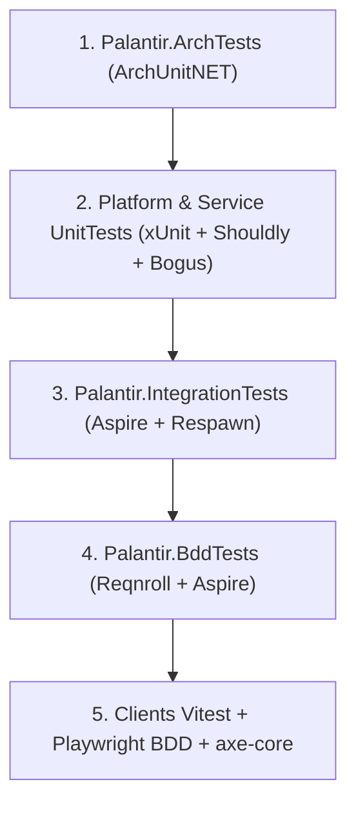

# Comprehensive Testing Guide

Palantir enforces quality across **five complementary test layers** covering architecture invariants, isolated domain/building-block logic, distributed Aspire integration, backend Gherkin BDD, and frontend unit + accessibility E2E tests.



---

## 1. Architecture Governance (`tests/Palantir.ArchTests`)

- [ArchitectureTests.cs](../../tests/Palantir.ArchTests/ArchitectureTests.cs): Verifies `Palantir.Constants` has zero dependencies on `SharedKernel`/`Platform`, `SharedKernel` does not reference `Platform`, all service `IEndpoint` and `IValidator<T>` classes are `sealed` under `Features/`, sagas reside in `Sagas/`, and microservices have zero cross-service project references.
- [ArchitectureInvariantsTests.cs](../../tests/Palantir.ArchTests/ArchitectureInvariantsTests.cs): Verifies `Order` inherits `AggregateRoot<OrderId>`, `SharedKernel` has no infrastructure references, and Vogen value objects (`OrderId.From(Guid.Empty)`, `SymbolId.From("")`) enforce validation.

---

## 2. Platform & Service Unit Tests

### Shared Helpers & Platform Building Blocks
- **Shared Fakers** ([DataFakers.cs](../../tests/Palantir.Testing.Shared/DataFakers.cs)): Bogus generators (`TradingFaker`) for symbols, prices, quantities, and trade sides.
- **Platform Unit Tests** (`tests/Palantir.Platform.UnitTests`):
  - [ValidationSpecificationTests.cs](../../tests/Palantir.Platform.UnitTests/ValidationSpecificationTests.cs): Verifies `.And()`, `.Or()`, `.Not()`, and `EnsureSatisfies` throwing `DomainSpecificationException`.
  - [PermissionEvaluatorTests.cs](../../tests/Palantir.Platform.UnitTests/PermissionEvaluatorTests.cs): Verifies flat permission mapping and contextual `NetworkConditionSpec` (VPN) evaluation.
  - [ChannelAuditEmitterTests.cs](../../tests/Palantir.Platform.UnitTests/ChannelAuditEmitterTests.cs): Verifies non-blocking channel writes.

### Per-Service Unit Test Projects (`tests/Services/`)

| Project | Key Test Coverage |
| --- | --- |
| `Palantir.OmsService.UnitTests` | `OrderAggregateTests`, `OrderStateTests`, `OrderSpecificationTests` (dual HTTP + domain spec reuse) |
| `Palantir.RiskService.UnitTests` | `RiskEngineTests` (notional thresholds, 10% margin checks) |
| `Palantir.LocalEngineService.UnitTests` | `OrderBookTests`, `OrderBookMatchingTests` (price-time priority matching) |
| `Palantir.SettlementService.UnitTests` | `OrderSettlementSagaTests` (saga transitions & margin compensation) |
| `Palantir.PortfolioService.UnitTests` | `PortfolioEntityTests` |
| `Palantir.AuditService.UnitTests` | `AppendAuditLogValidatorTests` |
| `Palantir.IamService.UnitTests` | `CreateUserValidatorTests` |
| `Palantir.ExternalGatewayService.UnitTests` | `RouteExternalOrderValidatorTests` |
| `Palantir.MarketDataService.UnitTests` | `MarketQuoteDtoTests` |
| `Palantir.AiAssistantService.UnitTests` | `GovernanceTests` (PII redaction, YAML tool/prompt policies) |

---

## 3. Aspire Distributed Integration Tests (`tests/Palantir.IntegrationTests`)

Replaces legacy Pact contract mocks by booting the real `Palantir.AppHost` topology via `Aspire.Hosting.Testing`:

1. **Shared Collection Fixture** ([AspireAppFixture.cs](../../tests/Palantir.IntegrationTests/Fixtures/AspireAppFixture.cs), [AspireCollection.cs](../../tests/Palantir.IntegrationTests/Fixtures/AspireCollection.cs)):
   - Calls `DistributedApplicationTestingBuilder.CreateAsync<Projects.Palantir_AppHost>(timeout)` once per `[Collection("Aspire")]`.
   - Waits explicitly on `ResourceNotifications.WaitForResourceHealthyAsync(...)` for `oms-service`, `risk-service`, and `audit-service`.
   - Creates service-discovered clients via `_app.CreateHttpClient(AspireResourceNames.<Service>)`.
   - Provides `ResetDatabaseAsync(...)` backed by `Respawn` (`DbAdapter.Postgres`) to clean relational schemas between mutating tests.
2. **Test Suites**: [OrderLifecycleTests.cs](../../tests/Palantir.IntegrationTests/OrderLifecycleTests.cs) and [RiskAndAuditIntegrationTests.cs](../../tests/Palantir.IntegrationTests/RiskAndAuditIntegrationTests.cs).

---

## 4. Backend BDD vs Frontend UI BDD

Palantir has **two distinct BDD suites** serving different layers:

| Suite | Location | Runner | Target |
| --- | --- | --- | --- |
| **Backend Acceptance BDD** | `tests/Palantir.BddTests/` | `Reqnroll.xUnit` + `Aspire.Hosting.Testing` | Live backend microservices (`OrderManagement.feature`, `RiskValidation.feature`, `AuditTrail.feature`) via `BddAspireHooks`. |
| **Frontend UI & WCAG BDD** | `tests/bdd/` + `src/Clients/e2e/` | `playwright-bdd` + `@axe-core/playwright` | Live microfrontends (`order_execution.feature`, `accessibility.feature`) verifying UI flows and WCAG 2.1 AA compliance. |

---

## 5. CI Execution Commands

Defined in [.github/workflows/backend-ci.yml](../../.github/workflows/backend-ci.yml) and [.github/workflows/frontend-ci.yml](../../.github/workflows/frontend-ci.yml):

```bash
# Backend
dotnet test tests/Palantir.ArchTests/Palantir.ArchTests.csproj --configuration Release
dotnet test Palantir.slnx --configuration Release --filter "FullyQualifiedName~UnitTests"
dotnet test tests/Palantir.IntegrationTests/Palantir.IntegrationTests.csproj --configuration Release
dotnet test tests/Palantir.BddTests/Palantir.BddTests.csproj --configuration Release

# Frontend
cd src/Clients
npm test
npm run test:e2e
```
