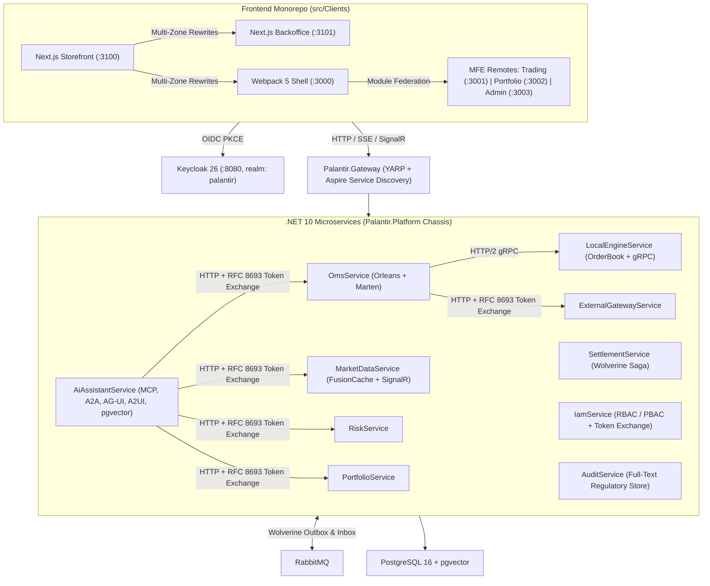
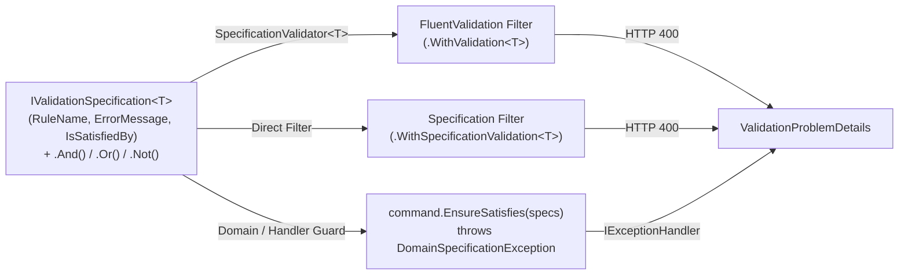
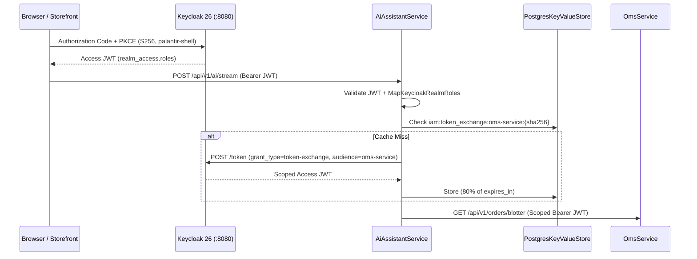
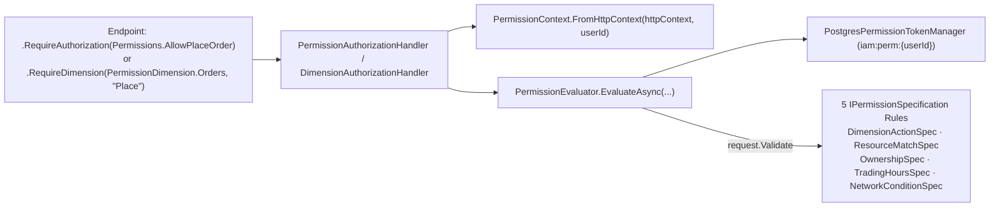
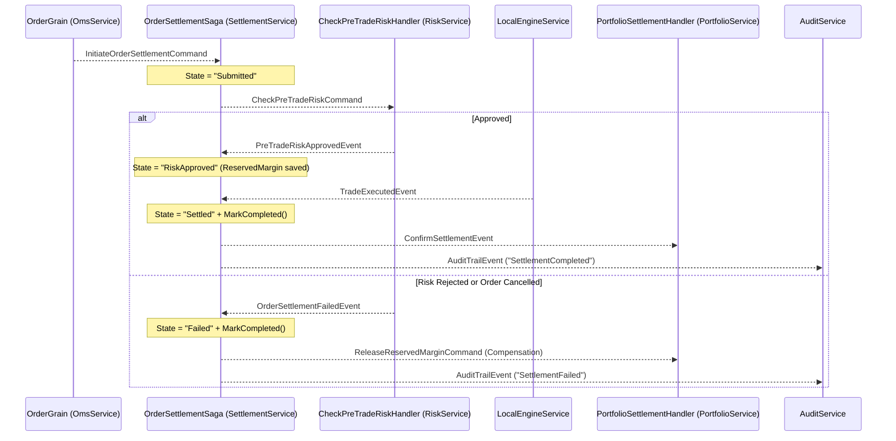

# Palantir Cloud-Native Trading Platform — Developer Tutorial & Architecture Guide

> **Audience**: Software engineers onboarding to or extending the Palantir Trading Platform (`src/`, `tests/`, `deploy/`, `docs/`).  
> **Format**: Hands-on architectural tutorial covering all **21 core capabilities** of the solution—each with problem context, step-by-step walkthroughs, real source code, and an **"Extend It Yourself"** recipe—followed by a concise **Known Caveats & Roadmap** appendix.

---

## Getting Started & Solution Map

### Prerequisites
- **.NET 10 SDK** (solution targets .NET 10 via [`Palantir.slnx`](../Palantir.slnx) and [`Directory.Packages.props`](../Directory.Packages.props))
- **Docker Desktop** or **Podman** (runs PostgreSQL 16 + `pgvector`, RabbitMQ, Keycloak 26, and pgAdmin)
- **Node.js 20+** (for [`src/Clients/`](../src/Clients/))

### Boot the Entire Distributed System in Two Commands
```bash
# 1. Install frontend workspace dependencies (first run only)
cd src/Clients && npm install && cd ../..

# 2. Launch Aspire AppHost (containers + Gateway + 10 services + 6 frontend apps)
dotnet run --project src/Aspire/Palantir.AppHost --launch-profile http
```

### Platform Topology



---

## Tutorial Chapters

1. [Cloud-Native Orchestration with .NET Aspire & Service Defaults](#1-cloud-native-orchestration-with-net-aspire--service-defaults)
2. [Dynamic Edge Routing with YARP & Aspire Service Discovery](#2-dynamic-edge-routing-with-yarp--aspire-service-discovery)
3. [Microservices Chassis (`Palantir.Platform`) & Convention-Based Endpoint Discovery](#3-microservices-chassis-palantirplatform--convention-based-endpoint-discovery)
4. [Vertical Slice Architecture, DDD, Strongly-Typed IDs & CQRS](#4-vertical-slice-architecture-ddd-strongly-typed-ids--cqrs)
5. [Specification Pattern Bridging API Validation to Domain Invariants](#5-specification-pattern-bridging-api-validation-to-domain-invariants)
6. [Centralized Exception Handling & RFC 9457 `ProblemDetails`](#6-centralized-exception-handling--rfc-9457-problemdetails)
7. [Roslyn Incremental Source Generator (`QueryBinderGenerator`)](#7-roslyn-incremental-source-generator-querybindergenerator)
8. [API Versioning & Feature Flag Management](#8-api-versioning--feature-flag-management)
9. [Zero-Trust AuthN/AuthZ: Keycloak, PKCE & RFC 8693 Token Exchange](#9-zero-trust-authnauthz-keycloak-pkce--rfc-8693-token-exchange)
10. [Dimensional PBAC: `PermissionContext`, `PermissionEvaluator` & `IPermissionSpecification`](#10-dimensional-pbac-permissioncontext-permissionevaluator--ipermissionspecification)
11. [Non-Blocking 4-Sink Channel Auditing & EF Core Interceptors](#11-non-blocking-4-sink-channel-auditing--ef-core-interceptors)
12. [High-Throughput Service-to-Service Communication with gRPC](#12-high-throughput-service-to-service-communication-with-grpc)
13. [Durable Messaging with WolverineFx Outbox, Inbox & Dead-Letter Handling](#13-durable-messaging-with-wolverinefx-outbox-inbox--dead-letter-handling)
14. [Distributed Saga Patterns: Stateful Orchestration & Event Choreography](#14-distributed-saga-patterns-stateful-orchestration--event-choreography)
15. [Event Sourcing, Async Projections & Stateful Virtual Actors (Marten + Orleans)](#15-event-sourcing-async-projections--stateful-virtual-actors-marten--orleans)
16. [Hybrid L1/L2 Caching with FusionCache & PostgreSQL `IDistributedCache`](#16-hybrid-l1l2-caching-with-fusioncache--postgresql-idistributedcache)
17. [Resilience, Rate Limiting & Background Job Scheduling (Quartz.NET)](#17-resilience-rate-limiting--background-job-scheduling-quartznet)
18. [Multi-Agent AI Copilot, `pgvector` Semantic Search & Protocols (MCP, A2A, AG-UI, A2UI, Governance)](#18-multi-agent-ai-copilot-pgvector-semantic-search--protocols-mcp-a2a-ag-ui-a2ui-governance)
19. [API & Event-Driven Documentation (OpenAPI, Scalar, AsyncAPI & EventCatalog)](#19-api--event-driven-documentation-openapi-scalar-asyncapi--eventcatalog)
20. [Modern Client Architecture: Workspaces, Module Federation, Next.js Multi-Zones & WCAG 2.1 AA](#20-modern-client-architecture-workspaces-module-federation-nextjs-multi-zones--wcag-21-aa)
21. [CI/CD Pipelines & Multi-Layered Testing / Architecture Governance](#21-cicd-pipelines--multi-layered-testing--architecture-governance)
- [Appendix: Known Caveats & Roadmap](#appendix-known-caveats--roadmap)

---

## 1. Cloud-Native Orchestration with .NET Aspire & Service Defaults

### Why & Problem Solved
Booting 11 .NET projects, PostgreSQL with `pgvector`, RabbitMQ, Keycloak, and 6 Node.js UIs manually requires fragile shell scripts, port coordination, and duplicated OpenTelemetry setup. Palantir centralizes topology, startup ordering, and telemetry inside [`Palantir.AppHost`](../src/Aspire/Palantir.AppHost/Program.cs) and [`Palantir.ServiceDefaults`](../src/Aspire/Palantir.ServiceDefaults/Extensions.cs).

### How Palantir Solves It
- **Single Composition Root (`Palantir.AppHost`)**: Declares infrastructure containers (`pgvector/pg16`, `rabbitmq`, `keycloak:26.0`), injects connection strings and `Keycloak__Url` into all microservices, and launches all 6 frontend dev servers via `AddFrontendUi`.
- **Shared Runtime Defaults (`Palantir.ServiceDefaults`)**: Every service invokes `builder.AddServiceDefaults()` and `app.MapDefaultEndpoints()` to receive Kestrel hardening (`AddServerHeader = false`), OpenTelemetry (`Palantir.*` + `Wolverine` traces), standard HTTP resilience, service discovery, and `/health` + `/alive` endpoints.

### Step-by-Step Code Walkthrough
1. **Provision Containers** in [`src/Aspire/Palantir.AppHost/Program.cs`](../src/Aspire/Palantir.AppHost/Program.cs#L7-L27): PostgreSQL uses `pgvector/pgvector:pg16` with a data volume and `pgAdmin`; Keycloak mounts [`deploy/keycloak/palantir-realm.json`](../deploy/keycloak/palantir-realm.json) with `--import-realm`.
2. **Wire Service Dependencies & Health Ordering** ([`Program.cs`](../src/Aspire/Palantir.AppHost/Program.cs#L52-L60)):

```csharp
// src/Aspire/Palantir.AppHost/Program.cs
var omsService = builder.AddProject<Projects.Palantir_OmsService>(AspireResourceNames.OmsService)
    .WithReference(palantirDb)
    .WithReference(rabbitmq)
    .WithReference(localEngine)
    .WithReference(externalGateway)
    .WithEnvironment("Keycloak__Url", keycloakHttp)
    .WaitFor(palantirDb)
    .WaitFor(rabbitmq)
    .WaitFor(localEngine);
```

3. **Apply Cross-Cutting Service Defaults** ([`Extensions.cs`](../src/Aspire/Palantir.ServiceDefaults/Extensions.cs#L17-L36)):

```csharp
// src/Aspire/Palantir.ServiceDefaults/Extensions.cs
public static IHostApplicationBuilder AddServiceDefaults(this IHostApplicationBuilder builder)
{
    if (builder is WebApplicationBuilder webBuilder)
    {
        webBuilder.WebHost.ConfigureKestrel(options => options.AddServerHeader = false);
    }

    builder.ConfigureOpenTelemetry();
    builder.AddDefaultHealthChecks();
    builder.Services.AddServiceDiscovery();
    builder.Services.AddDefaultOpenApi();

    builder.Services.ConfigureHttpClientDefaults(http =>
    {
        http.AddStandardResilienceHandler();
        http.AddServiceDiscovery();
    });

    return builder;
}
```

### Hands-On Recipe: Add a New Microservice to Aspire
1. Add a resource constant to `AspireResourceNames` in [`src/BuildingBlocks/Palantir.Constants/SystemConstants.cs`](../src/BuildingBlocks/Palantir.Constants/SystemConstants.cs#L3-L33).
2. In your new service's `Program.cs`, call `builder.AddServiceDefaults()` at startup and `app.MapDefaultEndpoints()` before `app.Run()`.
3. Register the project in [`src/Aspire/Palantir.AppHost/Program.cs`](../src/Aspire/Palantir.AppHost/Program.cs):
```csharp
var analyticsService = builder.AddProject<Projects.Palantir_AnalyticsService>("analytics-service")
    .WithReference(palantirDb)
    .WithReference(rabbitmq)
    .WithEnvironment("Keycloak__Url", keycloakHttp)
    .WaitFor(palantirDb)
    .WaitFor(rabbitmq);
```
4. Add `.WithReference(analyticsService)` to `gateway` so `Palantir.Gateway` receives its Aspire service discovery keys.

---

## 2. Dynamic Edge Routing with YARP & Aspire Service Discovery

### Why & Problem Solved
Because Aspire assigns dynamic local ports to backend microservices on each launch, browser SPAs and external HTTP callers need one stable edge gateway with CORS, REST, SignalR WebSockets, and SSE routing.

### How Palantir Solves It
[`Palantir.Gateway`](../src/Gateway/Palantir.Gateway/Program.cs) configures **YARP Reverse Proxy** using logical service names (`http://oms-service`) in [`appsettings.json`](../src/Gateway/Palantir.Gateway/appsettings.json) and resolves those names at proxy startup via a custom [`AspireServiceDiscoveryDestinationResolver`](../src/Gateway/Palantir.Gateway/AspireServiceDiscoveryDestinationResolver.cs).

### Step-by-Step Code Walkthrough
1. **Declare Routes & Logical Clusters** in [`src/Gateway/Palantir.Gateway/appsettings.json`](../src/Gateway/Palantir.Gateway/appsettings.json#L21-L160): routes map `/api/v1/orders/{**catch-all}` -> `oms-cluster` (`http://oms-service`), `/hubs/marketdata/{**catch-all}` -> `market-cluster`, `/mcp/{**catch-all}` -> `ai-cluster`, etc.
2. **Resolve Logical Hosts from Aspire Config** in [`AspireServiceDiscoveryDestinationResolver.cs`](../src/Gateway/Palantir.Gateway/AspireServiceDiscoveryDestinationResolver.cs#L17-L49):

```csharp
// src/Gateway/Palantir.Gateway/AspireServiceDiscoveryDestinationResolver.cs
if (Uri.TryCreate(dest.Address, UriKind.Absolute, out var uri))
{
    var host = uri.Host;
    var resolvedUrl = _configuration[$"services:{host}:http:0"]
                      ?? _configuration[$"services:{host}:https:0"]
                      ?? _configuration[$"services:{host}:default:0"];

    if (!string.IsNullOrEmpty(resolvedUrl))
    {
        resolved[key] = new DestinationConfig
        {
            Address = resolvedUrl,
            Health = dest.Health,
            Metadata = dest.Metadata,
            Host = dest.Host
        };
        continue;
    }
}
```

3. **Enable CORS for All Microfrontends** in [`Palantir.Gateway/Program.cs`](../src/Gateway/Palantir.Gateway/Program.cs#L18-L46): `AllowMicroUI` permits `:3000`–`:3003` and `:3100`–`:3101` with credentials.

### Hands-On Recipe: Expose a New Service Route Through the Gateway
1. In `Palantir.AppHost/Program.cs`, chain `.WithReference(yourService)` onto `gateway`.
2. Add a route and cluster entry in [`src/Gateway/Palantir.Gateway/appsettings.json`](../src/Gateway/Palantir.Gateway/appsettings.json):
```json
"Routes": {
  "analytics-route": {
    "ClusterId": "analytics-cluster",
    "Match": { "Path": "/api/v1/analytics/{**catch-all}" },
    "Transforms": [{ "PathPattern": "/api/v1/analytics/{**catch-all}" }]
  }
},
"Clusters": {
  "analytics-cluster": {
    "Destinations": {
      "destination1": { "Address": "http://analytics-service" }
    }
  }
}
```

---

## 3. Microservices Chassis (`Palantir.Platform`) & Convention-Based Endpoint Discovery

### Why & Problem Solved
Copy-pasting JWT authentication, caching, ProblemDetails, versioning, endpoint discovery, auditing, health checks, and rate limiting across 10 `Program.cs` files causes subtle drift. `Palantir.Platform` provides a two-line **Microservices Chassis** (`AddPalantirChassis` + `UsePalantirChassis`).

### How Palantir Solves It
[`ServiceChassisExtensions`](../src/BuildingBlocks/Palantir.Platform/ServiceChassisExtensions.cs) registers the entire cross-cutting stack in one call, while [`EndpointExtensions`](../src/BuildingBlocks/Palantir.Platform/Endpoints/EndpointExtensions.cs) uses **Scrutor** assembly scanning to auto-register and map every `IEndpoint` class onto `/api/v{version:apiVersion}`.

### Step-by-Step Code Walkthrough
1. **Boot the Chassis** in [`ServiceChassisExtensions.cs`](../src/BuildingBlocks/Palantir.Platform/ServiceChassisExtensions.cs#L20-L55):

```csharp
// src/BuildingBlocks/Palantir.Platform/ServiceChassisExtensions.cs
public static WebApplicationBuilder AddPalantirChassis(
    this WebApplicationBuilder builder,
    Assembly serviceAssembly)
{
    var connectionString = builder.Configuration.GetConnectionString(AspireResourceNames.PalantirDb)
                           ?? "Host=localhost;Database=PalantirDb;Username=postgres;Password=postgres";

    builder.Services.AddPalantirCaching(connectionString);
    builder.Services.AddPalantirSecurity(keycloakUrl);
    builder.Services.AddPalantirJwtAuthentication(builder.Configuration);
    builder.Services.AddPalantirProblemDetails();
    builder.Services.AddPalantirApiVersioning();
    builder.Services.AddPalantirFeatureFlags();
    builder.Services.AddPalantirValidators(serviceAssembly);
    builder.Services.AddEndpoints(serviceAssembly);
    builder.Services.AddPalantirAuditing(connectionString);
    builder.Services.AddPalantirHealthChecks(connectionString);
    builder.Services.AddPalantirRateLimiting();
    return builder;
}
```

2. **Auto-Discover `IEndpoint` Slices** in [`EndpointExtensions.cs`](../src/BuildingBlocks/Palantir.Platform/Endpoints/EndpointExtensions.cs#L43-L89): `AddEndpoints` scans `publicOnly: false` so endpoints can stay `internal sealed`, and `MapEndpoints` binds them into the `V1` versioned route group.

### Hands-On Recipe: Create a Convention-Compliant Minimal API Endpoint
1. Create a `sealed` class implementing `IEndpoint` inside `Features/<Area>/<Action>/` (required by `Palantir.ArchTests`):
```csharp
internal sealed class PingAnalyticsEndpoint : IEndpoint
{
    public void MapEndpoint(IEndpointRouteBuilder app)
    {
        app.MapGet("/analytics/ping", () => TypedResults.Ok(new { status = "ok" }))
            .ProducesGet<object>()
            .WithTags("Analytics")
            .MapToApiVersion(ApiVersioningExtensions.V1)
            .RequireAuthorization();
    }
}
```
2. Nothing else is required in `Program.cs`—`AddPalantirChassis(typeof(Program).Assembly)` and `UsePalantirChassis()` discover and map it automatically at `/api/v1/analytics/ping`.

---

## 4. Vertical Slice Architecture, DDD, Strongly-Typed IDs & CQRS

### Why & Problem Solved
Layered `Controllers/Services/Repositories` scatter single features across multiple folders and invite primitive obsession (`Guid orderId, Guid clientId` swapped accidentally). Palantir combines **Vertical Slice Architecture** (`Features/`) with **DDD Aggregates** and **Vogen** strongly-typed IDs in [`Palantir.SharedKernel`](../src/BuildingBlocks/Palantir.SharedKernel/).

### How Palantir Solves It
- **Zero-Dependency Kernel (`Palantir.SharedKernel`)**: Contains `Entity<TId>`, `AggregateRoot<TId>`, `DomainEvent`, `Order` / `Trade` aggregates, `Vogen` IDs (`OrderId`, `ClientId`, `SymbolId`), and `Money`/`Price`/`Quantity` value objects.
- **Vertical Slices (`Features/`)**: Each endpoint, command/query record, validator, and handler lives together in one file/folder (e.g., [`CreateOrderFeature.cs`](../src/Services/Oms/Palantir.OmsService/Features/Orders/Create/CreateOrderFeature.cs)), dispatched via Wolverine `IMessageBus.InvokeAsync<T>(command)` while read slices query Marten projections or EF Core directly (CQRS).

### Step-by-Step Code Walkthrough
1. **Strongly-Typed Identifiers** in [`Identifiers.cs`](../src/BuildingBlocks/Palantir.SharedKernel/Identifiers.cs#L5-L31):

```csharp
// src/BuildingBlocks/Palantir.SharedKernel/Identifiers.cs
[ValueObject<Guid>]
public readonly partial struct OrderId
{
    private static Validation Validate(Guid value) =>
        value != Guid.Empty ? Validation.Ok : Validation.Invalid("OrderId cannot be empty.");
}

[ValueObject<string>]
public readonly partial struct SymbolId
{
    private static Validation Validate(string value) =>
        !string.IsNullOrWhiteSpace(value) ? Validation.Ok : Validation.Invalid("SymbolId cannot be empty.");
}
```

2. **Aggregate State Transitions & Domain Events** in [`Aggregates/Order.cs`](../src/BuildingBlocks/Palantir.SharedKernel/Aggregates/Order.cs#L84-L121): `Order.ApplyExecution` validates terminal state and remaining quantity, records a `Trade`, recalculates weighted average fill price, transitions between `PartiallyFilled` and `Filled`, and raises `OrderExecutionAppliedDomainEvent`.

### Hands-On Recipe: Add a New Vertical Slice Command
1. Create `src/Services/Oms/Palantir.OmsService/Features/Orders/Pause/PauseOrderFeature.cs`.
2. Define `public sealed record PauseOrderCommand(Guid OrderId, string Reason);`.
3. Define `internal sealed class PauseOrderHandler` + `internal sealed class PauseOrderEndpoint : IEndpoint`.
4. Dispatch via Wolverine in `MapEndpoint`: `await bus.InvokeAsync<OrderStateSnapshot>(command, ct)`.

---

## 5. Specification Pattern Bridging API Validation to Domain Invariants

### Why & Problem Solved
If HTTP DTO validators and domain handlers implement separate validation logic, business rules inevitably diverge—and messages arriving via RabbitMQ or gRPC bypass HTTP validators entirely. Palantir uses **`IValidationSpecification<T>`** so **one specification class** runs at the HTTP edge, inside FluentValidation, and inside domain/application handlers.



### How Palantir Solves It
- **Core Contracts in `Palantir.SharedKernel`** ([`Specifications.cs`](../src/BuildingBlocks/Palantir.SharedKernel/Specifications.cs#L76-L195)): `IValidationSpecification<T>`, boolean combinators (`And`, `Or`, `Not`), non-short-circuiting `entity.Validate(...)`, and `entity.EnsureSatisfies(...)` (which throws `DomainSpecificationException`).
- **HTTP Bridge in `Palantir.Platform`** ([`SpecificationValidatorAdapter.cs`](../src/BuildingBlocks/Palantir.Platform/Validation/SpecificationValidatorAdapter.cs), [`FluentValidationExtensions.cs`](../src/BuildingBlocks/Palantir.Platform/Validation/FluentValidationExtensions.cs)): `SpecificationValidator<T>` exposes `UseSpecification(...)` inside `AbstractValidator<T>`.

### Step-by-Step Code Walkthrough
1. **Define Reusable Specifications** in [`CreateOrderFeature.cs`](../src/Services/Oms/Palantir.OmsService/Features/Orders/Create/CreateOrderFeature.cs#L30-L51):

```csharp
// src/Services/Oms/Palantir.OmsService/Features/Orders/Create/CreateOrderFeature.cs
public sealed class LimitOrderPriceSpecification : ValidationSpecification<CreateOrderCommand>
{
    public override string RuleName => nameof(CreateOrderCommand.Price);
    public override string ErrorMessage => "Limit and StopLimit orders require a positive price.";
    public override bool IsSatisfiedBy(CreateOrderCommand cmd) =>
        cmd.Type is not (OrderType.Limit or OrderType.StopLimit) || cmd.Price > 0;
}
```

2. **Bind to the HTTP Edge** via `SpecificationValidator<T>` and `.WithValidation<CreateOrderCommand>()`:

```csharp
public sealed class CreateOrderValidator : SpecificationValidator<CreateOrderCommand>
{
    public CreateOrderValidator()
    {
        RuleFor(x => x.ClientId).NotEmpty();
        UseSpecification(new OrderSymbolSpecification());
        UseSpecification(new OrderQuantitySpecification());
        UseSpecification(new LimitOrderPriceSpecification());
    }
}
```

3. **Enforce the Same Specs in the Handler/Domain** ([`CreateOrderFeature.cs`](../src/Services/Oms/Palantir.OmsService/Features/Orders/Create/CreateOrderFeature.cs#L68-L78)):

```csharp
private static readonly IValidationSpecification<CreateOrderCommand>[] DomainSpecs =
[
    new OrderSymbolSpecification(),
    new OrderQuantitySpecification(),
    new LimitOrderPriceSpecification()
];

public async Task<OrderStateSnapshot> Handle(CreateOrderCommand command, CancellationToken ct)
{
    command.EnsureSatisfies(DomainSpecs); // Protects HTTP + Wolverine bus callers alike
    ...
}
```

### Hands-On Recipe: Write & Compose a New Specification Rule
1. Create a specification class inheriting `ValidationSpecification<TRequest>` inside your vertical slice.
2. Optionally compose multiple specs with `.And(...)`, `.Or(...)`, or `.Not()` (e.g., `new PositivePriceSpec().And(new MaxNotionalSpec())`).
3. Register it in your `sealed class <Feature>Validator : SpecificationValidator<TRequest>` via `UseSpecification(spec)` **and** attach `.WithValidation<TRequest>()` on the endpoint.
4. Call `request.EnsureSatisfies(spec)` at the start of your handler so internal Wolverine/gRPC callers enforce the identical rule.

---

## 6. Centralized Exception Handling & RFC 9457 `ProblemDetails`

### Why & Problem Solved
Throwing `DomainSpecificationException` inside a handler or aggregate should produce the exact same HTTP 400 `ValidationProblemDetails` payload as an HTTP input validation failure—with distributed trace IDs attached and zero leaked stack traces.

### How Palantir Solves It
[`ProblemDetailsExtensions.cs`](../src/BuildingBlocks/Palantir.Platform/Exceptions/ProblemDetailsExtensions.cs) registers `DomainSpecificationExceptionHandler` (`IExceptionHandler`) and customizes `AddProblemDetails` to inject `Instance`, `traceId`, and `timestamp`.

### Step-by-Step Code Walkthrough
1. `AddPalantirChassis` registers `AddPalantirProblemDetails()`, and `UsePalantirChassis` activates `app.UseExceptionHandler()`.
2. When `EnsureSatisfies(...)` throws `DomainSpecificationException`, [`DomainSpecificationExceptionHandler`](../src/BuildingBlocks/Palantir.Platform/Exceptions/ProblemDetailsExtensions.cs#L36-L61) intercepts it:

```csharp
// src/BuildingBlocks/Palantir.Platform/Exceptions/ProblemDetailsExtensions.cs
var errors = specException.Failures
    .GroupBy(f => f.RuleName)
    .ToDictionary(g => g.Key, g => g.Select(f => f.ErrorMessage).ToArray());

var problem = new ValidationProblemDetails(errors)
{
    Status = StatusCodes.Status400BadRequest,
    Title = "Domain specification validation failed."
};
httpContext.Response.StatusCode = StatusCodes.Status400BadRequest;
await httpContext.Response.WriteAsJsonAsync(problem, cancellationToken);
```

### Hands-On Recipe: Map a Custom Domain Exception to HTTP 409/422
1. Implement `IExceptionHandler` in `Palantir.Platform/Exceptions/` (e.g., `OrderStateConflictExceptionHandler`) returning `StatusCodes.Status409Conflict`.
2. Register `services.AddExceptionHandler<OrderStateConflictExceptionHandler>();` inside `AddPalantirProblemDetails()` before the fallback handler.

---

## 7. Roslyn Incremental Source Generator (`QueryBinderGenerator`)

### Why & Problem Solved
Binding many optional query-string parameters in Minimal APIs manually is verbose, and runtime reflection slows startup. Palantir includes a Roslyn incremental source generator (`Palantir.Generators`) that emits compile-time `FromQuery(IQueryCollection)` extensions.

### How Palantir Solves It
[`QueryBinderGenerator`](../src/BuildingBlocks/Palantir.Generators/QueryBinderGenerator.cs) inspects classes decorated with `[QueryBindable]` from [`Palantir.Generators.Abstractions`](../src/BuildingBlocks/Palantir.Generators.Abstractions/Attributes.cs) and generates `<ClassName>BinderExtensions.FromQuery(IQueryCollection query)` supporting `string`, `int`, `decimal`, `long`, `bool`, and `Guid`.

### Step-by-Step Code Walkthrough
1. **Mark a Query DTO** with `[QueryBindable]` and optional `[QueryParamName("key")]`.
2. **Compile-Time Code Generation** in [`QueryBinderGenerator.cs`](../src/BuildingBlocks/Palantir.Generators/QueryBinderGenerator.cs#L13-L25):

```csharp
// src/BuildingBlocks/Palantir.Generators/QueryBinderGenerator.cs
var classDeclarations = context.SyntaxProvider
    .CreateSyntaxProvider(
        predicate: static (s, _) => s is ClassDeclarationSyntax c && c.AttributeLists.Count > 0,
        transform: static (ctx, _) => GetSemanticTargetForGeneration(ctx))
    .Where(static m => m is not null);
```

### Hands-On Recipe: Bind a Query Object with `[QueryBindable]`
1. Reference `Palantir.Generators.Abstractions` and add `<ProjectReference Include="...\Palantir.Generators.csproj" OutputItemType="Analyzer" ReferenceOutputAssembly="false" />`.
2. Annotate your query class:
```csharp
[QueryBindable]
public sealed class BlotterFilterQuery
{
    public string? Symbol { get; set; }
    [QueryParamName("max_rows")] public int? Limit { get; set; }
}
```
3. Inside your `IEndpoint`, parse directly with zero reflection: `var filter = BlotterFilterQueryBinderExtensions.FromQuery(httpContext.Request.Query);`.

---

## 8. API Versioning & Feature Flag Management

### Why & Problem Solved
Microservices need clean URL/header versioning (`/api/v1/...`) and runtime kill-switches to enable or disable endpoints without redeploying containers.

### How Palantir Solves It
- **Versioning**: [`ApiVersioningExtensions.cs`](../src/BuildingBlocks/Palantir.Platform/Endpoints/ApiVersioningExtensions.cs) combines `UrlSegmentApiVersionReader` and `HeaderApiVersionReader("api-version")` with `DefaultApiVersion = V1`.
- **Feature Flags**: [`FeatureFlagExtensions.cs`](../src/BuildingBlocks/Palantir.Platform/FeatureFlags/FeatureFlagExtensions.cs) wraps `Microsoft.FeatureManagement` with `.RequireFeature("FlagName")`.

### Step-by-Step Code Walkthrough
1. `EndpointExtensions.MapEndpoints` groups every service endpoint under `/api/v{version:apiVersion}` using `app.NewV1ApiVersionSet()`.
2. Endpoints declare `.MapToApiVersion(ApiVersioningExtensions.V1)` and optionally `.RequireFeature("EnableExternalRouting")`.

```csharp
// src/BuildingBlocks/Palantir.Platform/FeatureFlags/FeatureFlagExtensions.cs
public static RouteHandlerBuilder RequireFeature(this RouteHandlerBuilder builder, string featureName) =>
    builder.AddEndpointFilter(async (context, next) =>
    {
        var featureManager = context.HttpContext.RequestServices.GetRequiredService<IFeatureManager>();
        if (!await featureManager.IsEnabledAsync(featureName))
            return Results.NotFound(new { Message = $"Feature '{featureName}' is currently disabled." });
        return await next(context);
    });
```

### Hands-On Recipe: Gate a New Endpoint Behind a Feature Flag
1. Add `"FeatureManagement": { "BetaAiCopilot": true }` to `appsettings.json`.
2. Append `.RequireFeature("BetaAiCopilot")` to your `IEndpoint` route builder chain; toggling the flag to `false` immediately returns HTTP `404` without restarting or changing code.

---

## 9. Zero-Trust AuthN/AuthZ: Keycloak, PKCE & RFC 8693 Token Exchange

### Why & Problem Solved
Browser clients must log in without embedding client secrets (PKCE), every microservice must validate JWTs independently, and downstream service-to-service calls should narrow token scope via **RFC 8693 Token Exchange** rather than forwarding broad user tokens.



### How Palantir Solves It
- **Keycloak Realm**: [`deploy/keycloak/palantir-realm.json`](../deploy/keycloak/palantir-realm.json) pre-provisions `Admin`, `Trader`, `RiskOfficer`, `Auditor` roles, seeded users, and `palantir-shell` (`pkce.code.challenge.method: S256`).
- **PKCE Helpers**: [`src/Clients/storefront/lib/auth.ts`](../src/Clients/storefront/lib/auth.ts) builds `PkceConfig` and SHA-256 `createPkceChallenge`.
- **JWT + Role Claim Extraction**: [`Security.cs`](../src/BuildingBlocks/Palantir.Platform/Security/Security.cs#L297-L377) validates `ValidIssuer` and flattens Keycloak's nested `realm_access.roles` JSON claim into `ClaimsPrincipal` role claims.
- **RFC 8693 Token Exchange**: `KeycloakTokenExchangeService` + `TokenExchangeDelegatingHandler` automatically exchange incoming user tokens for target service audiences and cache them by SHA-256 hash.

### Step-by-Step Code Walkthrough
1. **Attach Token Exchange to Outbound Clients** (as done in [`AiAssistantService/Program.cs`](../src/Services/AiAssistant/Palantir.AiAssistantService/Program.cs#L38-L45) and [`OmsService/Program.cs`](../src/Services/Oms/Palantir.OmsService/Program.cs#L91-L99)):

```csharp
// src/Services/AiAssistant/Palantir.AiAssistantService/Program.cs
builder.Services.AddHttpClient("oms", client =>
    client.BaseAddress = new Uri($"http://{AspireResourceNames.OmsService}"))
    .AddTokenExchangeHandler(AspireResourceNames.OmsService);
```

2. **Exchange & Cache in `KeycloakTokenExchangeService`** ([`Security.cs`](../src/BuildingBlocks/Palantir.Platform/Security/Security.cs#L61-L98)): hashes `incomingUserToken`, checks `MessagingConstants.CacheKeys.TokenExchange(targetAudience, tokenHash)`, posts `urn:ietf:params:oauth:grant-type:token-exchange` to Keycloak, and stores the result for `expires_in * 0.8`.

### Hands-On Recipe: Add Token Exchange to a New Downstream HttpClient
1. Ensure the target service's `Program.cs` calls `AddPalantirChassis(...)` (which wires `AddPalantirJwtAuthentication`).
2. Register the caller's typed or named `HttpClient` with `.AddTokenExchangeHandler("your-target-service")`.
3. For gRPC clients, pass the audience as the second parameter of `AddResilientGrpcClient<TClient>(uri, "your-target-service")`.

---

## 10. Dimensional PBAC: `PermissionContext`, `PermissionEvaluator` & `IPermissionSpecification`

### Why & Problem Solved
Role checks (`Admin`, `Trader`) cannot answer contextual questions like *"Can this user `Place` an `Order` during `MarketState = OPEN` over VPN on an account they own?"*. Palantir implements **Dimensional Policy-Based Access Control (PBAC)** by unifying runtime context capture (`PermissionContext`), resource descriptors (`ResourceTemplate`), cached grants (`PermissionToken`), and composable `IPermissionSpecification` rules inside `PermissionEvaluator`.



### How Palantir Solves It
1. **Permission Dimensions & Templates**: [`PermissionDimension.cs`](../src/BuildingBlocks/Palantir.Platform/Security/Permissions/PermissionDimension.cs) defines 8 functional domains (`Orders`, `MarketData`, `Risk`, `Portfolio`, `Settlement`, `Audit`, `Iam`, `System`), and [`ResourceTemplate.cs`](../src/BuildingBlocks/Palantir.Platform/Security/Permissions/ResourceTemplate.cs) captures `Type`, `Id`, and `OwnerId`.
2. **Environmental Context (`PermissionContext`)**: [`PermissionContext.cs`](../src/BuildingBlocks/Palantir.Platform/Security/Permissions/PermissionContext.cs#L19-L34) extracts `EvaluatedAtUtc`, `SubjectUserId`, `ClientIpAddress`, `MarketState` (`X-Market-State`), `IsVpnConnected` (`X-VPN-Connected`), and `TenantId` (`X-Tenant-Id`) from `HttpContext`.
3. **Specification-Based Evaluator (`PermissionEvaluator`)**: [`PermissionEvaluator.cs`](../src/BuildingBlocks/Palantir.Platform/Security/Permissions/PermissionEvaluator.cs#L32-L87) retrieves the user's `PermissionToken` from PostgreSQL (`platform_cache`), converts permission strings into `PermissionGrant`s, builds `PermissionEvaluationRequest(dimension, action, resource, context, grant)`, and calls `request.Validate(_specifications)`.

### Step-by-Step Code Walkthrough
1. **Write Contextual Rules Using `IPermissionSpecification`** ([`PermissionSpecifications.cs`](../src/BuildingBlocks/Palantir.Platform/Security/Permissions/PermissionSpecifications.cs#L35-L95)):

```csharp
// src/BuildingBlocks/Palantir.Platform/Security/Permissions/PermissionSpecifications.cs
public sealed class TradingHoursSpec : IPermissionSpecification
{
    public string RuleName => "TradingHours";
    public string ErrorMessage => "Operation is not permitted in the current market state.";

    public bool IsSatisfiedBy(PermissionEvaluationRequest req)
    {
        if (req.Grant.Conditions is null ||
            !req.Grant.Conditions.TryGetValue("MarketState", out var requiredState))
            return true;

        return req.Context.MarketState is not null &&
               req.Context.MarketState.Equals(requiredState, StringComparison.OrdinalIgnoreCase);
    }
}
```

2. **Evaluate All Registered Specifications per Grant** ([`PermissionEvaluator.cs`](../src/BuildingBlocks/Palantir.Platform/Security/Permissions/PermissionEvaluator.cs#L54-L72)):

```csharp
public PermissionEvaluationResult EvaluateGrants(
    IEnumerable<PermissionGrant> grants,
    PermissionDimension dimension,
    string action,
    ResourceTemplate resource,
    PermissionContext context)
{
    foreach (var grant in grants)
    {
        var request = new PermissionEvaluationRequest(dimension, action, resource, context, grant);
        if (request.Validate(_specifications).IsValid)
            return new PermissionEvaluationResult(true);
    }

    return new PermissionEvaluationResult(false, $"No grant satisfies {dimension.Name}:{action} on {resource.Type}.");
}
```

3. **Hydrate & Assign Permissions via `IamService`**: [`AssignPermissionsEndpoint`](../src/Services/Iam/Palantir.IamService/Features/UserPermissions/Assign/AssignPermissionsFeature.cs) updates `TradingProfile.AssignedPermissions`, writes `PermissionToken` to `IPermissionTokenManager`, and publishes `PermissionsUpdatedIntegrationEvent`.

### Hands-On Recipe: Add a Custom `IPermissionSpecification` & Protect an Endpoint
1. Implement `IPermissionSpecification` (e.g., `TenantIsolationSpec` checking `req.Grant.Conditions["TenantId"] == req.Context.TenantId`).
2. Register it in [`Security.cs`](../src/BuildingBlocks/Palantir.Platform/Security/Security.cs#L254-L258):
   `services.TryAddEnumerable(ServiceDescriptor.Singleton<IPermissionSpecification, TenantIsolationSpec>());`
3. Protect any Minimal API endpoint with either a named policy (`.RequireAuthorization(Permissions.AllowPlaceOrder)`) or dimensional check (`.RequireDimension(PermissionDimension.Orders, "Place", "Order")`).
4. Hydrate the user's cached `PermissionToken` before calling protected endpoints via `POST /api/v1/iam/token/exchange?userId=<guid>` or `PUT /api/v1/iam/users/{id}/permissions`.

---

## 11. Non-Blocking 4-Sink Channel Auditing & EF Core Interceptors

### Why & Problem Solved
Compliance requires auditing every order and permission mutation, yet synchronous SQL/broker writes on the request thread ruin trading latency. Palantir separates fast `O(1)` event emission from batched background persistence across 4 sinks.

### How Palantir Solves It
- **Bounded Channel Pipeline**: [`ChannelAuditEmitter`](../src/BuildingBlocks/Palantir.Platform/Auditing/ChannelAuditEmitter.cs) pushes `AuditEntry` records into a `10,000`-capacity `Channel<AuditEntry>` (`TryWrite`), while [`AuditPipelineService`](../src/BuildingBlocks/Palantir.Platform/Auditing/AuditPipelineService.cs) drains batches of 100 entries in parallel across `PostgresAuditSink` (Npgsql binary `COPY`), `OtlpAuditSink`, `StructuredLogAuditSink`, and optional `RabbitMqAuditSink`.
- **EF Core Interceptors**: [`Interceptors.cs`](../src/BuildingBlocks/Palantir.Platform/Persistence/Interceptors.cs) provides `PublishDomainEventsInterceptor` and `AuditableEntityInterceptor` (auto-stamping `CreatedAtUtc`/`CreatedBy`/`LastModified*` and converting deletes on `ISoftDeletable` to soft deletes).

### Step-by-Step Code Walkthrough
```csharp
// src/Services/Oms/Palantir.OmsService/Features/Orders/Create/CreateOrderFeature.cs
auditEmitter.Emit(AuditEntry.Create(
    "OrderSubmitted", "OmsService", "Order", snapshot.OrderId.ToString(), "Create",
    new Dictionary<string, object?> { ["Symbol"] = request.Symbol, ["Quantity"] = request.Quantity },
    command.ClientId.ToString()));
```

### Hands-On Recipe: Emit Audit Events & Add a Custom Sink
1. Inject `IAuditEmitter` into any handler and call `auditEmitter.Emit(AuditEntry.Create(...))`.
2. To add a new sink (e.g., S3/Azure Blob), implement `IAuditSink.FlushAsync(IReadOnlyList<AuditEntry> batch, CancellationToken ct)` and register `services.AddSingleton<IAuditSink, BlobAuditSink>()`.
3. To enable automatic EF Core audit stamps on a `DbContext`, resolve `AuditableEntityInterceptor` and attach `.AddInterceptors(interceptor)` inside `AddDbContext<T>`.

---

## 12. High-Throughput Service-to-Service Communication with gRPC

### Why & Problem Solved
Order dispatch between `OmsService` and `LocalEngineService` requires binary serialization, HTTP/2 multiplexing, and typed retry policies instead of JSON/REST overhead.

### How Palantir Solves It
[`matching_engine.proto`](../src/BuildingBlocks/Palantir.Platform/Protos/matching_engine.proto) defines `MatchingEngineGrpc` (`SubmitOrder`, `CancelOrder`, `GetOrderBook`), [`GrpcExtensions.cs`](../src/BuildingBlocks/Palantir.Platform/Grpc/GrpcExtensions.cs) configures automatic retry backoff (`Unavailable`, `ResourceExhausted`) + RFC 8693 token exchange, and [`ExecutionRouter`](../src/Services/Oms/Palantir.OmsService/Execution/ExecutionRouter.cs) abstracts `Local` (gRPC) vs `External` (HTTP) venues behind `IVenueDispatcher`.

### Step-by-Step Code Walkthrough
1. **Protobuf Contract**: Serializes `quantity` and `price` as invariant strings to prevent IEEE-754 rounding drift.
2. **Client Registration** in [`OmsService/Program.cs`](../src/Services/Oms/Palantir.OmsService/Program.cs#L91-L93):

```csharp
// src/Services/Oms/Palantir.OmsService/Program.cs
builder.Services.AddResilientGrpcClient<MatchingEngineGrpc.MatchingEngineGrpcClient>(
    localEngineUri,
    AspireResourceNames.LocalEngineService);
```

3. **Server Implementation**: [`MatchingEngineGrpcService`](../src/Services/Execution/Palantir.LocalEngineService/Grpc/MatchingEngineGrpcService.cs) parses arguments, calls `book.Match(entry)` on the in-memory `OrderBook`, and publishes execution ticks via RabbitMQ.

### Hands-On Recipe: Add a New RPC Method to `MatchingEngineGrpc`
1. Add the `rpc` and `message` definitions to [`src/BuildingBlocks/Palantir.Platform/Protos/matching_engine.proto`](../src/BuildingBlocks/Palantir.Platform/Protos/matching_engine.proto).
2. Override the newly generated method in [`MatchingEngineGrpcService.cs`](../src/Services/Execution/Palantir.LocalEngineService/Grpc/MatchingEngineGrpcService.cs).
3. Call it from [`LocalGrpcVenueDispatcher`](../src/Services/Oms/Palantir.OmsService/Execution/ExecutionRouter.cs#L24-L79) using the injected `_grpcClient`.

---

## 13. Durable Messaging with WolverineFx Outbox, Inbox & Dead-Letter Handling

### Why & Problem Solved
Publishing an event to RabbitMQ right after `SaveChangesAsync()` creates a dual-write race: if the broker fails or the process crashes mid-way, state and events go out of sync.

### How Palantir Solves It
[`WolverineExtensions.cs`](../src/BuildingBlocks/Palantir.Platform/Messaging/WolverineExtensions.cs) configures **WolverineFx** with PostgreSQL-backed durable outbox/inbox tables (`"wolverine"` schema), automatic transaction wrapping, RabbitMQ auto-provisioning, and exception-specific dead-letter policies in [`DeadLetterExtensions.cs`](../src/BuildingBlocks/Palantir.Platform/Messaging/DeadLetterExtensions.cs).

### Step-by-Step Code Walkthrough
```csharp
// src/BuildingBlocks/Palantir.Platform/Messaging/WolverineExtensions.cs
opts.UseRabbitMq(new Uri(rabbitMqConnectionString))
    .AutoProvision()
    .DisableSystemRequestReplyQueueDeclaration();

opts.PersistMessagesWithPostgresql(postgresConnectionString, "wolverine");
if (useEntityFrameworkCore) opts.UseEntityFrameworkCoreTransactions();

opts.Policies.AutoApplyTransactions();
opts.Policies.UseDurableLocalQueues();
opts.Policies.UseDurableOutboxOnAllSendingEndpoints();
opts.Policies.UseDurableInboxOnAllListeners();
opts.AddPalantirDeadLetterHandling();
```

### Hands-On Recipe: Publish & Consume a New Durable Integration Event
1. Define the integration event record in your service's `IntegrationEvents/Events/` folder (keeping zero cross-service project references—duplicate or share contract shapes cleanly per bounded context).
2. In the publisher's `Program.cs`, configure routing inside `AddPalantirMessaging`:
   `opts.PublishMessage<YourEvent>().ToRabbitQueue("your.queue.v1");`
3. In the consumer's `Program.cs`, add `opts.ListenToRabbitQueue("your.queue.v1");` and create a `Handlers/YourEventHandler.cs` class with `public Task Handle(YourEvent evt, CancellationToken ct)`.

---

## 14. Distributed Saga Patterns: Stateful Orchestration & Event Choreography

### Why & Problem Solved
Order settlement spans OMS, Risk, Execution, Portfolio, and Audit without distributed 2PC locks—and must cleanly compensate (release reserved margin) when an order cancels or fails pre-trade risk.



### How Palantir Solves It
- **Orchestration**: [`OrderSettlementSaga`](../src/Services/Settlement/Palantir.SettlementService/Sagas/OrderSettlementSaga.cs) subclasses Wolverine `Saga`, correlated by `OrderId` and persisted in PostgreSQL (`settlement` schema), driving state transitions and compensation.
- **Choreography**: Downstream handlers ([`CheckPreTradeRiskHandler`](../src/Services/Risk/Palantir.RiskService/Handlers/CheckPreTradeRiskHandler.cs), [`PortfolioSettlementHandler`](../src/Services/Portfolio/Palantir.PortfolioService/Handlers/PortfolioSettlementHandler.cs)) react autonomously to published commands/events.

### Step-by-Step Code Walkthrough
```csharp
// src/Services/Settlement/Palantir.SettlementService/Sagas/OrderSettlementSaga.cs
public static (OrderSettlementSaga, CheckPreTradeRiskCommand) Start(InitiateOrderSettlementCommand command)
{
    var saga = new OrderSettlementSaga { Id = command.OrderId, OrderId = command.OrderId, CurrentState = "Submitted", /* ... */ };
    return (saga, new CheckPreTradeRiskCommand(command.OrderId, command.ClientId, command.Symbol, command.Quantity, command.Price));
}

public (ReleaseReservedMarginCommand?, AuditTrailEvent?) Handle(OrderSettlementFailedEvent evt)
{
    if (CurrentState is "Settled" or "Failed") return (null, null);
    FailureReason = evt.Reason;
    CurrentState = "Failed";
    MarkCompleted();
    return (new ReleaseReservedMarginCommand(OrderId, ClientId, ReservedMargin, evt.Reason),
            CreateAuditEvent("SettlementFailed", null, Price, Quantity));
}
```

### Hands-On Recipe: Add a New Step or Timeout to `OrderSettlementSaga`
1. Add any new state fields as properties on `OrderSettlementSaga` (note: `Palantir.ArchTests` requires `Saga` classes to reside in a `*.Sagas` namespace).
2. Add a `public (NextCommand?, AuditTrailEvent?) Handle(YourNewEvent evt)` method guarded by terminal-state idempotency (`if (CurrentState is "Settled" or "Failed") return (null, null);`).
3. Configure any new outbound message queue in `Palantir.SettlementService/Program.cs`.

---

## 15. Event Sourcing, Async Projections & Stateful Virtual Actors (Marten + Orleans)

### Why & Problem Solved
Active orders need strict single-writer turn isolation (avoiding concurrent fill/cancel races) and deadline timers (Good-Til-Time expiry), while compliance and blotter queries need an immutable event log and denormalized read views.

### How Palantir Solves It
`Palantir.OmsService` pairs **Microsoft Orleans** virtual actors (`OrderGrain`, `ClientSessionGrain`, `OrderExpiryGrain`) with **Marten** PostgreSQL event sourcing (`event_store` schema) and an async `OrderBlotterProjection`.

### Step-by-Step Code Walkthrough
1. **Configure Marten + Async Daemon** in [`MartenExtensions.cs`](../src/BuildingBlocks/Palantir.Platform/EventStore/MartenExtensions.cs#L11-L33) (`CorrelationIdEnabled`, `CausationIdEnabled`, `AddAsyncDaemon(DaemonMode.Solo)`, `IntegrateWithWolverine()`).
2. **Project Read Views** in [`OrderBlotterProjection.cs`](../src/Services/Oms/Palantir.OmsService/Projections/OrderBlotterProjection.cs#L22-L74): `SingleStreamProjection<OrderBlotterView>` transforms `OrderCreatedDomainEvent` -> `OrderRiskApprovedDomainEvent` -> `OrderExecutionAppliedDomainEvent` / `OrderCancelledDomainEvent` / `OrderExpiredDomainEvent`.
3. **Coordinate Lifecycle in `OrderGrain`** ([`Grains.cs`](../src/Services/Oms/Palantir.OmsService/Grains/Grains.cs#L51-L159)): creates `Order`, appends events via `MartenOrderRepository.AppendEventsAsync`, persists ADO.NET grain state, schedules `IOrderExpiryGrain` reminders for GTT orders, and dispatches execution.

### Hands-On Recipe: Add a New Domain Event & Projection Update
1. Define `public sealed record OrderAmendedDomainEvent(...) : DomainEvent;` in `Palantir.SharedKernel/Events/OrderDomainEvents.cs`.
2. Add an `Amend(...)` method on `Order` calling `AddDomainEvent(new OrderAmendedDomainEvent(...))` and update `Order.Apply(...)`.
3. Add `public void Apply(OrderAmendedDomainEvent @event, OrderBlotterView view)` inside [`OrderBlotterProjection.cs`](../src/Services/Oms/Palantir.OmsService/Projections/OrderBlotterProjection.cs) to keep read models updated automatically.

---

## 16. Hybrid L1/L2 Caching with FusionCache & PostgreSQL `IDistributedCache`

### Why & Problem Solved
Running a dedicated Redis cluster adds operational footprint locally and in small deployments, yet services still need fast L1 memory caching backed by a shared L2 distributed store with stampede protection and fail-safe fallbacks.

### How Palantir Solves It
[`CachingExtensions.cs`](../src/BuildingBlocks/Palantir.Platform/Caching/CachingExtensions.cs) implements `PostgresKeyValueStore` (`IKeyValueStore` + `IDistributedCache`) over an `UNLOGGED TABLE platform_cache` (skipping PostgreSQL WAL writes for cache speed) and wires it into **ZiggyCreatures.FusionCache** with fail-safe and OpenTelemetry enabled.

### Step-by-Step Code Walkthrough
```csharp
// src/Services/MarketData/Palantir.MarketDataService/Features/Quotes/Get/GetQuoteFeature.cs
var quote = await cache.GetOrSetAsync(
    MessagingConstants.CacheKeys.MarketQuote(upperSymbol),
    _ => Task.FromResult(new MarketQuoteDto(upperSymbol, 100.50m, 100.55m, 100.52m, DateTimeOffset.UtcNow)),
    TimeSpan.FromSeconds(15),
    ct);
```

### Hands-On Recipe: Cache Expensive Queries with Fail-Safe
1. Add a key helper to `MessagingConstants.CacheKeys` in `Palantir.Constants/SystemConstants.cs`.
2. Inject `IFusionCache` into your endpoint or handler and call `await cache.GetOrSetAsync(key, async token => await LoadFromDbAsync(token), TimeSpan.FromSeconds(30), ct);`.
3. For simple string/JSON token storage (like `PermissionToken`), inject `IKeyValueStore` directly.

---

## 17. Resilience, Rate Limiting & Background Job Scheduling (Quartz.NET)

### Why & Problem Solved
Protecting public and internal APIs from burst overload, surviving transient network blips, and providing persistent PostgreSQL-backed scheduling primitives.

### How Palantir Solves It
- **Rate Limiting**: [`RateLimitingExtensions.cs`](../src/BuildingBlocks/Palantir.Platform/RateLimiting/RateLimitingExtensions.cs) configures a global `FixedWindowRateLimiter` (100 requests / 60s, queue limit 10, HTTP `429`) partitioned by user identity or client IP.
- **HTTP Resilience**: `Palantir.ServiceDefaults` applies `AddStandardResilienceHandler()` to all `HttpClient`s.
- **Persistent Job Scheduling**: [`QuartzExtensions.cs`](../src/BuildingBlocks/Palantir.Platform/Scheduling/QuartzExtensions.cs) provides `AddPalantirScheduling(connectionString, configure)` backed by PostgreSQL + `System.Text.Json`.

### Step-by-Step Code Walkthrough
```csharp
// src/BuildingBlocks/Palantir.Platform/RateLimiting/RateLimitingExtensions.cs
options.GlobalLimiter = PartitionedRateLimiter.Create<HttpContext, string>(ctx =>
    RateLimitPartition.GetFixedWindowLimiter(
        ctx.User.Identity?.Name ?? ctx.Connection.RemoteIpAddress?.ToString() ?? "anonymous",
        _ => new FixedWindowRateLimiterOptions { PermitLimit = 100, Window = TimeSpan.FromSeconds(60), QueueLimit = 10 }));
```

### Hands-On Recipe: Enable a Persistent Quartz.NET Background Job in Any Service
1. Implement `IJob` (`public sealed class DailyReconciliationJob : IJob`).
2. In your service's `Program.cs`, register the persistent scheduler:
```csharp
builder.Services.AddPalantirScheduling(connectionString, q =>
{
    var jobKey = new JobKey("daily-reconciliation");
    q.AddJob<DailyReconciliationJob>(opts => opts.WithIdentity(jobKey));
    q.AddTrigger(opts => opts.ForJob(jobKey).WithCronSchedule("0 0 0 * * ?"));
});
```

---

## 18. Multi-Agent AI Copilot, `pgvector` Semantic Search & Protocols (MCP, A2A, AG-UI, A2UI, Governance)

### Why & Problem Solved
Institutional AI copilots must never hallucinate risk math, leak PII, or execute unauthorized tools, while remaining interoperable across modern agent protocols (**MCP**, **A2A**, **AG-UI**, and **A2UI**).

```mermaid
flowchart LR
    UI["Storefront / Copilot Client"] -->|POST /api/v1/ai/stream| AGUI["AgUiStreamEndpoint (SSE)"]
    AGUI --> GOV["AgentGovernanceManager<br/>(ai-agents.yaml + PresidioPiiRedactor)"]
    GOV --> COORD["TradeCopilotCoordinator"]
    COORD -->|Parallel| TA["TradeAnalysisAgent<br/>(IChatClient + OrderBook Math)"]
    COORD -->|Parallel| RG["RiskGuardAgent<br/>(IChatClient + Margin Guard)"]
    COORD --> A2UI["A2UI Payloads<br/>TradeProposalCard + RiskGauge"]
    A2UI -->|SSE a2ui_component| RENDER["a2ui-renderer.tsx"]

    EXT["External Agent / IDE"] -->|/mcp (MCP) or /api/v1/a2a/* (A2A)| MCP["TradingMcpTools / A2AEndpoint"]
    MCP -->|Token Exchange| SVC["OMS / MarketData / Risk / pgvector"]
```

### How Palantir Solves It
1. **Vendor-Neutral LLM & Embeddings**: [`AiProviderOptions.cs`](../src/Services/AiAssistant/Palantir.AiAssistantService/AiProvider/AiProviderOptions.cs) & [`OpenAiCompatibleClients.cs`](../src/Services/AiAssistant/Palantir.AiAssistantService/AiProvider/OpenAiCompatibleClients.cs) implement `Microsoft.Extensions.AI` `IChatClient` and `IEmbeddingGenerator<string, Embedding<float>>` for any OpenAI-compatible endpoint.
2. **PostgreSQL `pgvector` Sentiment RAG**: [`PostgresSentimentRepository.cs`](../src/Services/AiAssistant/Palantir.AiAssistantService/Persistence/PostgresSentimentRepository.cs) ranks news headlines via `x.Embedding.CosineDistance(queryVector)`.
3. **Parallel Multi-Agent Workflow**: [`TradeCopilotCoordinator.cs`](../src/Services/AiAssistant/Palantir.AiAssistantService/Agents/TradeCopilotCoordinator.cs) executes `TradeAnalysisAgent` and `RiskGuardAgent` concurrently via `Task.WhenAll`, computing deterministic imbalance/margin invariants in C# and using the LLM for rationale text.
4. **Protocol Endpoints**:
   - **MCP**: `app.MapMcp("/mcp").RequireAuthorization()` serves [`TradingMcpTools`](../src/Services/AiAssistant/Palantir.AiAssistantService/Mcp/TradingMcpTools.cs) (`get_order_blotter`, `get_market_quote`, `check_risk_exposure`, `get_market_sentiment`).
   - **A2A**: [`A2AFeature.cs`](../src/Services/AiAssistant/Palantir.AiAssistantService/Features/A2A/A2AFeature.cs) exposes `GET /api/v1/a2a/card` and `POST /api/v1/a2a/messages`.
   - **AG-UI & A2UI**: [`AgUiStreamFeature.cs`](../src/Services/AiAssistant/Palantir.AiAssistantService/Features/AgUi/AgUiStreamFeature.cs) streams `RUN_STARTED`, `thought_start`, `reasoning_token`, `a2ui_component`, and `RUN_FINISHED` SSE frames rendered by [`a2ui-renderer.tsx`](../src/Clients/storefront/components/a2ui-renderer.tsx).
5. **Policy Governance**: [`ai-agents.yaml`](../src/Services/AiAssistant/Palantir.AiAssistantService/Policies/ai-agents.yaml) + [`AgentGovernanceMiddleware.cs`](../src/Services/AiAssistant/Palantir.AiAssistantService/Governance/AgentGovernanceMiddleware.cs) enforce `default_action: deny`, per-agent tool allowlists, regex prompt-injection blocks, execution budgets, and PII redaction.

### Step-by-Step Code Walkthrough
```csharp
// src/Services/AiAssistant/Palantir.AiAssistantService/Mcp/TradingMcpTools.cs
[McpServerTool(Name = "get_market_sentiment"), Description("Analyzes financial news sentiment using PostgreSQL pgvector similarity.")]
public Task<McpToolCallResult> GetMarketSentimentAsync(string symbol, CancellationToken ct = default) =>
    ExecuteGovernedAsync("get_market_sentiment", new Dictionary<string, object> { ["symbol"] = symbol }, ct);
```

### Hands-On Recipe: Add a Governed MCP Tool & New A2UI Card
1. Add the tool method with `[McpServerTool(Name = "your_tool"), Description("...")]` in `TradingMcpTools.cs` and implement its handler in `McpToolExecutor`.
2. Whitelist `"your_tool"` under `allowed_agents` in [`Policies/ai-agents.yaml`](../src/Services/AiAssistant/Palantir.AiAssistantService/Policies/ai-agents.yaml) (otherwise `default_action: deny` blocks it).
3. Define any new declarative UI payload record in [`A2UI/ComponentSchemas.cs`](../src/Services/AiAssistant/Palantir.AiAssistantService/A2UI/ComponentSchemas.cs), emit it via `SendSseEventAsync(httpContext, "a2ui_component", ...)`, and render it inside [`a2ui-renderer.tsx`](../src/Clients/storefront/components/a2ui-renderer.tsx).
4. Configure your LLM API key locally via Aspire User Secrets: `dotnet user-secrets --project src/Aspire/Palantir.AppHost set "AiProvider:ApiKey" "<key>"`.

---

## 19. API & Event-Driven Documentation (OpenAPI, Scalar, AsyncAPI & EventCatalog)

### Why & Problem Solved
Synchronizing REST contracts, RabbitMQ event schemas, and domain ownership across 10 services without stale wikis.

### How Palantir Solves It
- **OpenAPI + Scalar**: [`OpenApiExtensions.cs`](../src/Aspire/Palantir.ServiceDefaults/ApiSpecification/OpenApi/OpenApiExtensions.cs) registers OpenAPI + `SecuritySchemeDefinitionsTransformer` (Keycloak Bearer auth) and serves Scalar UI at `/scalar/v1` (with `/` redirecting there in Development).
- **AsyncAPI (Saunter)**: [`AsyncApiExtensions.cs`](../src/Aspire/Palantir.ServiceDefaults/ApiSpecification/AsyncApi/AsyncApiExtensions.cs) generates event contracts per service alongside YAML specs in [`docs/asyncapi/`](./asyncapi/).
- **EventCatalog**: [`docs/eventcatalog/eventcatalog.config.js`](./eventcatalog/eventcatalog.config.js) ingests the AsyncAPI YAML contracts across 4 domains (`OrderManagement`, `MarketExecution`, `Settlement`, `RiskGovernance`) and 10 services.

### Step-by-Step Code Walkthrough
```javascript
// docs/eventcatalog/eventcatalog.config.js
generators: [[
  '@eventcatalog/generator-asyncapi',
  {
    services: [
      { path: path.join(__dirname, '..', 'asyncapi', 'order-events-asyncapi.yaml'), id: 'OmsService' },
      { path: path.join(__dirname, '..', 'asyncapi', 'market-ticks-asyncapi.yaml'), id: 'LocalEngineService' },
      { path: path.join(__dirname, '..', 'asyncapi', 'settlement-commands-asyncapi.yaml'), id: 'SettlementService' },
    ],
    domain: { id: 'OrderManagement', name: 'Order Management & Settlement', version: '1.0.0' },
  },
]]
```

### Hands-On Recipe: Document a New Service in EventCatalog & Scalar
1. Call `builder.AddDefaultAsyncApi("Your Service", "1.0.0", typeof(Program))` and `app.UseDefaultAsyncApi()` in `Program.cs` (OpenAPI/Scalar is already included via `AddServiceDefaults()`).
2. Export or author `docs/asyncapi/<service>-asyncapi.yaml` and register `{ path: ..., id: 'YourService' }` inside [`docs/eventcatalog/eventcatalog.config.js`](./eventcatalog/eventcatalog.config.js).
3. Run `cd docs/eventcatalog && npm install && npm run generate && npm run dev` to browse the updated catalog.

---

## 20. Modern Client Architecture: Workspaces, Module Federation, Multi-Zones & WCAG 2.1 AA

### Why & Problem Solved
Allowing independent teams to deploy Trading Desk, Portfolio, and Admin UIs autonomously while presenting one seamless portal with SEO-friendly Next.js entry zones and strict accessibility conformance.

### How Palantir Solves It
- **npm Workspaces Monorepo**: [`src/Clients/package.json`](../src/Clients/package.json) manages `shell`, `trading-desk`, `portfolio-mfe`, `admin-mfe`, `storefront`, and `backoffice`.
- **Webpack 5 Module Federation**: [`shell/webpack.config.js`](../src/Clients/shell/webpack.config.js) composes `tradingDesk` (`:3001`), `portfolio` (`:3002`), and `admin` (`:3003`) into `shell` (`:3000`) sharing singleton React 19, with `React.lazy` fallback alerts in [`shell/src/App.tsx`](../src/Clients/shell/src/App.tsx).
- **Next.js Multi-Zones**: [`storefront/next.config.mjs`](../src/Clients/storefront/next.config.mjs) routes `/desk` to the Module Federation shell (`:3000`) and `/backoffice` to `backoffice` (`:3101`).
- **WCAG 2.1 AA**: Semantic landmarks (`banner`, `navigation`, `main`), `aria-current="page"`, `aria-live="polite"` status announcers, `role="progressbar"` meters, and [`storefront/app/accessibility/page.tsx`](../src/Clients/storefront/app/accessibility/page.tsx).

### Step-by-Step Code Walkthrough
```javascript
// src/Clients/storefront/next.config.mjs
async rewrites() {
  return [
    { source: '/desk', destination: `${mfeShellUrl}/` },
    { source: '/desk/:path*', destination: `${mfeShellUrl}/:path*` },
    { source: '/backoffice', destination: `${backofficeUrl}/backoffice` },
    { source: '/backoffice/:path*', destination: `${backofficeUrl}/backoffice/:path*` },
  ];
}
```

### Hands-On Recipe: Add a New Module Federation Remote to the Shell
1. Create `src/Clients/analytics-mfe/` with a `webpack.config.js` exposing `./AnalyticsApp` via `ModuleFederationPlugin` on port `3004`.
2. Add `"analytics-mfe"` to `"workspaces"` in [`src/Clients/package.json`](../src/Clients/package.json).
3. Register `analytics: 'analytics@http://localhost:3004/remoteEntry.js'` in [`src/Clients/shell/webpack.config.js`](../src/Clients/shell/webpack.config.js) and lazy-load it in [`shell/src/App.tsx`](../src/Clients/shell/src/App.tsx) with an accessible `role="alert"` fallback.

---

## 21. CI/CD Pipelines & Multi-Layered Testing / Architecture Governance

### Why & Problem Solved
Distributed systems fail silently when architectural boundaries erode or integration/accessibility regressions slip past unit tests. Palantir enforces a 6-layer verification pyramid across backend and frontend CI pipelines.

### How Palantir Solves It
1. **Backend CI** ([`.github/workflows/backend-ci.yml`](../.github/workflows/backend-ci.yml)): restores, builds `Palantir.slnx` on `.NET 10.0.x`, and executes:
   - **Architecture Governance (`Palantir.ArchTests`)**: [`ArchitectureTests.cs`](../tests/Palantir.ArchTests/ArchitectureTests.cs) & [`ArchitectureInvariantsTests.cs`](../tests/Palantir.ArchTests/ArchitectureInvariantsTests.cs) using `ArchUnitNET` to enforce `Features/` vertical slices, sealed `IEndpoint`/`IValidator<>` types, `Sagas` namespace placement, zero cross-service project references, and pure `SharedKernel`.
   - **Unit Tests**: `Palantir.Platform.UnitTests` + 10 service `*UnitTests` projects (`xUnit` + `Shouldly` + `Bogus`).
   - **Aspire Integration Tests**: [`AspireAppFixture.cs`](../tests/Palantir.IntegrationTests/Fixtures/AspireAppFixture.cs) boots `Palantir_AppHost` via `Aspire.Hosting.Testing` and resets PostgreSQL schemas with `Respawn`.
   - **Backend BDD**: `Palantir.BddTests` (`Reqnroll.xUnit`) executing Gherkin feature files against Aspire.
2. **Frontend CI & E2E** ([`.github/workflows/frontend-ci.yml`](../.github/workflows/frontend-ci.yml)): runs `npm run test` (Vitest + `@testing-library/react`), builds all 6 workspaces, and prepares Playwright (`playwright-bdd` + `@axe-core/playwright` configured in [`playwright.config.ts`](../src/Clients/playwright.config.ts) for [`tests/bdd/*.feature`](../tests/bdd/accessibility.feature)).

### Step-by-Step Code Walkthrough
```csharp
// tests/Palantir.ArchTests/ArchitectureTests.cs
Classes().That().ImplementInterface(typeof(IEndpoint))
    .And().DoNotResideInNamespaceMatching(@"Palantir\.Platform\..*")
    .Should().ResideInNamespaceMatching(@"Palantir\..*\.Features\..*")
    .AndShould().BeSealed()
    .Because("All service endpoints must follow Vertical Slice Architecture under Features/ and be sealed.")
    .Check(Architecture);
```

### Hands-On Recipe: Run the Test Pyramid Locally & Add an Architecture Rule
```bash
# Architecture + Unit tests (fast, no Docker required)
dotnet test tests/Palantir.ArchTests/Palantir.ArchTests.csproj
dotnet test Palantir.slnx --filter "FullyQualifiedName~UnitTests"

# Distributed Aspire Integration + Reqnroll BDD (requires Docker)
dotnet test tests/Palantir.IntegrationTests/Palantir.IntegrationTests.csproj
dotnet test tests/Palantir.BddTests/Palantir.BddTests.csproj

# Frontend Vitest + Playwright-BDD accessibility E2E
cd src/Clients && npm run test && npm run test:e2e
```
To enforce a new structural invariant, add a `[Fact]` rule using `Classes().That()...Should()...Check(Architecture)` inside [`tests/Palantir.ArchTests/ArchitectureTests.cs`](../tests/Palantir.ArchTests/ArchitectureTests.cs).

---

## Appendix: Known Caveats & Roadmap

When extending or hardening Palantir for production, keep these static codebase caveats in mind:

| Area | Current Behavior / Caveat | Recommended Hardening |
| --- | --- | --- |
| **Token Exchange & Audience** | `TokenExchangeDelegatingHandler` ([`Security.cs`](../src/BuildingBlocks/Palantir.Platform/Security/Security.cs#L131-L135)) silently forwards the incoming token if exchange fails; `ValidateAudience` is `false`; `KeycloakTokenExchangeService` omits `client_id`/`client_secret`. | Fail closed on exchange errors, enable `ValidateAudience = true`, and provision client-credentials/token-exchange permissions in `palantir-realm.json`. |
| **PBAC Context & Conditions** | `PermissionContext.FromHttpContext` ([`PermissionContext.cs`](../src/BuildingBlocks/Palantir.Platform/Security/Permissions/PermissionContext.cs#L26-L34)) reads raw `X-VPN-Connected` / `X-Market-State` / `X-Tenant-Id` headers; `PermissionEvaluator.ParseGrants` sets `Conditions = null`. | Strip/overwrite trusted context headers at `Palantir.Gateway` and persist/parse grant `Conditions` inside `PermissionToken`. |
| **Gateway Edge Controls** | `Palantir.Gateway` ([`Program.cs`](../src/Gateway/Palantir.Gateway/Program.cs)) does not enable `AddPalantirRateLimiting()` or multi-endpoint load balancing (`NullChangeToken`). | Wire edge rate limiting and `IOptionsMonitor` / dynamic service discovery refresh. |
| **Idempotency Filter** | `IdempotencyEndpointFilter` ([`EndpointExtensions.cs`](../src/BuildingBlocks/Palantir.Platform/Endpoints/EndpointExtensions.cs#L134-L145)) echoes `X-Request-Id` without deduplicating cached responses. | Back `IdempotencyEndpointFilter` with `IKeyValueStore` response caching keyed by `(Route, RequestId)`. |
| **Specification EF Includes** | `SpecificationEvaluator.GetQuery` ([`Specifications.cs`](../src/BuildingBlocks/Palantir.SharedKernel/Specifications.cs#L53)) has a no-op `Includes.Aggregate` stub. | Implement EF Core `.Include(...)` evaluation in a `Palantir.Platform.Persistence` query evaluator. |
| **Unused BuildingBlocks** | `QueryBinderGenerator` (`[QueryBindable]`), `QuartzExtensions.AddPalantirScheduling`, `PublishDomainEventsInterceptor`, and `AuditableEntityInterceptor` have zero service call sites. | Adopt or remove unused abstractions as domain features expand. |
| **Risk & Settlement Math** | `CheckPreTradeRiskHandler` uses hardcoded `DefaultAvailableMargin = 100_000m`; `PortfolioSettlementHandler.Handle(ConfirmSettlementEvent)` only logs; `OrderGrain` saves Marten & Orleans state separately. | Query live account equity from `PortfolioService`, settle ledger balances on confirmation, and reconcile grain/stream persistence. |
| **AI Governance & Streaming** | `AgentGovernanceManager._dailyExecutionCount` is in-memory only (never resets daily); `AgUiStreamEndpoint` buffers `GenerateProposalAsync` before emitting tokens and passes stub market/margin numbers. | Move execution budgets to `IKeyValueStore` with daily keys, stream `IChatClient.GetStreamingResponseAsync` deltas, and query live services. |
| **Frontend State, WCAG & CI** | `shell/src/App.tsx` uses `outline: 'none'` on tab buttons and mocks Keycloak/MFE data; `frontend-ci.yml` installs Playwright without running `npm run test:e2e`; `trading.steps.ts` defaults `GATEWAY_URL` to `:5000` with stubbed steps. | Replace `outline: 'none'` with `:focus-visible` styles, connect PKCE + live Gateway/SignalR/AG-UI streams, and execute `npm run test:e2e` in CI. |
