# Palantir: Cloud-Native .NET 10 Trading Platform Reference Architecture

## Goal Description
Build **Palantir**, a production-grade, cloud-native .NET 10 reference architecture utilizing modern financial trading systems as the representative domain. The solution serves as an enterprise architectural blueprint synthesizing the strengths of both **BookWorm** (cutting-edge .NET, Aspire orchestration, zero-reflection source-generated CQRS, Vogen strongly-typed IDs, FusionCache, AI/MCP integration, and modern TUnit/PactNet/ArchUnit testing) and **DocumentManagement** (MassTransit Saga State Machines with compensation, granular PBAC with Redis-cached permission tokens, Elasticsearch compliance audit logging, traceable entities, and custom Roslyn source generators).

The architecture features:
1. An integrated **Identity & Access Management (IAM) Service (`Palantir.IamService`)** orchestrating **Keycloak** via the Keycloak Admin REST API, enforcing hybrid RBAC/PBAC with Redis-cached permission tokens, and auto-provisioning via Aspire realm import (`palantir-realm.json`).
2. A stateful **Microsoft Orleans Order Management System (OMS)** silo managing order lifecycles and client sessions with PostgreSQL clustering and persistence.
3. A **Dual-Mode Trading Engine**: an internal local matching engine (`Palantir.LocalEngineService`) capable of defining custom trading pairs and generating real-time OHLC candlestick data via TimescaleDB Continuous Aggregates, alongside an external exchange gateway (`Palantir.ExternalGatewayService`) connecting to third-party venues via REST/WebSockets.

---

## User Review Required

> [!IMPORTANT]
> - **SDK Requirement**: The solution targets `.NET 10.0 Preview` (`net10.0`), utilizing C# 14 language features and `.slnx` solution format.
> - **Keycloak & IAM Service**: Keycloak is containerized in Aspire and boots with `--import-realm` importing `deploy/keycloak/palantir-realm.json`. `Palantir.IamService` wraps the Keycloak Admin REST API to provision users, assign roles, and map granular trading permissions (`AllowPlaceOrder`, `AllowOverrideRisk`, `AllowDefineSymbol`) cached in Redis for `< 1ms` policy evaluation.
> - **Microsoft Orleans OMS**: Order state, client sessions, and time-in-force order lifecycle are managed by Orleans Virtual Actors (`IOrderGrain`, `IClientSessionGrain`) with clustering and grain persistence backed by PostgreSQL (`Orleans.Clustering.AdoNet`, `Orleans.Persistence.AdoNet`).
> - **Dual Execution Venues**:
>   - **Local Engine (`Palantir.LocalEngineService`)**: Custom symbol pairs, in-memory limit order book matching, and automated OHLC (1s, 1m, 5m, 1h, 1d) aggregation in TimescaleDB.
>   - **External Gateway (`Palantir.ExternalGatewayService`)**: Pluggable REST and WebSocket connector communicating with external venues, accompanied by a mock exchange simulator.
> - **Micro UI**: Webpack Module Federation with React 19 and TypeScript, exposing independent micro-frontend remotes (Trading Desk, Portfolio Management, Admin/IAM/Audit) loaded dynamically into a Host Shell.

---

## Architecture & System Overview

### High-Level Topology

```mermaid
flowchart TD
    subgraph Clients["Micro UI (Webpack Module Federation)"]
        Shell["Host Shell (Container App)"]
        DeskRemote["Trading Desk Remote (OrderBook, Blotter, OHLC Charts)"]
        PortfolioRemote["Portfolio & Risk Remote (Positions, PnL)"]
        AdminRemote["Admin Remote (User & Permission Mgmt, Symbols, Audit)"]
        Shell --> DeskRemote
        Shell --> PortfolioRemote
        Shell --> AdminRemote
    end

    subgraph GatewayLayer["Edge & Security Layer"]
        Gateway["YARP Reverse Proxy Gateway (Palantir.Gateway)"]
        Keycloak["Keycloak IAM Server (OAuth2 / OIDC + Token Exchange)"]
    end

    Shell -->|HTTPS / WSS| Gateway
    Gateway -->|JWT Validation| Keycloak

    subgraph AspireHost[".NET Aspire Orchestration (Palantir.AppHost)"]
        subgraph IamLayer["Identity & Access Management"]
            IamSvc["IAM Service (Palantir.IamService)\n- Keycloak Admin API Client\n- Trading Profiles & KYC\n- Permission Token Manager"]
        end

        subgraph OmsLayer["Orleans OMS Silo"]
            OmsSvc["Orleans OMS Silo (Palantir.OmsService)\n- OrderGrain (State & Lifecycle)\n- ClientSessionGrain\n- OrderExpiryReminder"]
        end

        subgraph ExecutionEngines["Dual-Mode Execution Engines"]
            LocalEngine["Local Trading Engine (Palantir.LocalEngineService)\n- Custom Symbol Definition\n- In-Memory Matching Book\n- Real-Time Tick Publisher"]
            ExternalGateway["External Exchange Gateway (Palantir.ExternalGatewayService)\n- REST / WebSocket Pluggable Venue Connectors\n- Simulated Mock Exchange"]
        end

        subgraph CoreServices["Trading Microservices (.NET 10 VSA + DDD)"]
            MarketDataSvc["Market Data Service (Palantir.MarketDataService)"]
            RiskSvc["Pre-Trade Risk Service (Palantir.RiskService)"]
            PortfolioSvc["Portfolio & Ledger Service (Palantir.PortfolioService)"]
            SettlementSvc["Settlement & Clearing Service (Palantir.SettlementService)"]
            AuditSvc["Regulatory Audit Service (Palantir.AuditService)"]
            AiCopilotSvc["AI Copilot & MCP Tools Service (Palantir.AiAssistantService)"]
        end

        subgraph EventBackbone["Hybrid Event Backbone"]
            RabbitMQ["RabbitMQ (MassTransit Commands & Sagas)"]
            Kafka["Apache Kafka (Market Ticks & High-Throughput Streams)"]
        end

        subgraph StorageLayer["Polyglot Persistence Layer"]
            Postgres["PostgreSQL\n- EF Core (Accounts, Portfolios, Sagas, IAM Profiles)\n- Orleans Clustering & Grain Storage"]
            Timescale["TimescaleDB (Hypertables & Continuous Aggregates for OHLC)"]
            Redis["Redis + FusionCache\n- L1/L2 OrderBook & Quotes Cache\n- Cached Permission Tokens (<1ms)"]
            Elastic["Elasticsearch (MiFID II / CAT Compliance Audit Logs)"]
            Qdrant["Qdrant (Vector Embeddings for Market Sentiment)"]
        end
    end

    Gateway --> IamSvc & OmsSvc & LocalEngine & MarketDataSvc & PortfolioSvc & AiCopilotSvc & AuditSvc
    IamSvc -->|Admin REST API| Keycloak
    IamSvc -->|Cache Permissions| Redis
    IamSvc -->|Publish IAM Events| RabbitMQ
    OmsSvc -->|Route Order Execution| LocalEngine & ExternalGateway
    OmsSvc -->|State Persistence| Postgres
    OmsSvc -->|Saga Triggers| RabbitMQ
    LocalEngine -->|Publish Ticks| Kafka & Timescale
    LocalEngine -->|Fills & Matches| RabbitMQ & Kafka
    ExternalGateway -->|Normalized Fills| RabbitMQ & Kafka
    SettlementSvc -->|Saga Orchestration| RabbitMQ
    MarketDataSvc -->|Stream Candles & OrderBook| Redis & Timescale
    AuditSvc --> Elastic
    AiCopilotSvc --> Qdrant
```



---

## Detailed Component Specifications

### 1. Solution Layout (`Palantir.slnx`)

```
Palantir/
├── .github/
│   └── workflows/                          # Multi-stage CI/CD pipelines
│       ├── backend-ci.yml                  # Build, Unit Tests (TUnit), ArchUnit
│       ├── contract-tests.yml              # PactNet contract tests
│       ├── frontend-ci.yml                 # Vitest, TypeCheck, Lint, Playwright
│       └── release.yml                     # Container build & SLSA provenance
├── deploy/
│   ├── keycloak/
│   │   └── palantir-realm.json             # Keycloak realm definition (clients, roles, test users)
│   └── helm/                               # K8s Helm charts & docker-compose fallbacks
├── docs/
│   └── palantir_implementation_plan.md     # Architecture documentation
├── src/
│   ├── Aspire/
│   │   ├── Palantir.AppHost/               # Aspire orchestrator (Postgres, Timescale, Keycloak, etc.)
│   │   └── Palantir.ServiceDefaults/       # OTEL, health checks, Serilog, discovery
│   │
│   ├── BuildingBlocks/
│   │   ├── Palantir.SharedKernel/          # DDD primitives: Entity, AggregateRoot, DomainEvent
│   │   ├── Palantir.Chassis/               # Cross-cutting: CQRS, EF Core, Redis, Auth, Endpoints
│   │   ├── Palantir.Constants/             # Centralized system constants, permissions, Aspire names
│   │   ├── Palantir.Generators/            # Roslyn Source Generators (Fast Query Parameter Binder)
│   │   └── Palantir.Generators.Abstractions/
│   │
│   ├── Gateway/
│   │   └── Palantir.Gateway/               # YARP Gateway with rate-limiting & auth forwarding
│   │
│   ├── Services/
│   │   ├── Iam/                            # Identity & Access Management Service
│   │   │   ├── Palantir.Iam.Contracts/     # Permissions catalog, DTOs, IAM integration events
│   │   │   └── Palantir.IamService/        # Keycloak Admin Client, User/Role endpoints, Redis cache
│   │   │
│   │   ├── Oms/                            # Microsoft Orleans OMS Silo
│   │   │   ├── Palantir.Oms.Contracts/     # Orleans Grain Interfaces (IOrderGrain, IClientSessionGrain)
│   │   │   └── Palantir.OmsService/        # Silo host with PostgreSQL clustering & persistence
│   │   │
│   │   ├── Execution/
│   │   │   ├── Palantir.LocalEngineService/# Custom symbol pairs, matching engine, TimescaleDB OHLC
│   │   │   └── Palantir.ExternalGatewayService/ # REST/WebSocket external exchange connectors + simulator
│   │   │
│   │   ├── MarketData/                     # Ticks, order books, candlestick streaming
│   │   │   └── Palantir.MarketDataService/
│   │   ├── Risk/                           # Pre-trade margin, limit checks, circuit breakers
│   │   │   └── Palantir.RiskService/
│   │   ├── Portfolio/                      # Cash ledger, open positions, real-time PnL
│   │   │   └── Palantir.PortfolioService/
│   │   ├── Settlement/                     # Post-trade clearing & MassTransit Saga workflow
│   │   │   └── Palantir.SettlementService/
│   │   ├── Audit/                          # Regulatory audit trail to Elasticsearch
│   │   │   └── Palantir.AuditService/
│   │   └── AiAssistant/                    # MCP server & AI market sentiment copilot
│   │       └── Palantir.AiAssistantService/
│   │
│   └── Clients/
│       ├── shell/                          # Module Federation Container Shell (Host)
│       ├── remote-trading-desk/            # Micro-frontend: Blotter, OrderBook, OHLC Charting
│       ├── remote-portfolio/               # Micro-frontend: Positions, Balances, Risk UI
│       ├── remote-admin/                   # Micro-frontend: User & Permission Management, Symbols, Audit
│       └── shared-components/              # Shared Tailwind/Radix UI component library
│
└── tests/
    ├── Palantir.ArchTests/                 # ArchUnitNET architecture governance tests
    ├── Palantir.ContractTests/             # PactNet consumer-driven contract tests
    ├── Palantir.Testing.Shared/            # Testcontainers fixtures & Bogus fakers
    ├── Services/
    │   ├── Palantir.IamService.UnitTests/
    │   ├── Palantir.OmsService.UnitTests/
    │   ├── Palantir.LocalEngineService.UnitTests/
    │   ├── Palantir.ExternalGatewayService.UnitTests/
    │   ├── Palantir.RiskService.UnitTests/
    │   ├── Palantir.SettlementService.IntegrationTests/
    │   └── Palantir.MarketDataService.UnitTests/
    └── e2e/
        └── playwright/                     # Playwright Micro UI E2E test suite
```

---

### 2. Integrated IAM & Keycloak Architecture (`Palantir.IamService`)

- **Keycloak Container in Aspire (`Palantir.AppHost`)**:
  - Keycloak container is configured with `--import-realm` mounting `deploy/keycloak/palantir-realm.json`.
  - Seeds the `palantir` realm, OIDC clients (`palantir-shell` with PKCE, `palantir-gateway` with client credentials, `palantir-mcp`), realm roles (`Admin`, `Trader`, `RiskOfficer`, `Auditor`), and pre-configured test users.
- **Keycloak Admin REST Client**:
  - `Palantir.IamService` utilizes a typed HTTP client (`KeycloakAdminClient`) authenticated via client credentials (`palantir-gateway` service account) to manage users, reset credentials, assign/revoke roles, and enable/disable accounts.
- **Local Trading User Profile Store (PostgreSQL EF Core)**:
  - Extends Keycloak users with trading-specific domain metadata: linked trading account IDs, KYC tier (Tier 1/2/3), max margin leverage, daily loss limits, and assigned desk/department trees.
- **Hybrid RBAC/PBAC & Redis Permission Token Manager (DocumentManagement Pattern)**:
  - `Palantir.Constants.Permissions`: Comprehensive catalog of 40+ granular trading permissions (e.g. `AllowPlaceOrder`, `AllowCancelOrder`, `AllowOverrideRisk`, `AllowDefineSymbol`, `AllowViewBlotter`, `AllowManageUsers`, `AllowViewAuditLogs`).
  - Roles in Keycloak map to sets of granular permissions inside `Palantir.IamService`.
  - When a user logs in, `Palantir.IamService` builds a **Permission Token** containing their verified permissions and stores it in Redis with a configurable TTL (e.g., 30 minutes, sliding).
  - Downstream services evaluate `[HasPermission(Permissions.AllowPlaceOrder)]` via a lightweight ASP.NET Core authorization handler reading from Redis in `< 1ms`, avoiding bulky JWT tokens.
  - When an admin updates a user's roles or permissions, `Palantir.IamService` publishes a `PermissionsUpdatedIntegrationEvent` via RabbitMQ, which immediately invalidates and refreshes the Redis cache.

---

### 3. Microsoft Orleans Order Management System (`Palantir.OmsService`)

- **Virtual Actor Contracts (`Palantir.Oms.Contracts`)**:
  - `IOrderGrain`: Keyed by `Guid orderId`. Encapsulates full order lifecycle, validation rules, state transitions (`New`, `Validated`, `PartiallyFilled`, `Filled`, `Cancelled`, `Rejected`), and execution routing.
  - `IClientSessionGrain`: Keyed by `string clientId`. Tracks client active orders, cumulative open exposure, and receives real-time execution callbacks.
  - `IOrderExpiryGrain`: Configured with Orleans Reminders to automatically cancel expired Good-Til-Time (GTT) orders.
- **Clustering & Storage**:
  - `Orleans.Clustering.AdoNet`: Cluster membership managed via PostgreSQL tables.
  - `Orleans.Persistence.AdoNet`: Grain state snapshots persisted directly into PostgreSQL tables with optimistic concurrency checks (`ETag`).
- **Execution Dispatch**:
  - The `OrderGrain` evaluates the destination venue from symbol metadata:
    - If `VenueType == Local`: Invokes `Palantir.LocalEngineService` via gRPC / high-speed client.
    - If `VenueType == External`: Dispatches via `Palantir.ExternalGatewayService`.

---

### 4. Dual-Mode Trading Engine

#### A. Local Trading Engine (`Palantir.LocalEngineService`)
- **Custom Trading Pair Management**:
  - Users can define custom pairs (e.g., `PAL/USD`, `ETH/PAL`, `GOLD/USDT`) with parameters: base currency, quote currency, tick size, lot size, min/max quantity, and price collar bands.
- **In-Memory Matching Engine**:
  - High-performance, lock-free price-time priority L2 limit order book (`OrderBook`).
  - Supports `Limit`, `Market`, and `Stop-Limit` order types with partial fills.
- **Internal OHLC (Open, High, Low, Close) Aggregation via TimescaleDB**:
  - Each trade match produces an execution tick written to a TimescaleDB hypertable (`market_ticks`).
  - TimescaleDB **Continuous Aggregates** automatically compute and materialize candlestick bars across multiple intervals:
    - `ohlc_1s`, `ohlc_1m`, `ohlc_5m`, `ohlc_1h`, `ohlc_1d`.
  - Active (in-flight) candles are held in Redis and updated in real-time before the window closes, then streamed to clients via SignalR.

#### B. External Exchange Gateway (`Palantir.ExternalGatewayService`)
- **REST & WebSocket Pluggable Venue Connectors**:
  - Modular connector architecture implementing `IExchangeVenueConnector`.
  - Normalizes external venue order formats into Palantir standard commands and maps external execution responses into standard `TradeExecutedEvent` messages.
- **Simulated Mock Exchange**:
  - Embedded container/service simulating an external venue with realistic order response latency, simulated order matching, and public quote feeds for deterministic testing.

---

### 5. Building Blocks & Cross-Cutting Chassis

#### `Palantir.SharedKernel`
- **Domain Primitives**:
  - Strongly-typed IDs via `Vogen` (`OrderId`, `TradeId`, `AccountId`, `SymbolId`, `UserId`).
  - Domain Events base record (`EventId`, `TimestampUtc`, `CorrelationId`).
  - Value Objects: `Money`, `Price`, `Quantity`, `TradeSide` (Buy/Sell), `OrderStatus`, `TimeInForce`.
  - Auditing (`IAuditableEntity`) and Soft Deletes (`ISoftDeletable`).
- **Specifications**: Base `ISpecification<T>` and specification evaluator for domain constraints.

#### `Palantir.Chassis`
- **Zero-Reflection CQRS**: `Mediator.SourceGenerator` for compile-time generated `ICommand<T>` / `IQuery<T>` handlers with pipeline behaviors (validation, logging, tracing).
- **Minimal API Discovery**: Automatic scanning and registration via `IEndpoint` with `Asp.Versioning.Http`.
- **Distributed Caching**: `FusionCache` (L1 MemoryCache + L2 Redis) for ultra-low-latency quote and order book queries.
- **Security & Authorization**:
  - Keycloak JWT Bearer authentication with automatic JWKS retrieval.
  - Granular Policy-Based Access Control (PBAC): `[HasPermission(Permissions.AllowPlaceOrder)]`, `[HasPermission(Permissions.AllowDefineSymbol)]`.
  - Redis-backed Permission Token Cache evaluating user rights in `< 1ms`.
- **EF Core Interceptors**: `PublishDomainEventsInterceptor` and `AuditableEntityInterceptor`.

#### `Palantir.Generators`
- Roslyn source generator generating allocation-free query parameter binding for Minimal APIs.

---

### 6. Messaging & Saga Workflow Architecture

- **RabbitMQ (MassTransit)**:
  - Command dispatching, request/response, and post-trade settlement sagas.
  - Outbox pattern enabled across all services via `MassTransit.EntityFrameworkCoreIntegration`.
- **Apache Kafka (MassTransit Kafka Rider)**:
  - High-throughput tick and candle streaming: `market.ticks.v1`, `market.ohlc.v1`, `trades.executed.v1`.
  - Partitioned by `SymbolId` for strict order preservation.
- **Order Execution & Settlement Saga**:
  - Orchestrated in `Palantir.SettlementService` via MassTransit Automatonymous state machine with compensation, margin holds/releases, and timeout monitors.

---

### 7. Micro UI (Module Federation Architecture)

- **Host Shell**:
  - React 19 + TypeScript + Webpack 5 Module Federation container.
  - Top-level Keycloak PKCE authentication, navigation, and workspace context.
- **Trading Desk Remote**:
  - Real-time Depth Chart & L2 OrderBook widget.
  - Interactive Candlestick Chart (Lightweight Charts) connected to internal TimescaleDB OHLC feeds.
  - Order Entry Blotter with live status updates.
- **Portfolio & Risk Remote**:
  - Live positions grid, margin utilization gauge, real-time PnL.
- **Admin & Management Remote**:
  - **User & Permission Management Console**: View users, create/edit accounts, assign Keycloak roles and granular trading permissions, view permission tokens.
  - **Custom Symbol Creator**: Define symbols, tick sizes, quote currencies.
  - **Compliance Audit Viewer**: Regulatory trade audit logs querying Elasticsearch.

---

### 8. AI Assistant & Model Context Protocol (MCP)

Implemented in `Palantir.AiAssistantService`:
- Exposes an **MCP Server** (`ModelContextProtocol.AspNetCore`) enabling AI agents to query orders, verify margin, check OHLC history, and simulate trades.
- Market Sentiment Copilot with news sentiment vectorization stored in **Qdrant**.

---

### 9. Testing Strategy & Quality Assurance

1. **Unit Testing (`TUnit` / `Shouldly` / `Bogus`)**: Fast parallel unit tests for trading math, order state transitions, matching logic, and permission evaluation.
2. **Orleans Testing (`Microsoft.Orleans.TestingHost`)**: Test cluster fixtures verifying `OrderGrain` lifecycle, re-entrancy, and state persistence.
3. **IAM Testing**: Test fixtures verifying Keycloak Admin client calls, role-to-permission mapping, and Redis permission token invalidation.
4. **Architecture Governance (`ArchUnitNET`)**: Strict layer separation, VSA feature isolation, and strongly-typed ID enforcement.
5. **Contract Testing (`PactNet v5`)**: Verify contracts between IAM, OMS, Execution Services, Risk, and Portfolio.
6. **Integration Testing (`Testcontainers`)**: Real Keycloak, PostgreSQL, TimescaleDB, RabbitMQ, Kafka, and Redis containers.
7. **End-to-End Testing (`Playwright`)**: Micro UI flows: Keycloak login, user creation in Admin Remote, custom symbol creation, order submission, and chart update verification.

---

## Verification Plan

### Automated Tests
- Unit & Architecture: `rtk dotnet test tests/Palantir.ArchTests/Palantir.ArchTests.csproj`
- IAM Unit & Integration Tests: `rtk dotnet test tests/Services/Palantir.IamService.UnitTests/Palantir.IamService.UnitTests.csproj`
- Orleans OMS Tests: `rtk dotnet test tests/Services/Palantir.OmsService.UnitTests/Palantir.OmsService.UnitTests.csproj`
- Matching & OHLC Tests: `rtk dotnet test tests/Services/Palantir.LocalEngineService.UnitTests/Palantir.LocalEngineService.UnitTests.csproj`
- Contract Tests: `rtk dotnet test tests/Palantir.ContractTests/Palantir.ContractTests.csproj`
- Frontend E2E: `npx playwright test`

### Manual Verification
1. Launch solution via .NET Aspire: `dotnet run --project src/Aspire/Palantir.AppHost`
2. Open Aspire Dashboard: Verify Keycloak, Postgres, TimescaleDB, RabbitMQ, Kafka, Redis, Elasticsearch, Qdrant, and all microservices report healthy.
3. Access Admin Remote: Log in as admin, create a new trader user (`trader2`), assign the `Trader` role and grant `AllowPlaceOrder` permission; verify user is provisioned in Keycloak and permission token is created in Redis.
4. Log in as `trader2`: Place a limit order on custom pair `PAL/USD` via the Orleans OMS; observe execution and real-time OHLC candlestick updates.
