# Palantir Multi-Phase Step-by-Step Implementation Guide

## Executive Overview
This document serves as the authoritative, comprehensive, step-by-step execution roadmap for the **Palantir Trading Platform** (`d:\01\01\07\PalantirCode\src`). It incorporates all 24 enterprise cloud-native capabilities synthesized from modern microservices architecture and the **BookWorm** reference implementation (`D:\01\01\07\BookWormCode\BookWorm`).

### Confirmed Architectural Invariants
1. **Chassis Project**: The microservices chassis is implemented within `Palantir.Platform`, packaging all cross-cutting infrastructure into a reusable building block across all microservices.
2. **Client Architecture**: Standardized on **Webpack 5 Module Federation** with distributed microfrontends: Shell (`:3000`), Trading Desk (`:3001`), Portfolio & Risk (`:3002`), and Admin & IAM (`:3003`), conforming to WCAG 2.1 AA standards.
3. **Identity Provider**: Exclusively **Keycloak** (OIDC + PKCE + RFC 8693 Token Exchange; strictly zero Azure/Entra ID).
4. **AI Architecture**: Self-hosted **Ollama** container orchestrated via Aspire with `Microsoft.Extensions.AI`, Microsoft Agent Framework, Model Context Protocol (MCP), A2A, AG-UI, and A2UI.
5. **Flagship Domain Slice**: **Order Lifecycle & Execution (OMS + LocalEngine + Settlement Saga + AI Trade Copilot)** implemented end-to-end with production-grade schemas, zero fallback or mock data, and full event-sourced persistence.

---

## Architecture Topology & Interaction Flow

```mermaid
flowchart TD
    subgraph Clients["Webpack 5 Module Federation MFE (WCAG 2.1 AA)"]
        Shell["Host Shell (:3000)\n- Keycloak PKCE\n- Remote Container Loader"]
        DeskMFE["Trading Desk MFE (:3001)\n- L2 OrderBook\n- Timescale Candlestick Chart\n- AI Copilot Drawer (A2UI)"]
        PortMFE["Portfolio & Risk MFE (:3002)\n- Margin Exposure Meter\n- Real-Time PnL Blotter"]
        AdminMFE["Admin & IAM MFE (:3003)\n- Keycloak Role/Permission Matrix\n- Symbol Management\n- Regulatory Audit Logs"]
        Shell --> DeskMFE
        Shell --> PortMFE
        Shell --> AdminMFE
    end

    subgraph EdgeLayer["Edge & Ingress Layer"]
        Gateway["YARP API Gateway (Palantir.Gateway)\n- RFC 8693 Token Exchange\n- Dynamic Service Discovery"]
        Keycloak["Keycloak IAM Server (:8080)\n- Realm: palantir\n- PKCE Clients & Roles"]
    end

    Clients -->|HTTPS / WSS| Gateway
    Gateway -->|JWKS Validation| Keycloak

    subgraph AspireAppHost["Aspire Cloud-Native Orchestration (Palantir.AppHost)"]
        subgraph Chassis["Microservices Chassis (Palantir.Platform)"]
            CQRS["CQRS Pipelines\n(MediatR + Behaviors)"]
            WLV["Wolverine Durable Outbox/Inbox\n(PostgreSQL Store)"]
            ES["Marten Event Store\n(PostgreSQL Streams)"]
            FC["FusionCache L1/L2\n(Redis Backplane)"]
            SEC["Security & Token Exchange\n(Keycloak + Redis PBAC)"]
            GRPC_C["Resilient gRPC Client Factory"]
        end

        subgraph FlagshipSlice["Flagship Slice: Order Lifecycle & Execution"]
            OMS["Palantir.OmsService (VSA + CQRS)\n- Features/Orders/CreateOrder\n- Features/Orders/CancelOrder\n- Marten Event Stream\n- Wolverine Outbox"]
            LocalEngine["Palantir.LocalEngineService\n- In-Memory Matching Book (L2/L3)\n- gRPC Matching Service (HTTP/2)\n- TimescaleDB Hypertable & OHLC"]
            Settlement["Palantir.SettlementService\n- MassTransit State Machine Saga\n- 2-Phase Settlement & Compensation"]
            AiCopilot["Palantir.AiAssistantService\n- Ollama via Aspire\n- Trade Analysis & Risk Guard Agents\n- MCP Server & A2UI Generator"]
        end

        subgraph SupportingServices["Ecosystem Microservices"]
            IAM["Palantir.IamService (Keycloak Admin REST)"]
            Risk["Palantir.RiskService (Pre-Trade Margin Verification)"]
            Port["Palantir.PortfolioService (Ledger & Reserved Balances)"]
            Market["Palantir.MarketDataService (SignalR + Kafka Ticks)"]
            Audit["Palantir.AuditService (Elasticsearch Regulatory Audit)"]
            ExtGW["Palantir.ExternalGatewayService (External Venues)"]
        end

        subgraph PolyglotPersistence["Polyglot Infrastructure"]
            PG[(PostgreSQL - PalantirDb)]
            TS[(TimescaleDB - Candlesticks)]
            RD[(Redis - Cache & PBAC)]
            RMQ[(RabbitMQ - Sagas & Commands)]
            KF[(Kafka - High-Throughput Ticks)]
            ES_DB[(Elasticsearch - Compliance Logs)]
            QD[(Qdrant - Sentiment Vectors)]
            OLL[(Ollama - Local LLM & Embeddings)]
        end
    end

    Gateway --> OMS
    Gateway --> IAM
    Gateway --> Port
    Gateway --> Risk
    Gateway --> Market
    Gateway --> Audit
    Gateway --> AiCopilot

    OMS -->|gRPC Matching| LocalEngine
    OMS -->|Append Events| ES
    OMS -->|Transactional Outbox| WLV
    WLV -->|Commands & Events| RMQ
    RMQ -->|Saga Execution| Settlement
    LocalEngine -->|Ticks| KF
    KF -->|Stream Ticks| Market
    Market -->|Live WebSocket| DeskMFE
    AiCopilot -->|Vector Search| QD
    AiCopilot -->|Prompt & Inference| OLL
    AiCopilot -->|Audit Records| Audit
    Audit -->|Store Logs| ES_DB
```



---

## Phase 1: Microservices Chassis Expansion (`Palantir.Platform`)

### Objective
Expand `Palantir.Platform` to package all reusable building blocks across the microservice landscape, adhering to SOLID principles (Single Responsibility, Open/Closed, Dependency Inversion) and removing duplication across services.

### Step 1.1: Package Dependencies in `Directory.Packages.props`
Ensure the following centralized package references exist without version fragmentation:
- `MediatR` (12.5.0) & `MediatR.Contracts` (2.0.1)
- `WolverineFx.Postgresql` (3.8.0) & `WolverineFx.Http.Marten` (3.8.0)
- `Marten` (7.36.0)
- `Microsoft.FeatureManagement.AspNetCore` (4.0.0)
- `Grpc.AspNetCore` (2.67.0) & `Grpc.Net.ClientFactory` (2.67.0) & `Grpc.Tools` (2.67.0)
- `Microsoft.Extensions.AI` (9.3.0-preview) & `Microsoft.Extensions.AI.Abstractions`
- `ZiggyCreatures.FusionCache.OpenTelemetry` (2.1.0)

### Step 1.2: Implement CQRS Abstractions & Pipeline Behaviors
Create directory structure: `Palantir.Platform/CQRS/`
1. **Abstractions**:
   - `ICommand<TResponse>`: Marker interface extending `IRequest<TResponse>`.
   - `ICommand`: Marker interface extending `IRequest<Unit>` for void commands.
   - `IQuery<TResponse>`: Marker interface extending `IRequest<TResponse>`.
   - `ICommandHandler<TCommand, TResponse>`: Handling abstraction.
   - `IQueryHandler<TQuery, TResponse>`: Query handling abstraction.
2. **Behaviors (`Palantir.Platform/CQRS/Pipelines/`)**:
   - `ValidationBehavior<TRequest, TResponse>`:
     - Scans `IEnumerable<IValidator<TRequest>>`.
     - Executes validation asynchronously before reaching the handler.
     - Throws standard `ValidationException` mapped by ProblemDetails middleware into HTTP 400.
   - `LoggingBehavior<TRequest, TResponse>`:
     - Logs request entry, execution duration, and structured correlation metadata (`UserId`, `OrderId`, `Symbol`).
   - `ActivityBehavior<TRequest, TResponse>`:
     - Starts an `Activity` from `ActivitySource("Palantir.Platform")` for distributed OpenTelemetry tracing across CQRS boundaries.
   - `TransactionBehavior<TRequest, TResponse>`:
     - Intercepts commands marked with `[TransactionalAttribute]`.
     - Wraps execution in an explicit database transaction with auto-commit on success and rollback on exceptions.
3. **Registration Extension**:
   - `AddPalantirCqrs(this IServiceCollection services, params Assembly[] assemblies)`:
     - Registers MediatR handlers from the target assemblies.
     - Adds open-generic pipeline behaviors in sequence: `Logging` -> `Activity` -> `Validation` -> `Transaction`.

### Step 1.3: Wolverine PostgreSQL Durable Outbox & Inbox
Expand `Palantir.Platform/Messaging/WolverineExtensions.cs`:
1. **Durable Outbox Configuration**:
   - `UsePostgresOutbox(this WolverineOptions opts, string connectionString)`:
     - Configures PostgreSQL storage schema `wolverine` for durable outbox (`wolverine_outgoing`) and inbox (`wolverine_incoming`).
     - Activates automatic table provisioning on application boot (`AddResourceSetupOnStartup`).
     - Enables EF Core transactional middleware so outbox writes participate in the ambient DbContext transaction.
2. **Resilience & Dead-Letter Routing**:
   - Configures transient retry policies with full jitter for database concurrency and network errors.
   - Routes failed messages to dead-letter queues after retry exhaustion.

### Step 1.4: Marten Event Sourcing Foundation
Create `Palantir.Platform/EventStore/MartenExtensions.cs`:
1. `AddPalantirEventStore(this IServiceCollection services, string connectionString, Action<StoreOptions>? configure = null)`:
   - Configures Marten with PostgreSQL connection.
   - Sets event metadata: `EnableMetadata(Metadata.CorrelationId | Metadata.CausationId | Metadata.Headers)`.
   - Configures daemon mode (`DaemonMode.Solo`) for asynchronous projection generation.
   - Establishes optimistic concurrency checks via stream revision versioning.

### Step 1.5: API Versioning & Feature Management
Create `Palantir.Platform/Endpoints/ApiVersioningExtensions.cs`:
1. **API Versioning**:
   - Sets default version to `1.0`.
   - Configures `UrlSegmentApiVersionReader` combined with `HeaderApiVersionReader("api-version")`.
   - Enables API explorer format `'v'V` for automatic Scalar/OpenAPI route grouping.
2. **Feature Management**:
   - Create `Palantir.Platform/FeatureFlags/FeatureFlagExtensions.cs`:
     - Adds `Microsoft.FeatureManagement` services.
     - Implements `RequireFeatureEndpointFilter(string featureName)` as a Minimal API route filter returning HTTP 404/Disabled when a feature is toggled off.

### Step 1.6: Keycloak PKCE Authentication & RFC 8693 Token Exchange
Expand `Palantir.Platform/Security/Security.cs`:
1. **JWT Bearer Validation**:
   - Configure Microsoft.AspNetCore.Authentication.JwtBearer with Keycloak JWKS endpoint (`/realms/palantir/protocol/openid-connect/certs`).
   - Validate audience, issuer, and token lifetimes.
2. **RFC 8693 Token Exchange Client**:
   - Interface `ITokenExchangeService`:
     - `Task<string> ExchangeTokenAsync(string incomingUserToken, string targetAudience, CancellationToken ct)`.
   - Implementation `KeycloakTokenExchangeService`:
     - Posts to Keycloak `/protocol/openid-connect/token` with parameters:
       `grant_type=urn:ietf:params:oauth:grant-type:token-exchange`, `subject_token={incomingToken}`, `subject_token_type=urn:ietf:params:oauth:token-type:access_token`, `audience={targetAudience}`.
     - Caches exchanged tokens in Redis with 80% of TTL to minimize token exchange latency on high-frequency inter-service RPC calls.
3. **Redis PBAC Cache**:
   - Maintain `< 1ms` permission evaluation using `IPermissionTokenManager`.

---

## Phase 2: Domain-Driven Design & Marten Event Sourcing

### Objective
Upgrade domain modeling in `Palantir.SharedKernel` and `Palantir.OmsService` to strictly enforce domain invariants, aggregate boundaries, and immutable event sourcing.

### Step 2.1: Rich Aggregate Roots in `Palantir.SharedKernel`
1. **`Order` Aggregate Root**:
   - State encapsulates: `OrderId`, `ClientId`, `SymbolId`, `TradeSide`, `OrderType`, `Quantity`, `Price`, `OrderStatus`, `CumulativeFilledQuantity`, `AverageFilledPrice`, `TimeInForce`.
   - Domain Invariants:
     - Cannot cancel or modify an order in terminal states (`Filled`, `Cancelled`, `Rejected`, `Expired`).
     - Fill quantity cannot exceed remaining order quantity.
     - Limit orders must possess positive non-zero prices.
   - Aggregate Event Generation:
     - `OrderCreatedDomainEvent(OrderId, ClientId, Symbol, Side, Type, Quantity, Price, TimestampUtc)`
     - `OrderRiskApprovedDomainEvent(OrderId, ReservedMargin, TimestampUtc)`
     - `OrderExecutionAppliedDomainEvent(OrderId, TradeId, FillQuantity, FillPrice, RemainingQuantity, Status, TimestampUtc)`
     - `OrderCancelledDomainEvent(OrderId, Reason, TimestampUtc)`
     - `OrderExpiredDomainEvent(OrderId, TimestampUtc)`
2. **`Trade` Entity**:
   - Encapsulates: `TradeId`, `OrderId`, `ExecutionVenue`, `Price`, `Quantity`, `ExecutedAtUtc`.

### Step 2.2: Marten Event Sourcing in `Palantir.OmsService`
1. Configure Marten Event Store in `Palantir.OmsService/Program.cs`:
   - Map event types: `opts.Events.AddEventType<OrderCreatedDomainEvent>()`, etc.
   - Configure inline and asynchronous projections:
     - `OrderBlotterProjection`: Projections emitting real-time `OrderBlotterView` read models stored in PostgreSQL.
2. Interface `IOrderRepository`:
   - `Task<Order> GetByIdAsync(OrderId id, CancellationToken ct)` (rehydrates aggregate from Marten event stream).
   - `Task AppendEventsAsync(Order order, CancellationToken ct)` (commits uncommitted domain events to the stream).

---

## Phase 3: Vertical Slice Architecture & gRPC in Flagship Slice

### Objective
Re-architect `Palantir.OmsService` and `Palantir.LocalEngineService` into self-contained vertical slices, replacing direct HTTP calls with high-performance gRPC.

### Step 3.1: Define Protobuf Contract
Create `Palantir.Platform/Protos/matching_engine.proto`:
```protobuf
syntax = "proto3";

package palantir.matching.v1;
option csharp_namespace = "Palantir.LocalEngineService.Grpc";

service MatchingEngineGrpc {
  rpc SubmitOrder (GrpcSubmitOrderRequest) returns (GrpcExecutionReport);
  rpc CancelOrder (GrpcCancelOrderRequest) returns (GrpcCancelReport);
  rpc GetOrderBook (GrpcGetOrderBookRequest) returns (GrpcOrderBookSnapshot);
}

message GrpcSubmitOrderRequest {
  string order_id = 1;
  string client_id = 2;
  string symbol = 3;
  int32 side = 4; // 1: Buy, 2: Sell
  int32 type = 5; // 1: Market, 2: Limit, 3: StopLimit
  string quantity = 6;
  string price = 7;
  int32 time_in_force = 8;
}

message GrpcExecutionReport {
  string order_id = 1;
  string status = 2; // Placed, Filled, PartiallyFilled, Rejected
  string filled_quantity = 3;
  string average_price = 4;
  string trade_id = 5;
  string message = 6;
  int64 timestamp_utc_ticks = 7;
}

message GrpcCancelOrderRequest {
  string order_id = 1;
  string symbol = 2;
  string reason = 3;
}

message GrpcCancelReport {
  string order_id = 1;
  bool is_cancelled = 2;
  string message = 3;
}

message GrpcGetOrderBookRequest {
  string symbol = 1;
  int32 depth = 2;
}

message GrpcOrderBookSnapshot {
  string symbol = 1;
  repeated GrpcPriceLevel bids = 2;
  repeated GrpcPriceLevel asks = 3;
  int64 timestamp_utc_ticks = 4;
}

message GrpcPriceLevel {
  string price = 1;
  string quantity = 2;
  int32 order_count = 3;
}
```

### Step 3.2: Implement gRPC Server in `Palantir.LocalEngineService`
1. Configure `Palantir.LocalEngineService.csproj` with `<Protobuf Include="..\..\BuildingBlocks\Palantir.Platform\Protos\matching_engine.proto" GrpcServices="Server" />`.
2. Implement `MatchingEngineGrpcService : MatchingEngineGrpc.MatchingEngineGrpcBase`:
   - Submits incoming orders directly to the in-memory `OrderBook` matching engine.
   - Publishes market tick events to Kafka upon match.
   - Returns execution reports over HTTP/2.

### Step 3.3: Implement Vertical Slices in `Palantir.OmsService`
Organize code under `src/Services/Oms/Palantir.OmsService/Features/`:
1. **`Features/Orders/CreateOrder/`**:
   - `CreateOrderCommand.cs`: Command carrying order parameters with `[Transactional]` marker.
   - `CreateOrderValidator.cs`: FluentValidation rules verifying positive price, quantity, valid symbol.
   - `CreateOrderHandler.cs`:
     - Creates `Order` aggregate.
     - Commits events to Marten event stream.
     - Invokes gRPC `MatchingEngineGrpcClient.SubmitOrderAsync()`.
     - Dispatches `InitiateOrderSettlementCommand` through Wolverine durable outbox.
   - `CreateOrderEndpoint.cs`: Maps `POST /api/v1/orders` requiring `Permissions.AllowPlaceOrder`.
2. **`Features/Orders/CancelOrder/`**:
   - `CancelOrderCommand.cs`, `CancelOrderValidator.cs`, `CancelOrderHandler.cs`, `CancelOrderEndpoint.cs`.
3. **`Features/Orders/GetOrderById/`**:
   - `GetOrderByIdQuery.cs`, `GetOrderByIdHandler.cs` (decorated with FusionCache L1/L2 retrieval), `GetOrderByIdEndpoint.cs`.
4. **`Features/Orders/GetActiveBlotter/`**:
   - `GetActiveBlotterQuery.cs`, `GetActiveBlotterHandler.cs` (queries Marten `OrderBlotterView`), `GetActiveBlotterEndpoint.cs`.

---

## Phase 4: Saga Orchestration & Distributed Compensation

### Objective
Upgrade post-trade settlement in `Palantir.SettlementService` using MassTransit state machine sagas to guarantee distributed transactional consistency across OMS, Risk, Portfolio, and Clearing.

### Step 4.1: Saga State Machine Definition
Enhance `Palantir.SettlementService/Sagas/OrderSettlementSaga.cs`:
1. **State Machine States**:
   - `Initial`, `Submitted`, `RiskApproved`, `ExecutionMatched`, `Settled`, `Compensating`, `Failed`.
2. **Lifecycle Events & Commands**:
   - `InitiateOrderSettlementCommand`: Begins saga from OMS outbox.
   - `PreTradeRiskApprovedEvent`: Emitted after margin reservation in Portfolio.
   - `TradeExecutedEvent`: Emitted upon engine matching.
   - `ReleaseReservedMarginCommand`: Compensating command sent to Portfolio if order is rejected or cancelled.
3. **Behavioral Transitions**:
   - `Initially(When(OrderInitiated))` -> Transition to `Submitted` -> Publish `CheckPreTradeRiskCommand`.
   - `During(Submitted, When(RiskApproved))` -> Transition to `RiskApproved`.
   - `During(RiskApproved, When(ExecutionMatched))` -> Transition to `Settled` -> Publish `ConfirmSettlementEvent`.
   - `DuringAny(When(OrderFailedOrRejected))` -> Transition to `Compensating` -> Publish `ReleaseReservedMarginCommand` -> Transition to `Failed`.
4. **PostgreSQL Persistence**:
   - Store saga instances in PostgreSQL with optimistic concurrency (`RowVersion`).

---

## Phase 5: Self-Hosted AI Multi-Agent Subsystem

### Objective
Integrate an on-premise AI ecosystem into `Palantir.AiAssistantService` without external cloud dependencies (zero Azure), utilizing local Ollama models and Microsoft Agent Framework.

### Step 5.1: Aspire Orchestration with Ollama
In `Palantir.AppHost/Program.cs`:
1. Register Ollama Container:
   ```csharp
   var ollama = builder.AddContainer("ollama", "ollama/ollama", "latest")
       .WithHttpEndpoint(port: 11434, targetPort: 11434, name: "http")
       .WithVolume("ollama-models", "/root/.ollama");
   ```
2. Reference Ollama endpoint in `Palantir.AiAssistantService`:
   ```csharp
   var aiAssistant = builder.AddProject<Projects.Palantir_AiAssistantService>("ai-assistant-service")
       .WithReference(ollama.GetEndpoint("http"))
       .WithEnvironment("Ollama__Endpoint", ollama.GetEndpoint("http"));
   ```

### Step 5.2: Microsoft.Extensions.AI & Agent Framework
In `Palantir.AiAssistantService`:
1. **Registration**:
   - Register `IChatClient` pointing to local Ollama model (e.g. `llama3.2`).
   - Register `IEmbeddingGenerator<string, Embedding<float>>` pointing to local embedding model (e.g. `nomic-embed-text`).
2. **Multi-Agent Orchestration**:
   - **Trade Analysis Agent**: Analyzes live order book imbalance, bid/ask spread, and TimescaleDB 1m OHLC momentum.
   - **Risk Guard Agent**: Evaluates portfolio daily loss limits, margin utilization, and regulatory short-selling restrictions.
   - **Coordinator Workflow**: Synthesizes analysis from both agents into a single recommendation.

### Step 5.3: Model Context Protocol (MCP) Standard Server
Implement standard MCP Server conforming to the Model Context Protocol:
1. Tools exposed:
   - `get_order_blotter(clientId, symbol, limit)`
   - `get_market_depth(symbol, depth)`
   - `simulate_margin_impact(clientId, symbol, side, qty, price)`
   - `search_market_sentiment(symbol, threshold)` (queries Qdrant vector collection)

### Step 5.4: A2A, AG-UI & A2UI Protocol Implementations
1. **A2A (Agent-to-Agent Protocol)**:
   - Client and server handlers enabling autonomous agents to query other specialized service agents across gRPC.
2. **AG-UI Protocol**:
   - Server-Sent Events (SSE) streaming endpoint `/api/v1/ai/stream` emitting reasoning tokens, thought traces, and action statuses to the Web UI.
3. **A2UI Interactive UI Components**:
   - JSON schemas defining interactive agent-generated widgets:
     - `TradeProposalCard`: Pre-filled order ticket with one-click execute button.
     - `RiskGauge`: Radial chart displaying projected portfolio margin utilization.
     - `DepthImpactChart`: Graphical slippage estimation visualizer.

### Step 5.5: Policy-Based Governance & Compliance Auditing
1. YAML Policy Engine (`AI/Governance/Policies/trading-copilot.yaml`):
   - Maximum daily tool execution budget.
   - Prohibited execution commands (e.g., direct margin override).
2. Presidio PII scrubbing redacting trader personal identity before model ingestion.
3. Emit every prompt, tool execution, and response to `Palantir.AuditService` (Elasticsearch).

---

## Phase 6: Centralized Architecture & Event Documentation

### Objective
Provide automated, interactive, and centralized architecture specifications across all endpoints and asynchronous message contracts.

### Step 6.1: OpenAPI 3.1 & Scalar Integration
- In `Palantir.ServiceDefaults/ApiSpecification/`:
  - Configure `Microsoft.AspNetCore.OpenApi` with custom transformers documenting OAuth2 Keycloak authorization schemes.
  - Expose Scalar UI at `/scalar/v1` on all REST microservices.

### Step 6.2: AsyncAPI 3.0 Specifications
Create `docs/asyncapi/`:
1. `market-ticks-asyncapi.yaml`: Documents Kafka topic `palantir.market.ticks` with schema for trade prices, sizes, and timestamps.
2. `order-events-asyncapi.yaml`: Documents Kafka topic `palantir.order.events` with schemas for `OrderCreated`, `OrderMatched`, and `OrderSettled`.
3. `settlement-commands-asyncapi.yaml`: Documents RabbitMQ message contracts for sagas.

### Step 6.3: EventCatalog Centralized Architecture Hub
Set up EventCatalog in `docs/eventcatalog/`:
1. Initialize EventCatalog configuration (`eventcatalog.config.js`).
2. Map Domains and Subdomains:
   - Domain: `PalantirTrading`
   - Subdomains: `OrderManagement`, `MarketExecution`, `Settlement`, `RiskGovernance`, `MarketData`.
3. Link OpenAPI and AsyncAPI schemas to service nodes in the visual catalog graph.

---

## Phase 7: Webpack 5 Module Federation Microfrontends (WCAG 2.1 AA)

### Objective
Build a modular, accessible trading station utilizing Webpack 5 Module Federation with independent remotes loaded into an enterprise Shell.

### Step 7.1: Module Federation Topology
```
src/Clients/
├── shell/                 # Host Shell Container (:3000)
├── trading-desk/          # Remote 1: Order Blotter, Charts, L2 Book (:3001)
├── portfolio-mfe/         # Remote 2: Margin Exposure, Positions (:3002)
└── admin-mfe/             # Remote 3: IAM, Symbols, Regulatory Audit (:3003)
```

### Step 7.2: Shell Application (`src/Clients/shell`, port 3000)
- Configures `ModuleFederationPlugin`:
  - Remotes: `tradingDesk@http://localhost:3001/remoteEntry.js`, `portfolio@http://localhost:3002/remoteEntry.js`, `admin@http://localhost:3003/remoteEntry.js`.
  - Shared dependencies: `react`, `react-dom` (singleton: true, eager: true).
- Houses top-level Keycloak PKCE client:
  - Automates token exchange and passes access tokens down to mounted remotes.
  - Implements global workspace layout, high-contrast dark theme, and navigation bar.

### Step 7.3: Trading Desk Remote (`src/Clients/trading-desk`, port 3001)
- Exposes `./TradingDeskApp`.
- Components:
  - `OrderEntryTicket`: Validated order placement form.
  - `OrderBookWidget`: Live L2 order book displaying bids/asks with depth bars.
  - `CandlestickChartWidget`: Real-time OHLC candlestick chart connected to TimescaleDB aggregation feed.
  - `AiCopilotDrawer`: Streaming assistant drawer supporting AG-UI events and rendering dynamic A2UI widgets (`TradeProposalCard`).

### Step 7.4: Portfolio & Risk Remote (`src/Clients/portfolio-mfe`, port 3002)
- Exposes `./PortfolioApp`.
- Components:
  - `AccountSummaryBar`: Cash balance, reserved margin, and available margin meters.
  - `PositionsGrid`: Real-time mark-to-market positions with unrealized PnL.

### Step 7.5: Admin & IAM Remote (`src/Clients/admin-mfe`, port 3003)
- Exposes `./AdminApp`.
- Components:
  - `UserManagementPanel`: Trader account creation, KYC tier assignment.
  - `PermissionMatrix`: Granular trading permission assignment (`AllowPlaceOrder`, etc.).
  - `SymbolConfigurator`: Defining base/quote currencies, tick sizes, and lot sizes.
  - `ComplianceAuditViewer`: Searchable regulatory audit log grid querying Elasticsearch.

### Step 7.6: WCAG 2.1 AA Accessibility Standards
- Ensure all components meet WCAG 2.1 Level AA:
  - Contrast ratios exceeding 4.5:1 for normal text and 3:1 for large graphical elements.
  - Complete keyboard navigability with visible focus indicators.
  - ARIA live regions (`aria-live="polite"`) for real-time market quotes and blotter updates to notify screen readers without focus disruption.
  - Author and publish `docs/ACCESSIBILITY.md` accessibility statement.

---

## Phase 8: Comprehensive Enterprise Testing Strategy

### Objective
Establish comprehensive automated quality assurance across all layers, guaranteeing zero regression and strict architectural boundary enforcement.

### Step 8.1: Service Unit Tests (xUnit + Shouldly + Bogus)
Location: `tests/Services/`
1. `Palantir.OmsService.UnitTests`:
   - Order aggregate state transition tests.
   - Command validation tests with FluentValidation.
   - CQRS handler execution tests with mocked repositories.
2. `Palantir.LocalEngineService.UnitTests`:
   - In-memory order book matching algorithms (Price-Time Priority).
   - Partial fill calculations, spread crossing, and cancellation tests.
3. `Palantir.SettlementService.UnitTests`:
   - MassTransit test harness verifying state machine transitions and compensation publishing.

### Step 8.2: Architecture Governance Tests (`ArchUnitNET`)
Location: `tests/Palantir.ArchTests/`
1. Layer Isolation: Domain layer must have zero dependencies on Infrastructure, Web, or external frameworks.
2. Vertical Slice Encapsulation: Features must not directly call internal classes of sibling features.
3. CQRS Rule: Endpoints must only invoke MediatR commands/queries; direct DbContext manipulation in endpoints is forbidden.
4. Value Object Rule: Primitive obsession guardrails enforcing Vogen strongly-typed IDs.

### Step 8.3: Pact-Based Contract Testing (`PactNet v5`)
Location: `tests/Palantir.ContractTests/`
1. **Consumers & Providers**:
   - Consumer: `Palantir.OmsService` -> Provider: `Palantir.LocalEngineService` (gRPC contract).
   - Consumer: `Palantir.OmsService` -> Provider: `Palantir.SettlementService` (Message contract).
   - Consumer: `Palantir.SettlementService` -> Provider: `Palantir.PortfolioService` (HTTP/REST contract).
2. Verification harness generating and verifying pact JSON definitions in `tests/pacts/`.

### Step 8.4: Frontend Unit & Component Tests
Location: `src/Clients/shell/__tests__/`, `src/Clients/trading-desk/__tests__/`
- Component rendering tests with Vitest and React Testing Library.
- A2UI dynamic card rendering tests.
- Automated axe-core accessibility tests (`axe(container)`) ensuring zero WCAG 2.1 AA violations.

### Step 8.5: End-to-End BDD Testing (`Playwright` + Cucumber)
Location: `tests/bdd/`
Create Gherkin `.feature` files:
1. `order_execution.feature`:
   ```gherkin
   Feature: Order Placement and Execution Flow
     Scenario: Limit Buy Order matched against existing Ask
       Given Trader "trader1" is authenticated via Keycloak PKCE
       And Symbol "PAL/USD" has an active sell order of 100 shares at 150.00
       When Trader submits a Limit Buy order for 100 shares of "PAL/USD" at 150.00
       Then The order status in the blotter should become "FILLED"
       And An execution record should be stored in TimescaleDB
       And The settlement saga should transition to "Settled"
   ```
2. `accessibility.feature`: Automated full-page WCAG 2.1 AA scans across all MFE views.

---

## Phase 9: CI/CD Automation with GitHub Actions

### Objective
Ensure all quality gates, builds, tests, and security scans run reliably in continuous integration.

### Step 9.1: Backend CI Workflow (`.github/workflows/backend-ci.yml`)
- Trigger: Push/PR on `main` and `develop`.
- Steps:
  1. Checkout code.
  2. Setup .NET 10 SDK.
  3. Restore dependencies (`dotnet restore Palantir.slnx`).
  4. Build solution (`dotnet build --no-restore --configuration Release`).
  5. Execute Architecture Governance Tests (`Palantir.ArchTests`).
  6. Execute Service Unit Tests.
  7. Execute Pact Contract Tests.

### Step 9.2: Frontend CI Workflow (`.github/workflows/frontend-ci.yml`)
- Trigger: Push/PR on `main` and `develop`.
- Steps:
  1. Setup Node.js 20.
  2. Install dependencies across Shell and Remotes (`npm ci`).
  3. Run Vitest component tests and axe-core accessibility checks.
  4. Build Webpack 5 Module Federation bundles (`npm run build`).
  5. Run Playwright BDD tests.

---

## Summary Deliverables Matrix

| Capability | Implementing Component | Verification Artifact |
|---|---|---|
| **Aspire Orchestration** | `Palantir.AppHost` | Healthy status across all containers in Aspire Dashboard |
| **Microservices Chassis** | `Palantir.Platform` | Shared CQRS, Outbox, Caching, and Security across all services |
| **Vertical Slices & CQRS** | `Palantir.OmsService/Features/` | Self-contained feature slices with MediatR pipeline behaviors |
| **Rich DDD & Event Sourcing**| `Palantir.SharedKernel` & Marten | Rehydrated aggregates from append-only PostgreSQL event streams |
| **gRPC Service Communication** | `matching_engine.proto` | High-throughput sub-millisecond RPC between OMS and LocalEngine |
| **Outbox & Inbox Patterns** | WolverineFx PostgreSQL Store | Guaranteed message delivery (`wolverine_outgoing` table) |
| **Distributed Saga** | `Palantir.SettlementService` | MassTransit State Machine with compensation on failure |
| **API Versioning & Flags** | `Palantir.Platform` | Versioned endpoints (`/api/v1/`) with feature flag gating |
| **Keycloak IAM & PKCE** | `Palantir.IamService` & UI | OIDC PKCE login and RFC 8693 Token Exchange downstream |
| **FusionCache Distributed** | `Palantir.Platform/Caching` | L1 Memory + L2 Redis with fail-safe cache stampede protection |
| **Self-Hosted AI Ecosystem** | `Palantir.AiAssistantService` | Ollama LLM + Agent Framework + MCP + A2A + AG-UI + A2UI |
| **Centralized Documentation** | `docs/eventcatalog/` | Interactive EventCatalog + OpenAPI (Scalar) + AsyncAPI |
| **Webpack 5 Module Federation** | `src/Clients/` | Shell `:3000` loading Remotes `:3001`, `:3002`, `:3003` |
| **WCAG 2.1 AA Accessibility** | All Client Components | `docs/ACCESSIBILITY.md` & zero violations in axe scans |
| **Automated Testing Suite** | `tests/` | Unit, ArchUnit, PactNet, Vitest, and Playwright BDD passing |
| **CI/CD Automation** | `.github/workflows/` | Fully automated GitHub Actions pipelines |
