# Comprehensive Architectural Review & Transformation Plan for Palantir Trading Platform

## Executive Summary
This document provides an audited review and execution plan for the **Palantir** trading ecosystem (`d:\01\01\07\PalantirCode\src`), aligned with enterprise cloud-native standards and patterns adapted from the **BookWorm** reference architecture (`D:\01\01\07\BookWormCode\BookWorm`). 

Key architectural alignments confirmed by user design directives:
1. **Microservices Chassis**: `Palantir.Platform` is retained and expanded as the comprehensive, reusable building block chassis across all services.
2. **Client Architecture**: Retains and expands the **Webpack 5 Module Federation** microfrontend (MFE) architecture across a containerized Shell (`:3000`), Trading Desk remote (`:3001`), Portfolio/Risk remote (`:3002`), and Admin/IAM remote (`:3003`), conforming to WCAG 2.1 AA standards.
3. **Identity Provider**: Exclusively **Keycloak** (OIDC + PKCE + RFC 8693 Token Exchange; zero Azure dependency).
4. **AI Runtime**: Self-hosted **Ollama** container orchestrated via Aspire with `Microsoft.Extensions.AI`, Microsoft Agent Framework, MCP, A2A, AG-UI, and A2UI.
5. **Flagship Slice**: **Order Lifecycle & Execution (OMS + LocalEngine + Settlement Saga + AI Trade Copilot)** serves as the primary end-to-end showcase for all 24 architectural capabilities.

---

## 1. Architectural Review & Gap Analysis

| Feature Area | Current Palantir Status | Gap vs Enterprise Target | Action in Implementation Plan |
|---|---|---|---|
| **Aspire Cloud-Native Hosting** | Partially Implemented (Postgres, Redis, RabbitMQ, Kafka, Keycloak, Timescale, Elasticsearch, Qdrant). | Missing Ollama container orchestration for local LLM & embeddings. | Add Ollama resource to Aspire AppHost with model pull hooks; wire connection strings. |
| **Microservices Chassis (`Palantir.Platform`)** | Contains basic caching, security, problem details, and partial endpoints. | Lacks CQRS pipelines, Marten event store setups, gRPC helpers, feature flags, and token exchange. | Expand `Palantir.Platform` into the unified building block chassis across all microservices. |
| **Vertical Slice Architecture & CQRS** | Anemic / Direct Endpoint dispatching to Orleans grains or DbContext. | No pipeline behaviors (`ValidationBehavior`, `LoggingBehavior`, `ActivityBehavior`, `TransactionBehavior`). | Restructure OMS and LocalEngine into `Features/{Entity}/{Action}/` slices with dedicated Command/Query/Endpoint/Validator. |
| **Domain-Driven Design (DDD)** | Basic `SharedKernel` with entity and Vogen value objects. | Aggregates lack encapsulated invariant rules, domain event streams, and write/read separation. | Implement rich aggregates (`Order`, `Trade`, `ExecutionReport`, `TradingAccount`) with explicit business invariants. |
| **gRPC Service Communication** | Direct HTTP `HttpClient` calls between OMS, LocalEngine, and ExternalGateway. | No protobuf definitions, HTTP/2 multiplexing, or gRPC typed client factories. | Create `Protos/matching_engine.proto`; implement gRPC server in LocalEngine and resilient gRPC client in OMS. |
| **Outbox & Inbox Patterns** | Wolverine referenced in `Directory.Packages.props`, but only basic `UseDurableLocalQueues()` used. | No database-persisted outbox/inbox (`wolverine_incoming` / `wolverine_outgoing`) or auto-transaction rollback. | Implement PostgreSQL message store persistence with Wolverine and transactional EF Core interceptors in OMS, LocalEngine, and Settlement. |
| **Event Sourcing** | Not implemented. Domain events are ephemeral in-memory lists. | Lacks an append-only event store, stream revisions, and projections. | Integrate **Marten** on PostgreSQL for Order and Trade aggregate event streams, with daemon projections for queryable read models. |
| **Saga Orchestration & Choreography** | Basic MassTransit state machine in `OrderSettlementSaga.cs`. | Lacks timeout compensation, risk reservation release on rejection, and full correlation with OMS events. | Upgrade `OrderSettlementStateMachine` with compensation activities, retry schedules, and two-phase settlement. |
| **API Versioning & Feature Flags** | NuGet packages referenced but unconfigured. | Endpoints lack API version grouping (`v1`, `v2`) and dynamic feature flag toggles. | Add `Asp.Versioning.Http` route transformers and `Microsoft.FeatureManagement` endpoint filters to `Palantir.Platform`. |
| **Identity & Access Management (Keycloak)** | Keycloak container running with custom realm JSON; basic bearer JWT validation. | No Authorization Code Flow with PKCE in UI; no RFC 8693 Token Exchange for downstream service hops. | Implement PKCE auth in UI, configure Keycloak Token Exchange client in Gateway, and enforce permission claims. |
| **Distributed Caching (FusionCache)** | Configured in `Palantir.Platform` with Redis backplane. | Not integrated into CQRS Query pipeline; manual cache calls in endpoints. | Create `CacheInvalidationBehavior` and automatic FusionCache query decorators with fail-safe support. |
| **AI LLM & Embeddings** | Stubbed SHA-256 pseudo-embeddings in `Palantir.AiAssistantService`. | No real LLM or embeddings engine; Azure strictly prohibited by user. | Host self-hosted **Ollama** container via Aspire; bind `Microsoft.Extensions.AI` `IChatClient` and `IEmbeddingGenerator`. |
| **Multi-Agent Workflows (Agent Framework)** | Single static endpoint invoking McpToolExecutor directly. | No multi-agent coordination, subagents, or actor framework. | Implement Microsoft Agent Framework orchestrating **Trade Analysis Agent** and **Risk Guard Agent**. |
| **Model Context Protocol (MCP)** | Handcrafted JSON payload executor. | Not using standardized MCP protocol schema or MCP client abstractions. | Implement MCP Server and Client protocol handlers conforming to the open Model Context Protocol spec. |
| **Agent Protocols (A2A, AG-UI, A2UI)** | Missing. | No agent-to-agent negotiation, UI generation protocol, or interactive card streams. | Build A2A client/server protocol, AG-UI interaction endpoints, and A2UI JSON-driven component definitions. |
| **Policy-Based Agent Governance** | None. Agent executes arbitrary tool calls without guardrails. | Missing PII redaction, execution budgets, and YAML policy enforcement. | Add agent governance middleware, Presidio PII anonymizer, and audit logging to Elasticsearch. |
| **CI/CD with GitHub Actions** | Basic backend and frontend workflows without test matrix. | Missing contract tests, arch tests, coverage thresholds, and security linting. | Comprehensive CI pipeline running ArchUnit, Pact tests, unit tests, and Playwright BDD tests. |
| **OpenAPI, AsyncAPI & EventCatalog** | Basic Scalar integration; no AsyncAPI or EventCatalog. | Architecture and event schemas are undocumented. | Generate OpenAPI specs, author AsyncAPI definitions for Kafka/RabbitMQ events, and configure EventCatalog in `docs/`. |
| **Modern Client Applications** | Single Webpack 5 module federation shell in `src/Clients/shell`. | Single monolithic app pretending to be MFE; remote apps (`tradingDesk`, `portfolio`, `admin`) are stubbed. | Implement fully functional Webpack 5 Module Federation remotes: Shell (`:3000`), TradingDesk (`:3001`), Portfolio (`:3002`), Admin (`:3003`) with WCAG 2.1 AA. |
| **Testing Strategy** | No unit tests, arch tests, contract tests, or BDD tests in place. | Quality gates cannot verify architectural integrity or prevent regression. | Implement ArchUnitNET tests, PactNet contract tests, service unit tests with Bogus/Shouldly, and Playwright BDD specs. |

---

## 2. Invariants & Guardrails

> [!IMPORTANT]
> **Core Architectural Principles:**
> 1. **Chassis Identity**: Reusable cross-cutting capabilities belong strictly inside `Palantir.Platform`.
> 2. **Client Architecture**: Standardized on **Webpack 5 Module Federation** with independent microfrontends and shared React singletons.
> 3. **Strict Zero Azure Dependency**: All cloud-native components run containerized on Aspire with Keycloak, Ollama, Postgres, Redis, RabbitMQ, Kafka, Timescale, Elasticsearch, and Qdrant.
> 4. **Flagship Slice**: **Order Lifecycle & Execution** is implemented end-to-end with zero mocked, fallback, or temporary data.
> 5. **Execution Guardrail**: No automatic execution of `dotnet build` or `dotnet run` commands per user policy.

---

## 3. Flagship Slice Architecture: Order Lifecycle & Execution

```mermaid
sequenceDiagram
    autonumber
    actor Trader as Trader (Webpack MFE Shell)
    participant GW as YARP Gateway
    participant OMS as Palantir.OmsService (VSA + CQRS)
    participant ES as Marten Event Store (Postgres)
    participant WLV as Wolverine Outbox/Inbox
    participant LE as Palantir.LocalEngineService (gRPC)
    participant SAGA as Palantir.SettlementService (MassTransit)
    participant AI as Palantir.AiAssistantService (Agent Framework + MCP)

    Trader->>GW: POST /api/v1/orders (Keycloak Bearer JWT with PKCE)
    GW->>OMS: Route to OMS (RFC 8693 Token Exchange)
    OMS->>OMS: Execute CreateOrderCommand (FluentValidation + CQRS Pipeline)
    OMS->>ES: Append OrderCreatedDomainEvent to Marten Stream
    OMS->>WLV: Enqueue Outbox Message (Transactional Outbox)
    WLV->>SAGA: InitiateOrderSettlementCommand (RabbitMQ)
    
    rect rgb(20, 30, 50)
        note over OMS,LE: High-Performance Synchronous Execution
        OMS->>LE: MatchOrderRequest via gRPC (HTTP/2)
        LE->>LE: In-Memory OrderBook matching (Price-Time Priority)
        LE-->>OMS: MatchOrderResponse (Filled / Partial / Placed)
    end

    OMS->>ES: Append OrderMatchedDomainEvent
    OMS->>WLV: Publish OrderMatchedIntegrationEvent (Kafka Market Ticks)
    
    WLV->>SAGA: TradeExecutedEvent
    SAGA->>SAGA: Transition to Settled & release reserved margin in Portfolio
    
    opt AI Trade Copilot Advisory
        Trader->>AI: Ask for Trade Risk & Execution Sentiment (AG-UI)
        AI->>AI: Multi-Agent Workflow (Trade Analysis Agent + Risk Guard)
        AI->>AI: Query MCP Tools (OMS Blotter + Qdrant Sentiment)
        AI-->>Trader: Stream interactive A2UI Trade Proposal Card
    end
```



---

## 4. Phase-by-Phase Implementation Plan

### Phase 1: Microservices Chassis Expansion (`Palantir.Platform`)
Expand `Palantir.Platform` to provide all cross-cutting infrastructure:
- **CQRS Infrastructure & Pipeline Behaviors**:
  - `ICommand<T>`, `IQuery<T>`, and `ICommandHandler<T, R>` interfaces.
  - MediatR pipeline behaviors:
    - `ValidationBehavior`: Automatic validation using FluentValidation.
    - `LoggingBehavior`: Structured telemetry logging with correlation IDs.
    - `ActivityBehavior`: OpenTelemetry distributed tracing spans.
    - `TransactionBehavior`: Database transaction wrapper with auto-rollback.
- **Wolverine PostgreSQL Outbox & Inbox**:
  - `UsePostgresOutbox(connectionString)` for message durability (`wolverine_incoming`, `wolverine_outgoing`).
  - Native dead-letter queue routing and exponential retry policies.
- **Marten Event Sourcing Configuration**:
  - Event store registration extensions on PostgreSQL.
  - Async daemon projection support for queryable read models.
- **API Versioning & Feature Management**:
  - `Asp.Versioning.Http` integration supporting URL segment versioning (`/api/v{version:apiVersion}/...`).
  - `Microsoft.FeatureManagement.AspNetCore` filter extensions for conditional endpoint activation.
- **Keycloak IAM & Token Exchange**:
  - Keycloak JWT Bearer validation with JWKS caching.
  - RFC 8693 Token Exchange client enabling secure service-to-service downstream authentication.
  - Redis-backed Permission Token Manager caching granular user permissions (<1ms evaluation).
- **gRPC Infrastructure**:
  - Standardized gRPC client factory configuration with Polly resilience and HTTP/2 keep-alive.

### Phase 2: Domain-Driven Design & Marten Event Sourcing
Upgrade domain modeling in `Palantir.SharedKernel` and `Palantir.OmsService`:
- **Domain Aggregates**:
  - `Order` Aggregate Root:
    - Invariant guards: Quantity > 0, Price > 0, valid state transitions (`New` -> `Submitted` -> `PartiallyFilled` -> `Filled` / `Cancelled` / `Rejected`).
    - Domain events: `OrderCreatedDomainEvent`, `OrderRiskCheckedDomainEvent`, `OrderExecutedDomainEvent`, `OrderCancelledDomainEvent`.
  - `Trade` Entity & `ExecutionReport` Value Object.
- **Marten Event Sourcing in OMS**:
  - Order event stream append operations.
  - Async projection building `OrderBlotterView` read model stored in PostgreSQL.

### Phase 3: Vertical Slice Architecture & gRPC in Flagship Slice
Refactor OMS and LocalEngine into cohesive vertical slices:
- **OMS Slices (`Palantir.OmsService/Features/`)**:
  - `Features/Orders/CreateOrder`: `CreateOrderCommand`, `CreateOrderEndpoint`, `CreateOrderValidator`, `CreateOrderHandler`.
  - `Features/Orders/CancelOrder`: `CancelOrderCommand`, `CancelOrderEndpoint`, `CancelOrderValidator`, `CancelOrderHandler`.
  - `Features/Orders/GetOrderById`: `GetOrderByIdQuery`, `GetOrderByIdEndpoint`, `GetOrderByIdHandler` (with FusionCache).
  - `Features/Orders/GetActiveBlotter`: `GetActiveBlotterQuery`, `GetActiveBlotterEndpoint`, `GetActiveBlotterHandler`.
- **gRPC Service Communication**:
  - Author protobuf contract `Protos/matching_engine.proto`:
    ```protobuf
    syntax = "proto3";
    package palantir.matching.v1;
    option csharp_namespace = "Palantir.LocalEngineService.Grpc";

    service MatchingEngineGrpc {
      rpc SubmitOrder (GrpcSubmitOrderRequest) returns (GrpcExecutionReport);
      rpc CancelOrder (GrpcCancelOrderRequest) returns (GrpcCancelReport);
      rpc GetOrderBook (GrpcGetOrderBookRequest) returns (GrpcOrderBookSnapshot);
    }
    ```
  - Implement `MatchingEngineGrpcService` in `Palantir.LocalEngineService`.
  - Wire resilient typed gRPC client in `Palantir.OmsService`.

### Phase 4: Saga Orchestration & Distributed Compensation
- Enhance `OrderSettlementStateMachine` in `Palantir.SettlementService`:
  - States: `Initial` -> `Submitted` -> `RiskApproved` -> `ExecutionMatched` -> `Settled` / `Compensating` / `Failed`.
  - If matching or risk checks fail, trigger compensation events to release reserved margin in `Palantir.PortfolioService`.
  - MassTransit EF Core PostgreSQL saga repository with optimistic concurrency.

### Phase 5: Self-Hosted AI Multi-Agent Subsystem
- **Aspire AppHost Integration**:
  - Register `ollama` container resource in `Palantir.AppHost` with persistent volume for models (`llama3.2`, `nomic-embed-text`).
- **Microsoft.Extensions.AI & Microsoft Agent Framework**:
  - Wire `IChatClient` and `IEmbeddingGenerator` pointing to Ollama endpoint.
  - Multi-agent workflow:
    - **Trade Analysis Agent**: Analyzes market depth, order book imbalance, and historical volatility.
    - **Risk Guard Agent**: Evaluates portfolio margin impact, daily drawdown limits, and max leverage.
- **Model Context Protocol (MCP)**:
  - Expose standardized MCP tools: `get_order_blotter`, `get_market_depth`, `simulate_order_risk`, `search_market_sentiment`.
- **A2A, AG-UI & A2UI Protocols**:
  - A2A (Agent-to-Agent) client for inter-agent communication.
  - AG-UI protocol for streaming structured reasoning tokens to the frontend.
  - A2UI interactive UI component schemas (e.g. order confirmation cards, risk gauges, slippage charts).
- **Agent Governance & Auditing**:
  - Policy engine enforcing execution limits and tool whitelists.
  - Presidio PII anonymization.
  - Regulatory audit logging to Elasticsearch in `Palantir.AuditService`.

### Phase 6: Centralized Documentation (OpenAPI, AsyncAPI, EventCatalog)
- **OpenAPI**: Expose Scalar UI and OpenAPI 3.1 endpoints across all REST services.
- **AsyncAPI**: Author AsyncAPI 3.0 specification files for Kafka topics (`palantir.market.ticks`, `palantir.order.events`) and RabbitMQ exchanges.
- **EventCatalog**: Set up `docs/eventcatalog` documenting domains, services, events, and message flows.

### Phase 7: Webpack 5 Module Federation Microfrontends
Organize `src/Clients` into a modular Module Federation MFE structure:
- **Shell Application (`src/Clients/shell`, port 3000)**:
  - Host container with navigation, Keycloak PKCE authentication state, and remote container loader.
- **Trading Desk Remote (`src/Clients/trading-desk`, port 3001)**:
  - Real-time Order Blotter, Level 2 Market Depth chart, SignalR live ticker, and AI Copilot drawer supporting A2UI components.
- **Portfolio & Risk Remote (`src/Clients/portfolio-mfe`, port 3002)**:
  - Account balances, margin exposure meters, real-time unrealized PnL, and position grid.
- **Admin & IAM Remote (`src/Clients/admin-mfe`, port 3003)**:
  - Keycloak permission matrix, symbol definition, user KYC tier management, and regulatory audit log viewer.
- **WCAG 2.1 AA Compliance**:
  - High-contrast color tokens, keyboard navigation, aria-live regions for live ticks, and accessibility statement.

### Phase 8: Comprehensive Enterprise Testing Suite
- **Service Unit Tests**: xUnit + Shouldly + Bogus fakers for domain entities, validators, CQRS handlers, and matching engine.
- **Pact Contract Tests**: PactNet consumer and provider tests verifying messaging contracts between OMS, Settlement, Risk, and Portfolio.
- **Architecture Tests**: ArchUnitNET suite verifying layer isolation, DDD aggregate boundaries, and CQRS handler encapsulation.
- **Frontend Unit & Component Tests**: Vitest + React Testing Library for MFE components, A2UI rendering, and permission guards.
- **BDD End-to-End Tests**: Playwright + Cucumber `.feature` scenarios covering:
  - Authentication via Keycloak PKCE flow.
  - Order entry, matching, and blotter update.
  - WCAG 2.1 AA automated accessibility scans.

---

## 5. Verification Plan

### Automated Tests
```powershell
# 1. Architecture Governance Tests
rtk dotnet test tests/Palantir.ArchTests/Palantir.ArchTests.csproj --configuration Release

# 2. Domain & Slice Unit Tests
rtk dotnet test tests/Services/Palantir.OmsService.UnitTests/Palantir.OmsService.UnitTests.csproj --configuration Release
rtk dotnet test tests/Services/Palantir.LocalEngineService.UnitTests/Palantir.LocalEngineService.UnitTests.csproj --configuration Release

# 3. Pact Consumer/Provider Contract Tests
rtk dotnet test tests/Palantir.ContractTests/Palantir.ContractTests.csproj --configuration Release

# 4. Frontend Unit & Accessibility Component Tests
cd src/Clients/shell && npm test

# 5. Playwright BDD End-to-End Verification
cd src/Clients/shell && npx playwright test
```

### Manual Verification
1. Launch Aspire AppHost and verify all containers (Postgres, Redis, RabbitMQ, Kafka, Keycloak, Timescale, Elasticsearch, Qdrant, Ollama) show Healthy status in the Aspire Dashboard.
2. Log into the Trading Desk MFE Shell via Keycloak PKCE flow.
3. Submit a Limit Buy order; verify instantaneous gRPC matching in LocalEngine, Marten event stream append, Wolverine outbox emission, and MassTransit settlement progression.
4. Interact with the AI Trade Copilot; verify Ollama model inference, MCP tool invocation, and rendering of an interactive A2UI order proposal card.
