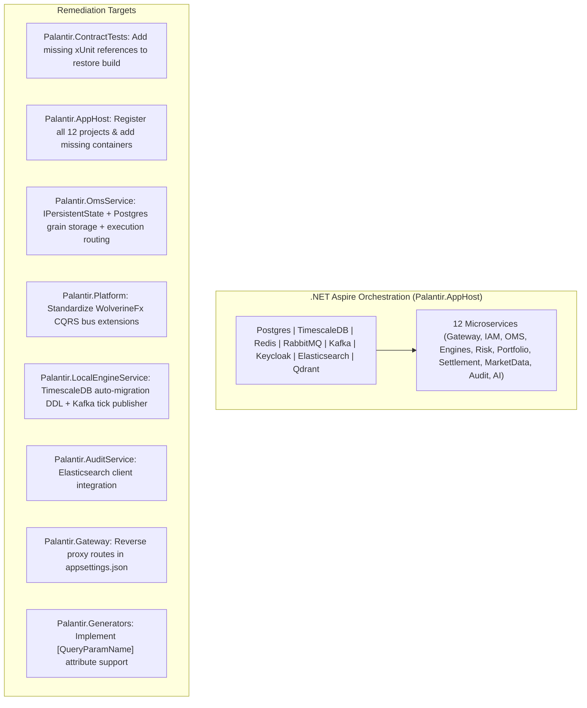

# Architectural Review & Implementation Plan: Palantir Reference Architecture

## Goal Description
Conduct an architectural review of the `src/` codebase against the reference architecture blueprint, formalize [palantir_implementation_plan.md](file:///d:/01/01/07/PalantirCode/docs/palantir_implementation_plan.md) (incorporating `Palantir.IamService` and Keycloak Admin integration), standardize on **WolverineFx** for in-process CQRS and messaging/outbox integration, auto-migrate TimescaleDB continuous aggregates on startup, dispatch executions directly via HTTP/gRPC from Orleans `OrderGrain`, and execute a backend-first remediation plan to bring all microservices, persistence stores, and Aspire orchestration to production standard.

---

## User Review Required

> [!IMPORTANT]
> - **Governing Blueprint**: [palantir_implementation_plan.md](file:///d:/01/01/07/PalantirCode/docs/palantir_implementation_plan.md) confirmed as the target reference architecture.
> - **CQRS Framework**: **WolverineFx** selected for compile-time generated in-process command handling and outbox/messaging integration.
> - **TimescaleDB Initialization**: **Auto-migrate on startup** in `LocalEngineService` using raw SQL DDL to ensure the TimescaleDB extension, `market_ticks` hypertable, and continuous aggregates exist.
> - **Execution Dispatch**: **Direct HTTP/gRPC** invocation from `OrderGrain` to `LocalEngineService` or `ExternalGatewayService` with synchronous acknowledgment and async tick/fill emission.
> - **Scope Prioritization**: **Backend & Infrastructure First** (Phases 1-5), deferring Micro UI remotes to follow-up.

---

## Codebase Audit & Gap Analysis

### Detailed Gap Summary

1. **Test Project Build Failure**:
   - [Palantir.ContractTests.csproj](file:///d:/01/01/07/PalantirCode/tests/Palantir.ContractTests/Palantir.ContractTests.csproj) misses `xunit` references while [OmsRiskContractTests.cs](file:///d:/01/01/07/PalantirCode/tests/Palantir.ContractTests/OmsRiskContractTests.cs) references `Xunit`.
2. **Aspire AppHost Orchestration**:
   - [Program.cs](file:///d:/01/01/07/PalantirCode/src/Aspire/Palantir.AppHost/Program.cs) does not register any microservice projects or containers for TimescaleDB, Elasticsearch, and Qdrant.
3. **Microsoft Orleans OMS Silo**:
   - [Program.cs](file:///d:/01/01/07/PalantirCode/src/Services/Oms/Palantir.OmsService/Program.cs) and [Grains.cs](file:///d:/01/01/07/PalantirCode/src/Services/Oms/Palantir.OmsService/Grains/Grains.cs) use in-memory state without ADO.NET persistence or dispatching orders to execution engines.
4. **Local Engine & TimescaleDB Aggregates**:
   - [LocalEngineEndpoints.cs](file:///d:/01/01/07/PalantirCode/src/Services/Execution/Palantir.LocalEngineService/Endpoints/LocalEngineEndpoints.cs) does not publish matched ticks to Kafka topic `market.ticks.v1`, and lacks startup DDL migration.
5. **Gateway Reverse Proxy Routes**:
   - [appsettings.json](file:///d:/01/01/07/PalantirCode/src/Gateway/Palantir.Gateway/appsettings.json) omits routes for engine, external, risk, settlement, and MCP endpoints.
6. **Roslyn Source Generator**:
   - [QueryBinderGenerator.cs](file:///d:/01/01/07/PalantirCode/src/BuildingBlocks/Palantir.Generators/QueryBinderGenerator.cs) ignores `[QueryParamName]` attributes.
7. **Domain Types**:
   - Missing `ClientId` in [Identifiers.cs](file:///d:/01/01/07/PalantirCode/src/BuildingBlocks/Palantir.SharedKernel/Identifiers.cs).

---

## Proposed Changes

### Phase 1: Build Repair & Building Blocks Fixes
- Fix [Palantir.ContractTests.csproj](file:///d:/01/01/07/PalantirCode/tests/Palantir.ContractTests/Palantir.ContractTests.csproj) by adding `xunit` and `xunit.runner.visualstudio`.
- Add `ClientId` strongly-typed ID struct to [Identifiers.cs](file:///d:/01/01/07/PalantirCode/src/BuildingBlocks/Palantir.SharedKernel/Identifiers.cs).
- Implement `[QueryParamName]` handling in [QueryBinderGenerator.cs](file:///d:/01/01/07/PalantirCode/src/BuildingBlocks/Palantir.Generators/QueryBinderGenerator.cs).
- Fix exception helper in [TradingValueObjects.cs](file:///d:/01/01/07/PalantirCode/src/BuildingBlocks/Palantir.SharedKernel/TradingValueObjects.cs).
- Standardize WolverineFx CQRS integration in [Palantir.Platform](file:///d:/01/01/07/PalantirCode/src/BuildingBlocks/Palantir.Platform/Palantir.Platform.csproj).

### Phase 2: Aspire AppHost & Gateway Route Completion
- Wire all 12 projects in [Program.cs](file:///d:/01/01/07/PalantirCode/src/Aspire/Palantir.AppHost/Program.cs) with references to databases, messaging buses, and caches.
- Configure TimescaleDB container (`timescale/timescaledb-ha:pg16`), Elasticsearch container, and Qdrant container in AppHost.
- Populate full route mapping table in [appsettings.json](file:///d:/01/01/07/PalantirCode/src/Gateway/Palantir.Gateway/appsettings.json).

### Phase 3: Orleans OMS Persistence & Execution Routing
- Configure `AddAdoNetGrainStorage` with PostgreSQL in [Program.cs](file:///d:/01/01/07/PalantirCode/src/Services/Oms/Palantir.OmsService/Program.cs).
- Refactor [OrderGrain](file:///d:/01/01/07/PalantirCode/src/Services/Oms/Palantir.OmsService/Grains/Grains.cs) to use `IPersistentState<OrderGrainState>` and route order execution directly to `LocalEngineService` or `ExternalGatewayService` via HTTP/gRPC.
- Implement `IOrderExpiryGrain` with Orleans Reminders for GTT cancellation.

### Phase 4: Local Engine Kafka Tick Publishing & TimescaleDB Continuous Aggregates
- Publish ticks and matches to Kafka topic `market.ticks.v1` in [LocalEngineEndpoints.cs](file:///d:/01/01/07/PalantirCode/src/Services/Execution/Palantir.LocalEngineService/Endpoints/LocalEngineEndpoints.cs).
- Implement startup SQL migration executing DDL for TimescaleDB hypertable `market_ticks` and continuous aggregates `ohlc_1s`, `ohlc_1m`, `ohlc_5m`, `ohlc_1h`, `ohlc_1d`.

### Phase 5: Elasticsearch Audit Trail & MCP Server
- Integrate Elasticsearch client in [Palantir.AuditService](file:///d:/01/01/07/PalantirCode/src/Services/Audit/Palantir.AuditService/Endpoints/AuditEndpoints.cs).
- Integrate official `ModelContextProtocol.AspNetCore` server in [Palantir.AiAssistantService](file:///d:/01/01/07/PalantirCode/src/Services/AiAssistant/Palantir.AiAssistantService/Endpoints/AiEndpoints.cs).

---

## Verification Plan

### Automated Tests
- Full test pass: `rtk dotnet test Palantir.slnx`
- ArchUnit tests: `rtk dotnet test tests/Palantir.ArchTests/Palantir.ArchTests.csproj`
- Contract tests: `rtk dotnet test tests/Palantir.ContractTests/Palantir.ContractTests.csproj`
- Engine unit tests: `rtk dotnet test tests/Services/Palantir.LocalEngineService.UnitTests/Palantir.LocalEngineService.UnitTests.csproj`
- OMS unit tests: `rtk dotnet test tests/Services/Palantir.OmsService.UnitTests/Palantir.OmsService.UnitTests.csproj`

### Manual Verification
1. Launch solution: `rtk dotnet run --project src/Aspire/Palantir.AppHost`
2. Verify all 12 projects and supporting containers are healthy in the Aspire Dashboard.
3. Submit an order via Gateway, verify OMS state persistence, matching in Local Engine, and tick emission.